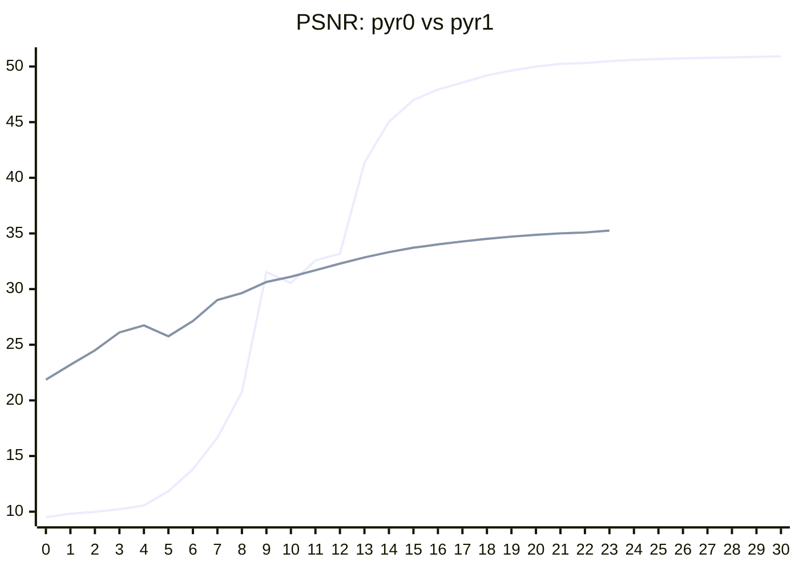
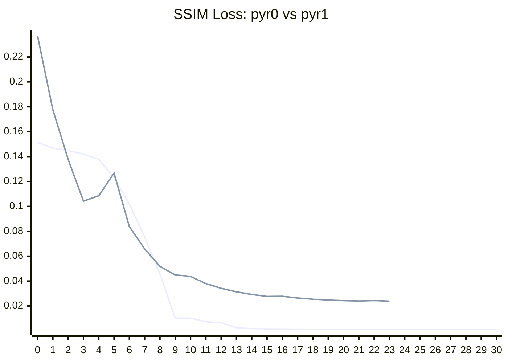

实验内容：基于 Gabor Field 工作渲染 LS 台风数据数据集，测试 Gabor Fields 工作的边界


<Cards>
  <Card icon={<SiGithub />} href="https://github.com/VENUSXK/gabor_fields/tree/experiment-20261022" title="Github">
    Fork Gabor Field 工作，主要改变了部署和渲染部分的代码
  </Card>
  <Card icon={<SiGoogledrive />} href="https://drive.google.com/file/d/1XKrbRn-YqBbQGea7DqVKzm2c99TxYR7V/view?usp=drive_link" title="Google Drive">
  LS台风数据 2D纹理数组 1334 x 1501 x 30 8bit
  </Card>
</Cards>

| 实验环境 |
| --- |
| Intel Core i7-14700KF |
| NVIDIA GeForce RTX 4090 D（24 GB GDDR6X） |
| 64 GB DDR5-4800（2 × 32 GB） |
| Ubuntu 26.04.1 LTS |

训练 command：

```shell title="shell" 
WANDB_MODE=disabled bash examples/train.sh \
  data/volumes/[data_name].npy \
  --output results/checkpoints/[output_path] \
  --opacity_scale 10.0 \
  --gauss_count 1024 \
  --gabor_count 24576 \
  --ref_spp_chunk 64 \
  --opt_cam_batch 1
```


gabor field 工作和 groun truth 结果对比：

<ImageComparison
key="poster"
before={`/experiments/20261022-optimized-pyr1-1920x1080-32spp-1opacity-10maxdepth/render_cam02.png`}
after={`experiments/20261022-ground_truth-1920x1080-32spp-1opacity-10maxdepth/LS-20261008_groundtruth_0_cam02.png`}
beforeAlt="20261022-optimized-pyr0-1920x1080-32spp-1opacity-10maxdepth"
afterAlt="20261022-optimized-pyr1-1920x1080-32spp-1opacity-10maxdepth"
beforeLabel={`gaussian 1024 + gabor 24576\nspp 32\nopacity_scaler 4.0\nmax_depth 10\nrendering_time 17,033.10 ms`}
afterLabel={`GT 1024x1024x1024 voxel\nspp 32\nopacity_scaler 4.0\nmax_depth 10\nrendering_time 20,463.09 ms`}
caption="Gabor 测试"
/>


数据压缩情况：

|  | texture array (png)  | voxel grid (npy) | gabor field (ply) |
| --- | --- | --- | --- |
| 存储形式 | 1334 x 1501 x 30 8bit | 1024 × 1024 × 1024 float32 | 1024 gaussian kernel + 24576 gabor kernel |
| 大小 | 17 MB | 4.00 GB | 1.7 MB |


PSNR 量化：



Line 1 表示 pyr0 (gaussian only) 的 PSNR 数据，Line 2 表示 pyr1 (gaussian + gabor) 的 PSNR 数据


SSIM 量化：



Line 1 表示 ssim_pyr0 (gaussian only) 的 SSIM Loss 数据，Line 2 表示 ssim_pyr1 (gaussian + gabor) 的 SSIM Loss 数据

##  groud-truth 比较


```bash title="render command" tab="gaussian + gabor"
.venv/bin/python -m gfields.render \   #[!code highlight]
  results/checkpoints/LS-20261008_y100_official_gabor/optimized_asset_pyr1 \   #[!code highlight]
  --multiple_scattering \
  --max_depth 10 \
  --use_perspective_cam \
  --cam_fov 65 \
  --cam_distance 3 \
  --cam_count 8 \
  --render_all_cams \
  --cam_elevation 75 \
  --cam_azimuth_span 360 \
  --cam_res_x 1920 \
  --cam_res_y 1080 \
  --spp 32 \
  --rr_depth 2 \
  --rr_nee_depth 64 \
  --max_depth_primitive 256 \
  --rr_depth_primitive 256 \
  --max_overlaps 256 \
  --solver_type bisection \
  --solver_max_iterations 4 \
  --stochastic_selection_criteria deterministic \
  --stochastic_selection_criteria_nee deterministic \
  --opacity_scaler 4.0 \
  --albedo 1.0 \
  --envmap data/envmaps/qwantani_dusk_2_1k.exr \
  --envmap_scale 1.0 \
  --max_level 1 \
  --output results/renders/LS-20261008_y100_official_gabor
```


```shell title="render command" tab="ground_truth"
.venv/bin/python -m gfields.references.grid \   #[!code highlight]
  data/volumes/LS-20261008_density_y100_cube.npy \   #[!code highlight]
  --asset_name LS-20261008 \
  --method groundtruth \
  --multiple_scattering \
  --max_depth 10 \
  --rr_depth 2 \
  --use_perspective_cam \
  --cam_fov 65 \
  --cam_distance 3 \
  --cam_count 8 \
  --render_all_cams \
  --cam_elevation 75 \
  --cam_azimuth_span 360 \
  --cam_res_x 1920 \
  --cam_res_y 1080 \
  --spp 32 \
  --density_scale 40.0 \
  --albedo 1.0 \
  --envmap data/envmaps/qwantani_dusk_2_1k.exr \
  --envmap_scale 1.0 \
  --output results/renders/LS-20261008_y100_npy_groundtruth
```

{(() => {
  const pyr0_time = ["16,999.31", "16,300.60", "17,033.10", "16,745.14", "17,012.97", "16,518.64", "16,721.10", "16,279.13"];
  return pyr0_time.map((time0, i) => {
    const cam = `cam${String(i).padStart(2, "0")}`;
    return (
      <ImageComparison
        key={cam}
        before={`/experiments/20261022-optimized-pyr1-1920x1080-32spp-1opacity-10maxdepth/render_${cam}.png`}
        after={`experiments/20261022-ground_truth-1920x1080-32spp-1opacity-10maxdepth/LS-20261008_groundtruth_0_${cam}.png`}
        beforeAlt="20261022-optimized-pyr0-1920x1080-32spp-1opacity-10maxdepth"
        afterAlt="20261022-optimized-pyr1-1920x1080-32spp-1opacity-10maxdepth"
        beforeLabel={`gaussian 1024 + gabor 24576\nspp 32\nopacity_scaler 4.0\nmax_depth 10\nrendering_time ${time0} ms`}
        afterLabel={`GT 1024x1024x1024 voxel\nspp 32\nopacity_scaler 4.0\nmax_depth 10\nrendering_time 20,463.09 ms`}
        caption="Gabor 测试"
      />
    );
  });
})()}


##  pyr0 和 pyr1 比较

对比测试 gaussian 和 gabor 拟合效果，采用 1024 个 gaussian 核，24576 个 gabor 核

```bash title="render command" tab="gaussian only"
.venv/bin/python -m gfields.render \
  results/checkpoints/LS-20261008_y100_official_gabor/optimized_asset_pyr1 \
  --multiple_scattering \
  --max_depth 10 \
  --use_perspective_cam \
  --cam_fov 65 \
  --cam_distance 3 \
  --cam_count 8 \
  --render_all_cams \
  --cam_elevation 75 \
  --cam_azimuth_span 360 \
  --cam_res_x 1920 \
  --cam_res_y 1080 \
  --spp 32 \
  --rr_depth 2 \
  --rr_nee_depth 64 \
  --max_depth_primitive 256 \
  --rr_depth_primitive 256 \
  --max_overlaps 256 \
  --solver_type bisection \
  --solver_max_iterations 4 \
  --stochastic_selection_criteria deterministic \
  --stochastic_selection_criteria_nee deterministic \
  --opacity_scaler 4.0 \
  --albedo 1.0 \
  --envmap data/envmaps/qwantani_dusk_2_1k.exr \
  --envmap_scale 1.0 \
  --max_level 0 \  #[!code highlight]
  --output results/renders/LS-20261008_y100_official_gabor
```


```bash title="render command" tab="gaussian + gabor"
.venv/bin/python -m gfields.render \
  results/checkpoints/LS-20261008_y100_official_gabor/optimized_asset_pyr1 \
  --multiple_scattering \
  --max_depth 10 \
  --use_perspective_cam \
  --cam_fov 65 \
  --cam_distance 3 \
  --cam_count 8 \
  --render_all_cams \
  --cam_elevation 75 \
  --cam_azimuth_span 360 \
  --cam_res_x 1920 \
  --cam_res_y 1080 \
  --spp 32 \
  --rr_depth 2 \
  --rr_nee_depth 64 \
  --max_depth_primitive 256 \
  --rr_depth_primitive 256 \
  --max_overlaps 256 \
  --solver_type bisection \
  --solver_max_iterations 4 \
  --stochastic_selection_criteria deterministic \
  --stochastic_selection_criteria_nee deterministic \
  --opacity_scaler 4.0 \
  --albedo 1.0 \
  --envmap data/envmaps/qwantani_dusk_2_1k.exr \
  --envmap_scale 1.0 \
  --max_level 1 \   #[!code highlight]
  --output results/renders/LS-20261008_y100_official_gabor
```


{/* 每台相机的渲染耗时（Total time sync, ms），下标顺序对应 cam00…cam07 */}
{(() => {
  const pyr0_time = ["16,999.31", "16,300.60", "17,033.10", "16,745.14", "17,012.97", "16,518.64", "16,721.10", "16,279.13"];
  const pyr1_time = ["121,858.95", "117,955.60", "123,540.86", "119,464.15", "122,535.70", "119,242.61", "123,135.10", "118,671.29"];
  return pyr0_time.map((time0, i) => {
    const cam = `cam${String(i).padStart(2, "0")}`;
    return (
      <ImageComparison
        key={cam}
        before={`/experiments/20261022-optimized-pyr0-1920x1080-32spp-1opacity-10maxdepth/render_${cam}.png`}
        after={`/experiments/20261022-optimized-pyr1-1920x1080-32spp-1opacity-10maxdepth/render_${cam}.png`}
        beforeAlt="20261022-optimized-pyr0-1920x1080-32spp-1opacity-10maxdepth"
        afterAlt="20261022-optimized-pyr1-1920x1080-32spp-1opacity-10maxdepth"
        beforeLabel={`gaussian 1024\nspp 32\nopacity_scaler 4.0\nmax_depth 10\nrendering_time ${time0} ms`}
        afterLabel={`gaussian 1024 + gabor 24576\nspp 32\nopacity_scaler 4.0\nmax_depth 10\nrendering_time ${pyr1_time[i]} ms`}
        caption="Gabor 测试"
      />
    );
  });
})()}


##  multi scattering 测试

multi scattering 根据 max depth 决定散射层数，这里对比了不同散射深度的结果

```bash title="render command" tab="max_depth 2"
.venv/bin/python -m gfields.render \
  results/checkpoints/LS-20261008_y100_official_gabor/optimized_asset_pyr1 \
  --multiple_scattering \
  --max_depth 2 \    #[!code highlight]
  --use_perspective_cam \
  --cam_fov 65 \
  --cam_distance 3 \
  --cam_count 8 \
  --render_all_cams \
  --cam_elevation 75 \
  --cam_azimuth_span 360 \
  --cam_res_x 1920 \
  --cam_res_y 1080 \
  --spp 32 \
  --rr_depth 2 \
  --rr_nee_depth 64 \
  --max_depth_primitive 256 \
  --rr_depth_primitive 256 \
  --max_overlaps 256 \
  --solver_type bisection \
  --solver_max_iterations 4 \
  --stochastic_selection_criteria deterministic \
  --stochastic_selection_criteria_nee deterministic \
  --opacity_scaler 4.0 \
  --albedo 1.0 \
  --envmap data/envmaps/qwantani_dusk_2_1k.exr \
  --envmap_scale 1.0 \
  --max_level 0 \
  --output results/renders/LS-20261008_y100_official_gabor
```

```bash title="render command" tab="max_depth 10"
.venv/bin/python -m gfields.render \
  results/checkpoints/LS-20261008_y100_official_gabor/optimized_asset_pyr1 \
  --multiple_scattering \
  --max_depth 10 \  #[!code highlight]
  --use_perspective_cam \
  --cam_fov 65 \
  --cam_distance 3 \
  --cam_count 8 \
  --render_all_cams \
  --cam_elevation 75 \
  --cam_azimuth_span 360 \
  --cam_res_x 1920 \
  --cam_res_y 1080 \
  --spp 32 \
  --rr_depth 2 \
  --rr_nee_depth 64 \
  --max_depth_primitive 256 \
  --rr_depth_primitive 256 \
  --max_overlaps 256 \
  --solver_type bisection \
  --solver_max_iterations 4 \
  --stochastic_selection_criteria deterministic \
  --stochastic_selection_criteria_nee deterministic \
  --opacity_scaler 4.0 \
  --albedo 1.0 \
  --envmap data/envmaps/qwantani_dusk_2_1k.exr \
  --envmap_scale 1.0 \
  --max_level 0 \
  --output results/renders/LS-20261008_y100_official_gabor
```

{(() => {
  const depth2_time = ["6,165.05", "5,703.44", "5,951.13", "5,802.93", "5,920.72", "5,758.13", "5,890.91", "5,721.78"];
  const depth10_time = ["16,999.31", "16,300.60", "17,033.10", "16,745.14", "17,012.97", "16,518.64", "16,721.10", "16,279.13"];
  return depth2_time.map((time2, i) => {
    const cam = `cam${String(i).padStart(2, "0")}`;
    return (
      <ImageComparison
        key={cam}
        before={`/experiments/20261022-optimized-pyr0-1920x1080-32spp-1opacity-2maxdepth/render_${cam}.png`}
        after={`/experiments/20261022-optimized-pyr0-1920x1080-32spp-1opacity-10maxdepth/render_${cam}.png`}
        beforeAlt="20261022-optimized-pyr0-1920x1080-32spp-1opacity-2maxdepth"
        afterAlt="20261022-optimized-pyr0-1920x1080-32spp-1opacity-10maxdepth"
        beforeLabel={`gaussian 1024\nspp 32\nopacity_scaler 4.0\nmax_depth 2\nrendering_time ${time2} ms`}
        afterLabel={`gaussian 1024\nspp 32\nopacity_scaler 4.0\nmax_depth 10\nrendering_time ${depth10_time[i]} ms`}
        caption="多重散射测试"
      />
    );
  });
})()}

{/* ## 实验总结

验证了 Gabor Field 工作在 LS 数据集整体上是可行的，但是还有很多局限性：

Gabor Field 拟合的体积场是立方体，而 LS 的数据集在垂直层面是稀疏的（30层），Gabor Field 拟合时需要将稀疏数据集补 0，此时内存开销非常大。

Gabor Field 最多支持 1268 × 1268 × 1268 的 voxel 数据 (2.04 billion voxels, 最多支持 float32 表示的 7.76 GB 数据)
 ，大纹理只能支持下采样，才能拟合。

此外 Gabor Field 方法主要面向 ray tracing，没有考虑 real-time 上的情况，考虑做工作 GaborRT，把这篇工作应用到实时。 */}