```mermaid
xychart-beta
    title "GPU Time Comparison (max_depth_primitive [bar 1] vs baseline [bar 2])"
    x-axis "max_depth_primitive" [32, 64, 128, 256]
    y-axis "GPU Time (ms)" 0 --> 14000
    bar [320.39, 2748.79, 12406.18, 13868.53]
    bar [13786.08, 13786.08, 13786.08, 13786.08]
```

```mermaid
xychart-beta
    title "GPU Time Comparison (rr_depth_primitive [bar 1] vs baseline [bar 2])"
    x-axis "rr_depth_primitive" [32, 64, 128, 256]
    y-axis "GPU Time (ms)" 0 --> 14000
    bar [1064.88, 4652.54, 12732.98, 13853.25]
    bar [13786.08, 13786.08, 13786.08, 13786.08]
```

实验内容：深挖 Gabor Fields 工作 render 部分的各模块，了解各个渲染过程中瓶颈


| 实验环境 |
| --- |
| Intel Core i7-14700KF |
| NVIDIA GeForce RTX 4090 D（24 GB GDDR6X） |
| 64 GB DDR5-4800（2 × 32 GB） |
| Ubuntu 26.04.1 LTS |

## Nsight System 分析


```shell  title="nsight system command"
nsys profile \     #[!code highlight]
  --trace=cuda,nvtx,osrt \     #[!code highlight]
  --sample=none \     #[!code highlight]
  --stats=true \     #[!code highlight]
  --output=results/nsight/gabor_ms_cam2 \     #[!code highlight]
  .venv/bin/python -m gfields.render \
  results/checkpoints/LS-20261008_y100_official_gabor/optimized_asset_pyr1 \
  --multiple_scattering \
  --max_depth 10 \
  --use_perspective_cam \
  --cam_fov 65 \
  --cam_distance 3 \
  --cam_count 8 \
  --cam_index 2 \
  --cam_elevation 75 \
  --cam_azimuth_span 360 \
  --cam_res_x 1920 \
  --cam_res_y 1080 \
  --spp 32 \
  --rr_depth 2 \
  --rr_nee_depth 64 \
  --max_depth_primitive 256 \
  --rr_depth_primitive 256 \
  --max_overlaps 256 \
  --solver_type bisection \
  --solver_max_iterations 4 \
  --stochastic_selection_criteria deterministic \
  --stochastic_selection_criteria_nee deterministic \
  --opacity_scaler 4.0 \
  --albedo 1.0 \
  --envmap data/envmaps/qwantani_dusk_2_1k.exr \
  --envmap_scale 1.0 \
  --max_level 1 \
  --output results/renders/LS-20261008_y100_official_gabor
```

渲染结果：

<OssImage
  src="experiments/20261022-ground_truth-1920x1080-32spp-1opacity-10maxdepth/LS-20261008_groundtruth_0_cam02.png"
  alt="Gabor Baseline"
  width={1920}
  height={1080}
  caption="Gabor Baseline"
/>

Nsight System 结果：

<OssImage
  src="experiments/20261028-nsight-system-analysis-result.png"
  alt="Nsight Systems 分析结果"
  width={2559}
  height={1515}
  caption="Nsight Systems 分析结果"
  processing="none"
/>

### 实验结论

Mitsuba/Dr.Jit 把 `sample()` 中的路径追踪逻辑编译、融合，生成一个大型 OptiX GPU 程序，一次 optixLaunch 运行约 123 秒。瓶颈确定在大型 OptiX 路径追踪 kernel 内部，但无法区分具体哪个模块最慢。

下一步计划：1. 用 Nsight Compute 分析整个 optixLaunch 为什么慢；2. 通过消融实验，推断各模块耗时。

## Nsight Compute 分析

```shell  title="nsight compute command"
ncu \     #[!code highlight]
  --target-processes all \     #[!code highlight]
  --kernel-name-base function \     #[!code highlight]
  --kernel-name regex:"raygen__.*" \     #[!code highlight]
  --launch-count 1 \     #[!code highlight]
  --set basic \     #[!code highlight]
  --replay-mode kernel \     #[!code highlight]
  --force-overwrite \     #[!code highlight]
  --export results/nsight/gabor_ncu_basic \     #[!code highlight]
  .venv/bin/python -m gfields.render \
  results/checkpoints/LS-20261008_y100_official_gabor/optimized_asset_pyr1 \
  --multiple_scattering \
  --max_depth 10 \
  --use_perspective_cam \
  --cam_fov 65 \
  --cam_distance 3 \
  --cam_count 8 \
  --cam_index 2 \
  --cam_elevation 75 \
  --cam_azimuth_span 360 \
  --cam_res_x 320 \
  --cam_res_y 180 \
  --spp 1 \
  --rr_depth 2 \
  --rr_nee_depth 64 \
  --max_depth_primitive 256 \
  --rr_depth_primitive 256 \
  --max_overlaps 256 \
  --solver_type bisection \
  --solver_max_iterations 4 \
  --stochastic_selection_criteria deterministic \
  --stochastic_selection_criteria_nee deterministic \
  --opacity_scaler 4.0 \
  --albedo 1.0 \
  --envmap data/envmaps/qwantani_dusk_2_1k.exr \
  --envmap_scale 1.0 \
  --max_level 1 \
  --output results/renders/LS-20261008_y100_official_gabor
```


## Optix 渲染后端消融实验

### SPP 消融

SPP (Samples Per Pixel)，表示从像素出发的完整随机路径的条数


```shell title="render command"
.venv/bin/python -m gfields.render \
  results/checkpoints/LS-20261008_y100_official_gabor/optimized_asset_pyr1 \
  --multiple_scattering \
  --max_depth 10 \
  --use_perspective_cam \
  --cam_fov 65 \
  --cam_distance 3 \
  --cam_count 8 \
  --cam_elevation 75 \
  --cam_azimuth_span 360 \
  --cam_index 2 \
  --cam_res_x 640 \
  --cam_res_y 360 \
  --spp 1 \   #[!code highlight]
  --rr_depth 2 \
  --rr_nee_depth 64 \
  --max_depth_primitive 256 \
  --rr_depth_primitive 256 \
  --max_overlaps 256 \
  --solver_type bisection \
  --solver_max_iterations 4 \
  --stochastic_selection_criteria deterministic \
  --stochastic_selection_criteria_nee deterministic \
  --opacity_scaler 4.0 \
  --albedo 1.0 \
  --envmap data/envmaps/qwantani_dusk_2_1k.exr \
  --envmap_scale 1.0 \
  --max_level 1 \
  --output results/renders/ablation-20261029/baseline
```

GPU 时间结果：

| 实验 | GPU 时间 (ms) | 帧率 (FPS) | 相对加速比 | 与 SPP 1 时间差 (ms) |
|:---:|:---:|:---:|:---:|:---:|
| SPP 1 | 632.03 | 1.58 | 1.00x | 0.00 |
| SPP 2 | 1,029.33 | 0.97 | 1.63x | 397.30 |
| SPP 4 | 1,874.95 | 0.53 | 2.97x | 1,242.92 |
| SPP 8 | 3,551.20 | 0.28 | 5.62x | 2,919.17 |
| SPP 16 | 6,955.48 | 0.14 | 11.00x | 6,323.45 |
| SPP 32 | 13,786.08 | 0.07 | 21.81x | 13,154.05 |
| SPP 64 | 27,724.98 | 0.04 | 43.87x | 27,092.95 |

渲染结果（不同 SPP）：

<ImageSequenceSlider
  images={[
    { src: "experiments/20261029-optimized-pyr1-640x360-spp-4opacity/20261029-optimized-pyr1-640x360-1spp-4opacity.png", label: "SPP 1\n632.03 ms" },
    { src: "experiments/20261029-optimized-pyr1-640x360-spp-4opacity/20261029-optimized-pyr1-640x360-2spp-4opacity.png", label: "SPP 2\n1,029.33 ms" },
    { src: "experiments/20261029-optimized-pyr1-640x360-spp-4opacity/20261029-optimized-pyr1-640x360-4spp-4opacity.png", label: "SPP 4\n1,874.95 ms" },
    { src: "experiments/20261029-optimized-pyr1-640x360-spp-4opacity/20261029-optimized-pyr1-640x360-8spp-4opacity.png", label: "SPP 8\n3,551.20 ms" },
    { src: "experiments/20261029-optimized-pyr1-640x360-spp-4opacity/20261029-optimized-pyr1-640x360-16spp-4opacity.png", label: "SPP 16\n6,955.48 ms" },
    { src: "experiments/20261029-optimized-pyr1-640x360-spp-4opacity/20261029-optimized-pyr1-640x360-32spp-4opacity.png", label: "SPP 32\n13,786.08 ms" },
  ]}
  width={640}
  height={360}
/>


### NEE 消融

Next Event Estimation，表示在介质碰撞点 $x_t$ 处，主动向光源发射一条阴影射线，直接估计光源对该点的贡献

```shell  title="render command"
.venv/bin/python -m gfields.render \
  results/checkpoints/LS-20261008_y100_official_gabor/optimized_asset_pyr1 \
  --multiple_scattering \
  --no_nee \     #[!code highlight]
  --max_depth 10 \
  --use_perspective_cam \
  --cam_fov 65 \
  --cam_distance 3 \
  --cam_count 8 \
  --cam_elevation 75 \
  --cam_azimuth_span 360 \
  --cam_index 2 \
  --cam_res_x 640 \
  --cam_res_y 360 \
  --spp 32 \  
  --rr_depth 2 \
  --rr_nee_depth 64 \
  --max_depth_primitive 256 \
  --rr_depth_primitive 256 \
  --max_overlaps 256 \
  --solver_type bisection \
  --solver_max_iterations 4 \
  --stochastic_selection_criteria deterministic \
  --stochastic_selection_criteria_nee deterministic \
  --opacity_scaler 4.0 \
  --albedo 1.0 \
  --envmap data/envmaps/qwantani_dusk_2_1k.exr \
  --envmap_scale 1.0 \
  --max_level 1 \
  --output results/renders/ablation-20261029-no_nee
```


| 实验 | GPU 时间 (ms) | 帧率 (FPS) | 相对加速比 | 与 SPP 1 时间差 (ms) |
|:---:|:---:|:---:|:---:|:---:|
| SPP 1 | 399.54 | 2.50 | 1.00x | 0.00 |
| SPP 2 | 789.11 | 1.27 | 1.98x | 389.57 |
| SPP 4 | 1,143.63 | 0.87 | 2.86x | 744.09 |
| SPP 8 | 2,204.31 | 0.45 | 5.52x | 1,804.77 |
| SPP 16 | 4,286.37 | 0.23 | 10.73x | 3,886.83 |
| SPP 32 | 8,434.24 | 0.12 | 21.11x | 8,034.70 |
| SPP 64 | 16,777.66 | 0.06 | 41.99x | 16,378.12 |

```mermaid
xychart-beta
    title "GPU Time Comparison (NEE on [bar 1] vs NEE off [bar 2])"
    x-axis "SPP (samples per pixel)" [1, 2, 4, 8, 16, 32, 64]
    y-axis "GPU Time (ms)" 0 --> 28000
    bar [632.03, 1029.33, 1874.95, 3551.20, 6955.48, 13786.08, 27724.98]
    bar [399.54, 789.11, 1143.63, 2204.31, 4286.37, 8434.24, 16777.66]
```




渲染结果（NEE on vs NEE off）：

{(() => {
  const sppList = [
    { spp: 1, neeOn: "632.03", neeOff: "399.54" },
    { spp: 2, neeOn: "1,029.33", neeOff: "789.11" },
    { spp: 4, neeOn: "1,874.95", neeOff: "1,143.63" },
    { spp: 8, neeOn: "3,551.20", neeOff: "2,204.31" },
    { spp: 16, neeOn: "6,955.48", neeOff: "4,286.37" },
    { spp: 32, neeOn: "13,786.08", neeOff: "8,434.24" },
    { spp: 64, neeOn: "27,724.98", neeOff: "16,777.66" },
  ];
  return sppList.map(({ spp, neeOn, neeOff }) => {
    const timeOn = neeOn ? `\n${neeOn} ms` : "";
    const timeOff = neeOff ? `\n${neeOff} ms` : "";
    return (
      <ImageComparison
        key={spp}
        before={`experiments/20261029-optimized-pyr1-640x360-spp-4opacity/20261029-optimized-pyr1-640x360-${spp}spp-4opacity.png`}
        after={`experiments/20261029-optimized-pyr1-640x360-spp-4opacity-no_nee/20261029-optimized-pyr1-640x360-${spp}spp-4opacity-no_nee.png`}
        beforeAlt={`NEE on spp ${spp}`}
        afterAlt={`NEE off spp ${spp}`}
        beforeLabel={`NEE on\nspp ${spp}${timeOn}`}
        afterLabel={`NEE off\nspp ${spp}${timeOff}`}
      />
    );
  });
})()}


### 距离求解消融


```shell title="shell" tab="二分法 4 次迭代(base_line)"
.venv/bin/python -m gfields.render \
  results/checkpoints/LS-20261008_y100_official_gabor/optimized_asset_pyr1 \
  --multiple_scattering \
  --max_depth 10 \
  --use_perspective_cam \
  --cam_fov 65 \
  --cam_distance 3 \
  --cam_count 8 \
  --cam_elevation 75 \
  --cam_azimuth_span 360 \
  --cam_index 2 \
  --cam_res_x 640 \
  --cam_res_y 360 \
  --spp 32 \
  --rr_depth 2 \
  --rr_nee_depth 64 \
  --max_depth_primitive 256 \
  --rr_depth_primitive 256 \
  --max_overlaps 256 \
  --solver_type bisection \
  --solver_max_iterations 4 \      #[!code highlight]
  --stochastic_selection_criteria deterministic \
  --stochastic_selection_criteria_nee deterministic \
  --opacity_scaler 4.0 \
  --albedo 1.0 \
  --envmap data/envmaps/qwantani_dusk_2_1k.exr \
  --envmap_scale 1.0 \
  --max_level 1 \
  --output results/renders/ablation-20261029-solver_type/4solver_max_iterations/
```


```shell title="shell" tab="二分法 2 次迭代"
.venv/bin/python -m gfields.render \
  results/checkpoints/LS-20261008_y100_official_gabor/optimized_asset_pyr1 \
  --multiple_scattering \
  --max_depth 10 \
  --use_perspective_cam \
  --cam_fov 65 \
  --cam_distance 3 \
  --cam_count 8 \
  --cam_elevation 75 \
  --cam_azimuth_span 360 \
  --cam_index 2 \
  --cam_res_x 640 \
  --cam_res_y 360 \
  --spp 32 \
  --rr_depth 2 \
  --rr_nee_depth 64 \
  --max_depth_primitive 256 \
  --rr_depth_primitive 256 \
  --max_overlaps 256 \
  --solver_type bisection \
  --solver_max_iterations 2 \       #[!code highlight]
  --stochastic_selection_criteria deterministic \
  --stochastic_selection_criteria_nee deterministic \
  --opacity_scaler 4.0 \
  --albedo 1.0 \
  --envmap data/envmaps/qwantani_dusk_2_1k.exr \
  --envmap_scale 1.0 \
  --max_level 1 \
  --output results/renders/ablation-20261029-solver_type/2solver_max_iterations/
```

```shell title="shell" tab="二分法 1 次迭代"
.venv/bin/python -m gfields.render \
  results/checkpoints/LS-20261008_y100_official_gabor/optimized_asset_pyr1 \
  --multiple_scattering \
  --max_depth 10 \
  --use_perspective_cam \
  --cam_fov 65 \
  --cam_distance 3 \
  --cam_count 8 \
  --cam_elevation 75 \
  --cam_azimuth_span 360 \
  --cam_index 2 \
  --cam_res_x 640 \
  --cam_res_y 360 \
  --spp 32 \
  --rr_depth 2 \
  --rr_nee_depth 64 \
  --max_depth_primitive 256 \
  --rr_depth_primitive 256 \
  --max_overlaps 256 \
  --solver_type bisection \
  --solver_max_iterations 1 \       #[!code highlight]
  --stochastic_selection_criteria deterministic \
  --stochastic_selection_criteria_nee deterministic \
  --opacity_scaler 4.0 \
  --albedo 1.0 \
  --envmap data/envmaps/qwantani_dusk_2_1k.exr \
  --envmap_scale 1.0 \
  --max_level 1 \
  --output results/renders/ablation-20261029-solver_type/1solver_max_iterations/
```

```shell title="shell" tab="牛顿法"
.venv/bin/python -m gfields.render \
  results/checkpoints/LS-20261008_y100_official_gabor/optimized_asset_pyr1 \
  --multiple_scattering \
  --max_depth 10 \
  --use_perspective_cam \
  --cam_fov 65 \
  --cam_distance 3 \
  --cam_count 8 \
  --cam_elevation 75 \
  --cam_azimuth_span 360 \
  --cam_index 2 \
  --cam_res_x 640 \
  --cam_res_y 360 \
  --spp 32 \
  --rr_depth 2 \
  --rr_nee_depth 64 \
  --max_depth_primitive 256 \
  --rr_depth_primitive 256 \
  --max_overlaps 256 \
  --solver_type newton \      #[!code highlight]
  --solver_max_iterations 4 \
  --stochastic_selection_criteria deterministic \
  --stochastic_selection_criteria_nee deterministic \
  --opacity_scaler 4.0 \
  --albedo 1.0 \
  --envmap data/envmaps/qwantani_dusk_2_1k.exr \
  --envmap_scale 1.0 \
  --max_level 1 \
  --output results/renders/ablation-20261029-solver_type/newton/
```

```shell title="shell" tab="关闭距离求解器"
.venv/bin/python -m gfields.render \
  results/checkpoints/LS-20261008_y100_official_gabor/optimized_asset_pyr1 \
  --multiple_scattering \
  --max_depth 10 \
  --use_perspective_cam \
  --cam_fov 65 \
  --cam_distance 3 \
  --cam_count 8 \
  --cam_elevation 75 \
  --cam_azimuth_span 360 \
  --cam_index 2 \
  --cam_res_x 640 \
  --cam_res_y 360 \
  --spp 32 \
  --rr_depth 2 \
  --rr_nee_depth 64 \
  --max_depth_primitive 256 \
  --rr_depth_primitive 256 \
  --max_overlaps 256 \
  --solver_type disabled \      #[!code highlight]
  --solver_max_iterations 1 \    #[!code highlight]
  --stochastic_selection_criteria deterministic \
  --stochastic_selection_criteria_nee deterministic \
  --opacity_scaler 4.0 \
  --albedo 1.0 \
  --envmap data/envmaps/qwantani_dusk_2_1k.exr \
  --envmap_scale 1.0 \
  --max_level 1 \
  --output results/renders/ablation-20261029-solver_type/disabled/
```

| 求解器 (solver_type) | SPP | GPU 时间 (ms) | 帧率 (FPS) | 相对加速比 | 与基线时间差 (ms) |
|:---:|:---:|:---:|:---:|:---:|:---:|
| disabled | 32 | 13,571.05 | 0.07 | 1.00x | 0.00 |
| bisection_1 | 32 | 13,825.45 | 0.07 | 1.02x | 254.40 |
| bisection_2 | 32 | 13,756.72 | 0.07 | 1.01x | 185.67 |
| bisection_4 | 32 | 13,769.01 | 0.07 | 1.01x | 197.96 |
| newton_4 | 32 | 13,849.29 | 0.07 | 1.02x | 278.24 |

```mermaid
xychart-beta
    title "GPU Time Comparison (solver_type [bar 1] vs bisection_4 baseline [bar 2])"
    x-axis "solver_type" [disabled, bisection_1, bisection_2, bisection_4, newton_4]
    y-axis "GPU Time (ms)" 0 --> 14000
    bar [13571.05, 13825.45, 13756.72, 13769.01, 13849.29]
    bar [13769.01, 13769.01, 13769.01, 13769.01, 13769.01]
```



渲染结果（不同 solver_type）：

{(() => {
  const solverList = [
    { solver: "bisection 1", file: "bisection_1", time: "13,825.45" },
    { solver: "bisection 2", file: "bisection_2", time: "13,756.72" },
    { solver: "bisection 4", file: "bisection_4", time: "13,769.01" },
    { solver: "disabled", file: "disabled", time: "13,571.05" },
    { solver: "newton 4", file: "newton_4", time: "13,849.29" },
  ];
  return solverList.map(({ solver, file, time }) => (
    <ImageComparison
      key={file}
      before="experiments/20261029-optimized-pyr1-640x360-spp-4opacity/20261029-optimized-pyr1-640x360-32spp-4opacity.png"
      after={`experiments/20261029-ablation-solver_type-pyr1-640x360-32spp-4opacity/20261029-ablation-${file}-pyr1-640x360-32spp-4opacity.png`}
      beforeAlt="baseline bisection 4"
      afterAlt={`solver ${solver}`}
      beforeLabel={`baseline (bisection 4)\n13,786.08 ms`}
      afterLabel={`${solver}\n${time} ms`}
    />
  ));
})()}





```mermaid
xychart-beta
    title "GPU Time Comparison (solver_type [bar 1] vs baseline bisection_4 [bar 2])"
    x-axis "solver_type" [disabled, bisection_1, bisection_2, bisection_4, newton_4]
    y-axis "GPU Time (ms)" 0 --> 14000
    bar [13571.05, 13825.45, 13756.72, 13769.01, 13849.29]
    bar [13769.01, 13769.01, 13769.01, 13769.01, 13769.01]
```

### 路径深度消融


| max_depth | SPP | GPU 时间 (ms) | 帧率 (FPS) | 相对加速比 | 与 1 max_depth 时间差 (ms) |
|:---:|:---:|:---:|:---:|:---:|:---:|
| 1 | 32 | 1,370.48 | 0.73 | 1.00x | 0.00 |
| 2 | 32 | 4,734.41 | 0.21 | 3.45x | 3,363.93 |
| 4 | 32 | 8,627.91 | 0.12 | 6.30x | 7,257.43 |
| 8 | 32 | 12,781.81 | 0.08 | 9.33x | 11,411.33 |
| 10 | 32 | 13,758.01 | 0.07 | 10.04x | 12,387.53 |

```mermaid
xychart-beta
    title "GPU Time Comparison (max_depth ablation [bar 1] vs max_depth 10 baseline [bar 2])"
    x-axis "max_depth" [1, 2, 4, 8, 10]
    y-axis "GPU Time (ms)" 0 --> 14000
    bar [1370.48, 4734.41, 8627.91, 12781.81, 13758.01]
    bar [13758.01, 13758.01, 13758.01, 13758.01, 13758.01]
```




渲染结果（不同 max_depth）：

{(() => {
  const maxDepthList = [
    { maxDepth: 1, time: "1,370.48" },
    { maxDepth: 2, time: "4,734.41" },
    { maxDepth: 4, time: "8,627.91" },
    { maxDepth: 8, time: "12,781.81" },
    { maxDepth: 10, time: "13,758.01" },
  ];
  return maxDepthList.map(({ maxDepth, time }) => (
    <ImageComparison
      key={maxDepth}
      before="experiments/20261029-optimized-pyr1-640x360-spp-4opacity/20261029-optimized-pyr1-640x360-32spp-4opacity.png"
      after={`experiments/20261029-optimized-pyr1-640x360-32spp-4opacity-max_depth/20261029-ablation-${maxDepth}max_depth-pyr1-640x360-32spp-4opacity.png`}
      beforeAlt="NEE on spp 32 max_depth 10"
      afterAlt={`max_depth ${maxDepth}`}
      beforeLabel={`max_depth 10\n13,786.08 ms`}
      afterLabel={`max_depth ${maxDepth}\n${time} ms`}
    />
  ));
})()}




```mermaid
xychart-beta
    title "GPU Time Comparison (max_depth ablation [bar 1] vs baseline [bar 2])"
    x-axis "max_depth" [1, 2, 4, 8, 10]
    y-axis "GPU Time (ms)" 0 --> 14000
    bar [1370.48, 4734.41, 8627.91, 12781.81, 13758.01]
    bar [13758.01, 13758.01, 13758.01, 13758.01, 13758.01]
```

### primitive 相交消融

```shell title="bash" tab="max_depth_primitive 消融" 
for depth in 32 64 128 256; do
  .venv/bin/python -m gfields.render \
    results/checkpoints/LS-20261008_y100_official_gabor/optimized_asset_pyr1 \
    --multiple_scattering \
    --max_depth 10 \
    --use_perspective_cam \
    --cam_fov 65 \
    --cam_distance 3 \
    --cam_count 8 \
    --cam_elevation 75 \
    --cam_azimuth_span 360 \
    --cam_index 2 \
    --cam_res_x 640 \
    --cam_res_y 360 \
    --spp 32 \
    --rr_depth 2 \
    --rr_nee_depth 64 \
    --max_depth_primitive "$depth" \
    --rr_depth_primitive 256 \
    --max_overlaps 256 \
    --solver_type bisection \
    --solver_max_iterations 4 \
    --stochastic_selection_criteria deterministic \
    --stochastic_selection_criteria_nee deterministic \
    --opacity_scaler 4.0 \
    --albedo 1.0 \
    --envmap data/envmaps/qwantani_dusk_2_1k.exr \
    --envmap_scale 1.0 \
    --max_level 1 \
    --output "results/renders/ablation-20261029-primitive/max_depth_${depth}"
done
```

```shell title="bash" tab="rr_depth_primitive 消融" 
for rr_depth_prim in 32 64 128 256; do
  .venv/bin/python -m gfields.render \
    results/checkpoints/LS-20261008_y100_official_gabor/optimized_asset_pyr1 \
    --multiple_scattering \
    --max_depth 10 \
    --use_perspective_cam \
    --cam_fov 65 \
    --cam_distance 3 \
    --cam_count 8 \
    --cam_elevation 75 \
    --cam_azimuth_span 360 \
    --cam_index 2 \
    --cam_res_x 640 \
    --cam_res_y 360 \
    --spp 32 \
    --rr_depth 2 \
    --rr_nee_depth 64 \
    --max_depth_primitive 256 \
    --rr_depth_primitive "$rr_depth_prim" \
    --max_overlaps 256 \
    --solver_type bisection \
    --solver_max_iterations 4 \
    --stochastic_selection_criteria deterministic \
    --stochastic_selection_criteria_nee deterministic \
    --opacity_scaler 4.0 \
    --albedo 1.0 \
    --envmap data/envmaps/qwantani_dusk_2_1k.exr \
    --envmap_scale 1.0 \
    --max_level 1 \
    --output "results/renders/ablation-20261029-primitive/rr_depth_${rr_depth_prim}"
done
```

```shell title="bash" tab="max_overlaps 消融" 
for overlaps in 32 64 128 256; do
  .venv/bin/python -m gfields.render \
    results/checkpoints/LS-20261008_y100_official_gabor/optimized_asset_pyr1 \
    --multiple_scattering \
    --max_depth 10 \
    --use_perspective_cam \
    --cam_fov 65 \
    --cam_distance 3 \
    --cam_count 8 \
    --cam_elevation 75 \
    --cam_azimuth_span 360 \
    --cam_index 2 \
    --cam_res_x 640 \
    --cam_res_y 360 \
    --spp 32 \
    --rr_depth 2 \
    --rr_nee_depth 64 \
    --max_depth_primitive 256 \
    --rr_depth_primitive 256 \
    --max_overlaps "$overlaps" \
    --solver_type bisection \
    --solver_max_iterations 4 \
    --stochastic_selection_criteria deterministic \
    --stochastic_selection_criteria_nee deterministic \
    --opacity_scaler 4.0 \
    --albedo 1.0 \
    --envmap data/envmaps/qwantani_dusk_2_1k.exr \
    --envmap_scale 1.0 \
    --max_level 1 \
    --output "results/renders/ablation-20261029-primitive/max_overlaps_${overlaps}"
done
```


#### max_depth_primitive 消融

`max_depth_primitive` 表示达到 primitive 访问数量后，无条件停止。

| max_depth_primitive | SPP | GPU 时间 (ms) | 帧率 (FPS) | 相对加速比 | 与 32 时间差 (ms) |
|:---:|:---:|:---:|:---:|:---:|:---:|
| 32 | 32 | 320.39 | 3.12 | 1.00x | 0.00 |
| 64 | 32 | 2,748.79 | 0.36 | 8.58x | 2,428.40 |
| 128 | 32 | 12,406.18 | 0.08 | 38.72x | 12,085.79 |
| 256 | 32 | 13,868.53 | 0.07 | 43.29x | 13,548.14 |

以原始 `32 SPP baseline = 13,786.08 ms` 作为对比：



{(() => {
  const experiments = [
    { value: 32,  time: "320.39" },
    { value: 64,  time: "2,748.79" },
    { value: 128, time: "12,406.18" },
    { value: 256, time: "13,868.53" },
  ];

  const baseline =
    "experiments/20261029-optimized-pyr1-640x360-spp-4opacity/20261029-optimized-pyr1-640x360-32spp-4opacity.png";

  return experiments.map(({ value, time }) => (
    <ImageComparison
      key={`max-depth-${value}`}
      before={baseline}
      after={`experiments/20261029-optimized-pyr1-640x360-spp-4opacity-primitive/20261029-ablation-max_depth_${value}-pyr1-640x360-32spp-4opacity.png`}
      beforeAlt="Baseline max depth primitive 256"
      afterAlt={`Max depth primitive ${value}`}
      beforeLabel={`Baseline\nmax_depth_primitive 256\n13,786.08 ms`}
      afterLabel={`max_depth_primitive ${value}\n${time} ms`}
    />
  ));
})()}

#### rr_depth_primitive 消融

`rr_depth_primitive` 表示从 primitive 数量之后做俄罗斯轮盘赌，随机决定是否继续。

| rr_depth_primitive | SPP | GPU 时间 (ms) | 帧率 (FPS) | 相对加速比 | 与 32 时间差 (ms) |
|:---:|:---:|:---:|:---:|:---:|:---:|
| 32 | 32 | 1,064.88 | 0.66 | 1.00x | 0.00 |
| 64 | 32 | 4,652.54 | 0.15 | 4.30x | 5,015.39 |
| 128 | 32 | 12,732.98 | 0.06 | 11.91x | 16,567.59 |
| 256 | 32 | 13,853.25 | 0.05 | 12.90x | 18,071.35 |


{(() => {
  const experiments = [
    { value: 32,  time: "1,064.88" },
    { value: 64,  time: "4,652.54" },
    { value: 128, time: "12,732.98" },
    { value: 256, time: "13,853.25" },
  ];

  const baseline =
    "experiments/20261029-optimized-pyr1-640x360-spp-4opacity/20261029-optimized-pyr1-640x360-32spp-4opacity.png";

  return experiments.map(({ value, time }) => (
    <ImageComparison
      key={`rr-depth-${value}`}
      before={baseline}
      after={`experiments/20261029-optimized-pyr1-640x360-spp-4opacity-primitive/20261029-ablation-rr_depth_${value}-pyr1-640x360-32spp-4opacity.png`}
      beforeAlt="Baseline primitive RR depth 256"
      afterAlt={`Primitive RR depth ${value}`}
      beforeLabel={`Baseline\nrr_depth_primitive 256\n13,786.08 ms`}
      afterLabel={`rr_depth_primitive ${value}\n${time} ms`}
    />
  ));
})()}

#### max_overlaps 消融

`max_overlaps` 表示一条射线在某个位置上，最多允许同时记录多少个重叠的 Gabor/Gaussian primitives

| max_overlaps | SPP | GPU 时间 (ms) | 帧率 (FPS) | 相对加速比 | 与 32 时间差 (ms) |
|:---:|:---:|:---:|:---:|:---:|:---:|
| 32 | 32 | 7,069.65 | 0.10 | 1.00x | 0.00 |
| 64 | 32 | 13,330.24 | 0.05 | 1.90x | 9,266.60 |
| 128 | 32 | 13,800.06 | 0.05 | 1.98x | 10,060.00 |
| 256 | 32 | 13,902.29 | 0.05 | 1.99x | 10,173.07 |

以原始 `32 SPP baseline = 13,786.08 ms` 作为对比：




{(() => {
  const experiments = [
    { value: 32,  time: "7,069.65" },
    { value: 64,  time: "13,330.24" },
    { value: 128, time: "13,800.06" },
    { value: 256, time: "13,902.29" },
  ];

  const baseline =
    "experiments/20261029-optimized-pyr1-640x360-spp-4opacity/20261029-optimized-pyr1-640x360-32spp-4opacity.png";

  return experiments.map(({ value, time }) => (
    <ImageComparison
      key={`max-overlaps-${value}`}
      before={baseline}
      after={`experiments/20261029-optimized-pyr1-640x360-spp-4opacity-primitive/20261029-ablation-max_overlaps_${value}-pyr1-640x360-32spp-4opacity.png`}
      beforeAlt="Baseline maximum overlaps 256"
      afterAlt={`Maximum overlaps ${value}`}
      beforeLabel={`Baseline\nmax_overlaps 256\n13,786.08 ms`}
      afterLabel={`max_overlaps ${value}\n${time} ms`}
    />
  ));
})()}
