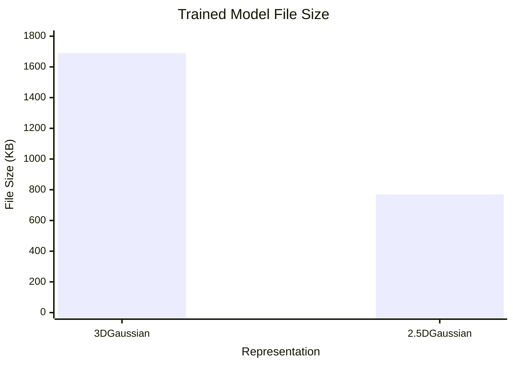
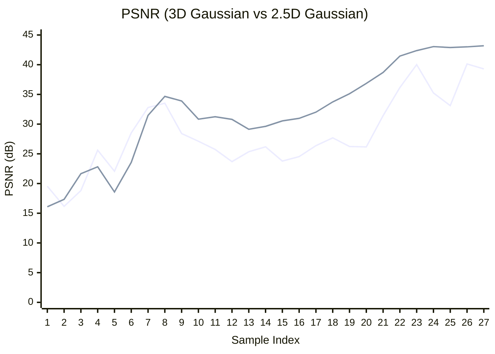
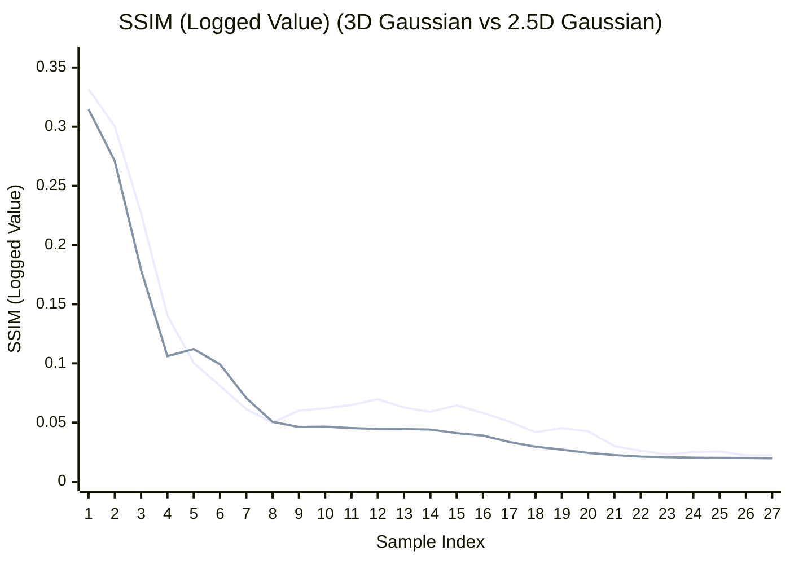
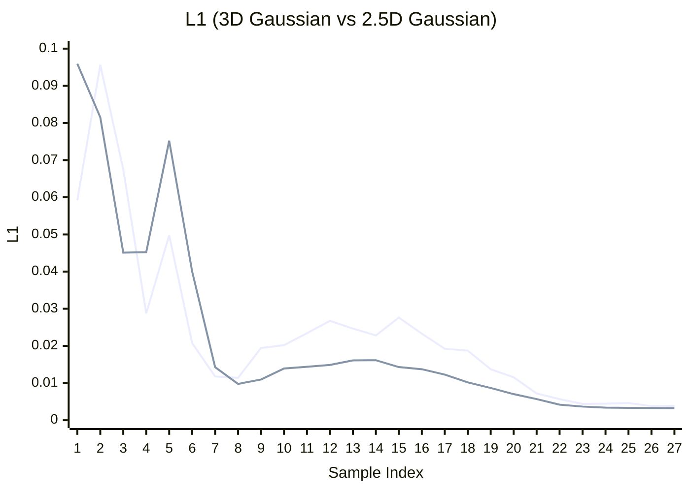
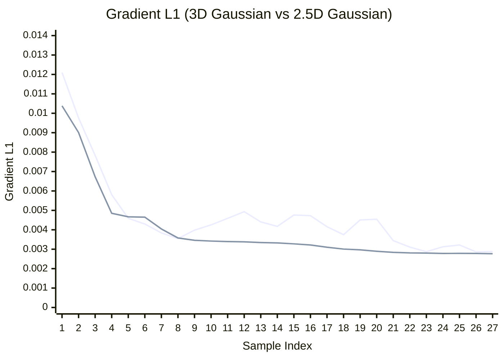
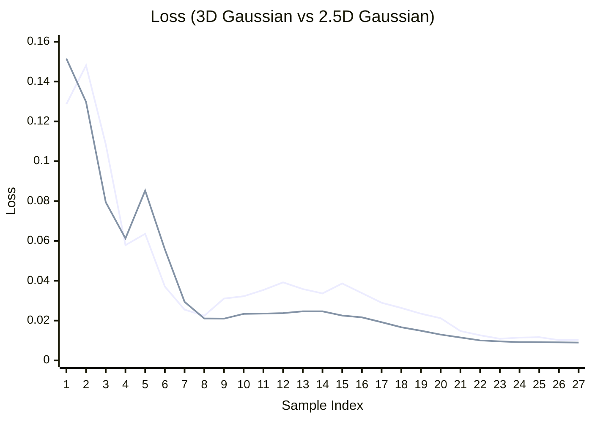
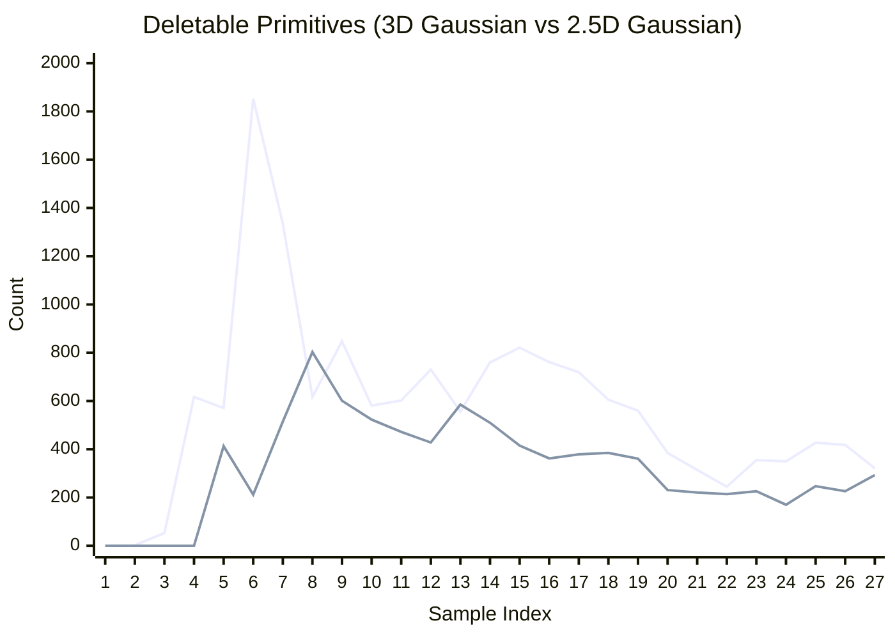
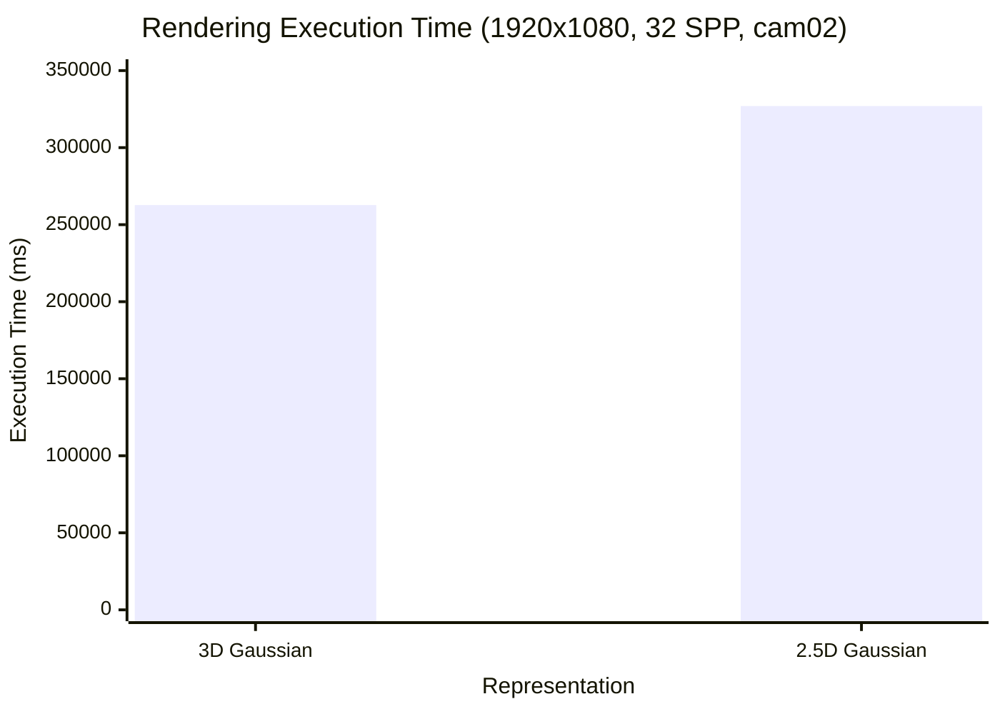

### 2.5D 单高斯实现

设置 `--primitives_per_column 1`，相当于把 3d 高斯限制 y 轴旋转自由度。

```shell title="shell" tab="column 训练"
WANDB_MODE=disabled bash examples/train.sh \
  data/thin_layer/LS_density_y100.npy \
  --output results/checkpoints/k1_slab8_cam32_stable \
  --opacity_scale 10.0 \
  --use_columns_representation \
  --column_count 24576 --primitives_per_column 1 \
  --column_slab_depth 8 \
  --column_lr 4.0 \
  --centers_lr 0.003 --scales_lr 0.0002 \
  --opacity_lr 0.00002 --quats_lr 0.0003 \
  --init_scale 1.0 --init_opacity 0.00008 \
  --lambda_opacity 0.0001 --lambda_scale 0.000001 \
  --gauss_target_level 0 \
  --iterations_gaussian 200 \
  --cam_count 32 \
  --cam_res_x 512 --cam_res_y 512 \
  --ref_spp_chunk 64 \
  --opt_cam_batch 1 \
  --seed_offset 0
```

```shell title="shell" tab="gaussian 训练"
WANDB_MODE=disabled bash examples/train.sh \
  data/thin_layer/LS_density_y100.npy \
  --gaussian \
  --output results/checkpoints/gaussian_24576_cam32_matched \
  --opacity_scale 10.0 \
  --gauss_count 24576 \
  --global_lr_gaussian 4.0 \
  --centers_lr 0.003 --scales_lr 0.0002 \
  --opacity_lr 0.00002 --quats_lr 0.0003 \
  --init_scale 1.0 --init_opacity 0.00008 \
  --lambda_opacity 0.0001 --lambda_scale 0.000001 \
  --gauss_target_level 0 \
  --iterations_gaussian 200 \
  --cam_count 32 \
  --cam_res_x 512 --cam_res_y 512 \
  --densify_until 0 --relocate_until 0 \
  --ref_spp_chunk 64 \
  --opt_cam_batch 1 \
  --seed_offset 0
```
















```shell title="shell" tab="column 渲染"
.venv/bin/python -m gfields.render \
  results/checkpoints/k1_slab8_cam32_stable/optimized_asset_pyr0 \
  --use_columns_representation \
  --kernel gaussian \
  --multiple_scattering \
  --max_depth 10 \
  --use_perspective_cam \
  --cam_fov 65 \
  --cam_distance 3 \
  --cam_count 8 \
  --cam_elevation 75 \
  --cam_azimuth_span 360 \
  --cam_index 2 \
  --cam_res_x 1920 \
  --cam_res_y 1080 \
  --spp 32 \
  --rr_depth 2 \
  --rr_nee_depth 64 \
  --max_depth_primitive 256 \
  --rr_depth_primitive 256 \
  --max_overlaps 256 \
  --solver_type bisection \
  --solver_max_iterations 4 \
  --stochastic_selection_criteria deterministic \
  --stochastic_selection_criteria_nee deterministic \
  --opacity_scaler 4.0 \
  --albedo 1.0 \
  --envmap data/envmaps/qwantani_dusk_2_1k.exr \
  --envmap_scale 1.0 \
  --max_level 0 \
  --output results/renders/k1_slab8_cam32_stable_1920x1080
```

```shell title="shell" tab="gaussian 渲染"
.venv/bin/python -m gfields.render \
  results/checkpoints/gaussian_24576_cam32_matched/optimized_asset_pyr0 \
  --kernel gaussian \
  --multiple_scattering \
  --max_depth 10 \
  --use_perspective_cam \
  --cam_fov 65 \
  --cam_distance 3 \
  --cam_count 8 \
  --cam_elevation 75 \
  --cam_azimuth_span 360 \
  --cam_index 2 \
  --cam_res_x 1920 \
  --cam_res_y 1080 \
  --spp 32 \
  --rr_depth 2 \
  --rr_nee_depth 64 \
  --max_depth_primitive 256 \
  --rr_depth_primitive 256 \
  --max_overlaps 256 \
  --solver_type bisection \
  --solver_max_iterations 4 \
  --stochastic_selection_criteria deterministic \
  --stochastic_selection_criteria_nee deterministic \
  --opacity_scaler 4.0 \
  --albedo 1.0 \
  --envmap data/envmaps/qwantani_dusk_2_1k.exr \
  --envmap_scale 1.0 \
  --max_level 0 \
  --output results/renders/gaussian_24576_cam32_matched_1920x1080
```



<ImageComparison
  before="experiments/20261116-ablation_columns_kx_slabx/gaussian_24576_cam32_matched_1920x1080.png"
  after="experiments/20261116-ablation_columns_kx_slabx/k1_slab8_cam32_stable_1920x1080.png"
  beforeAlt="3D Gaussian，24,576 个独立高斯，cam02"
  afterAlt="2.5D Gaussian，24,576 根 Column，每柱 1 个高斯，slab 深度 8，cam02"
  beforeLabel={`3D Gaussian\n24,576 independent Gaussians\n1920×1080 · 32 spp · cam02\nExecution time: 262,720.91 ms`}
  afterLabel={`2.5D Gaussian\n24,576 columns\n1 gaussian per column\nslab=8\n1920×1080\n32 spp\n326,984.34 ms`}
/>


### slab ablation

```shell
for slab_depth in 1 4 8 32 0; do
  WANDB_MODE=disabled bash examples/train.sh \
    data/thin_layer/LS_density_y100.npy \
    --output "results/checkpoints/ablation_k1_cam32_stable/slab${slab_depth}" \
    --opacity_scale 10.0 \
    --use_columns_representation \
    --column_count 24576 --primitives_per_column 1 \
    --column_slab_depth "$slab_depth" \
    --column_lr 4.0 \
    --centers_lr 0.003 --scales_lr 0.0002 \
    --opacity_lr 0.00002 --quats_lr 0.0003 \
    --init_scale 1.0 --init_opacity 0.00008 \
    --lambda_opacity 0.0001 --lambda_scale 0.000001 \
    --gauss_target_level 0 \
    --iterations_gaussian 200 \
    --cam_count 32 \
    --cam_res_x 512 --cam_res_y 512 \
    --ref_spp_chunk 64 \
    --opt_cam_batch 1 \
    --seed_offset 0 || break
done
```