### 简单自由度约束实验

设置 `--primitives_per_column 1`，相当于把 3d 高斯限制 y 轴旋转自由度。

```shell title="shell" tab="column 训练"
WANDB_MODE=disabled bash examples/train.sh \
  data/thin_layer/LS_density_y100.npy \
  --output results/checkpoints/k1_slab8_cam32_stable \
  --opacity_scale 10.0 \
  --use_columns_representation \
  --column_count 24576 --primitives_per_column 1 \
  --column_slab_depth 8 \
  --column_lr 4.0 \
  --centers_lr 0.003 --scales_lr 0.0002 \
  --opacity_lr 0.00002 --quats_lr 0.0003 \
  --init_scale 1.0 --init_opacity 0.00008 \
  --lambda_opacity 0.0001 --lambda_scale 0.000001 \
  --gauss_target_level 0 \
  --iterations_gaussian 200 \
  --cam_count 32 \
  --cam_res_x 512 --cam_res_y 512 \
  --ref_spp_chunk 64 \
  --opt_cam_batch 1 \
  --seed_offset 0
```

```shell title="shell" tab="gaussian 训练"
WANDB_MODE=disabled bash examples/train.sh \
  data/thin_layer/LS_density_y100.npy \
  --gaussian \
  --output results/checkpoints/gaussian_24576_cam32_matched \
  --opacity_scale 10.0 \
  --gauss_count 24576 \
  --global_lr_gaussian 4.0 \
  --centers_lr 0.003 --scales_lr 0.0002 \
  --opacity_lr 0.00002 --quats_lr 0.0003 \
  --init_scale 1.0 --init_opacity 0.00008 \
  --lambda_opacity 0.0001 --lambda_scale 0.000001 \
  --gauss_target_level 0 \
  --iterations_gaussian 200 \
  --cam_count 32 \
  --cam_res_x 512 --cam_res_y 512 \
  --densify_until 0 --relocate_until 0 \
  --ref_spp_chunk 64 \
  --opt_cam_batch 1 \
  --seed_offset 0
```


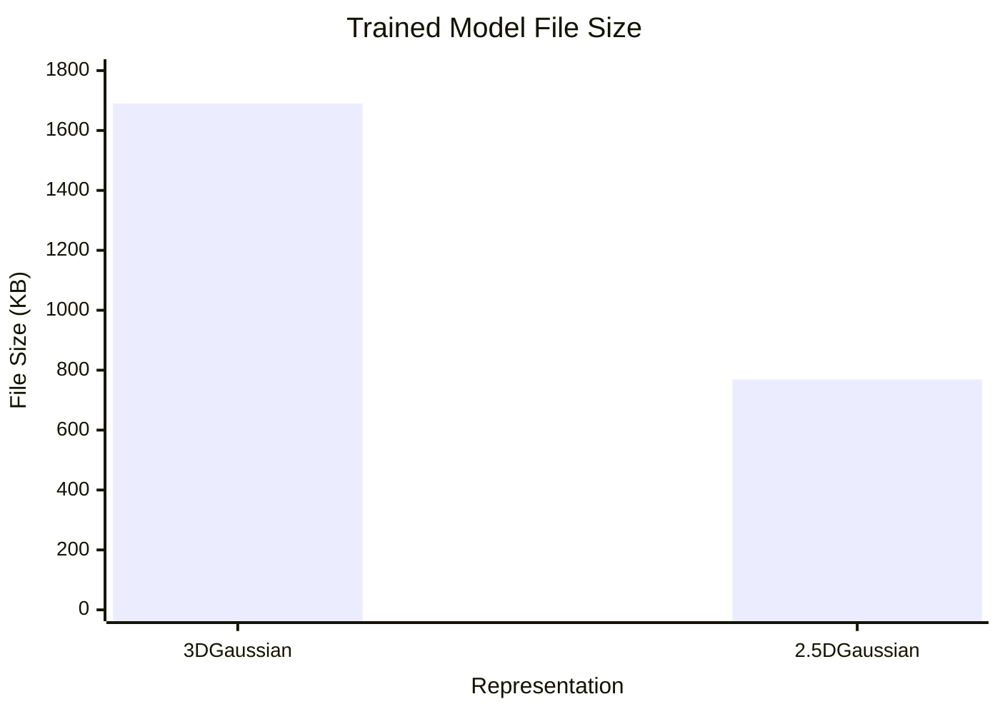

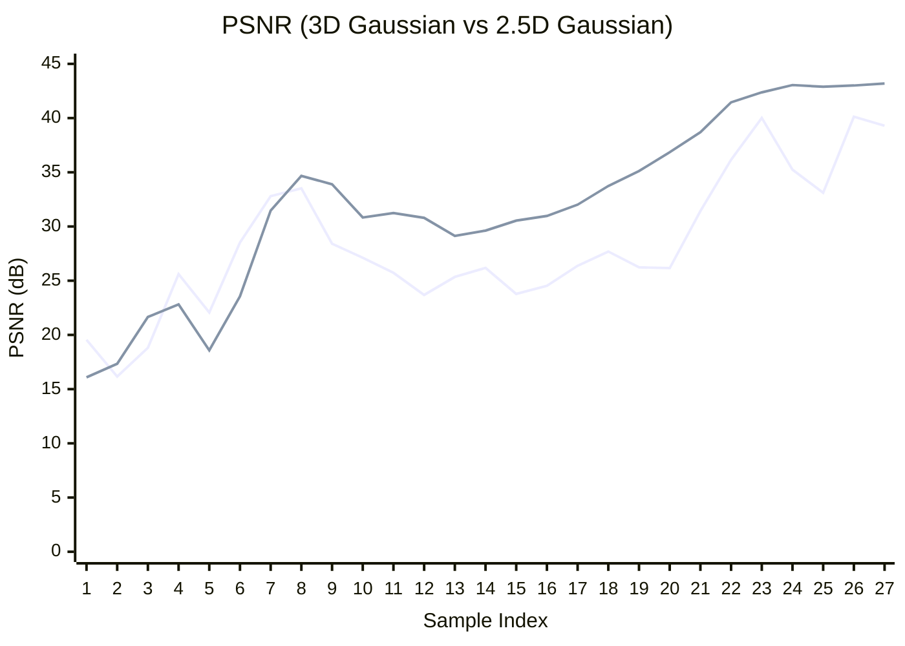

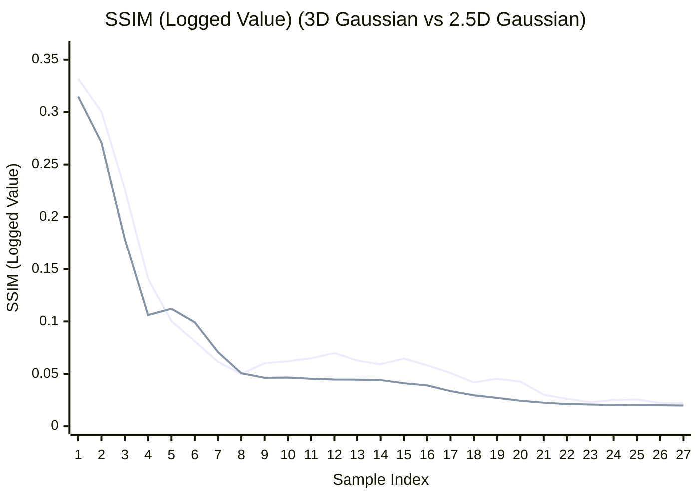

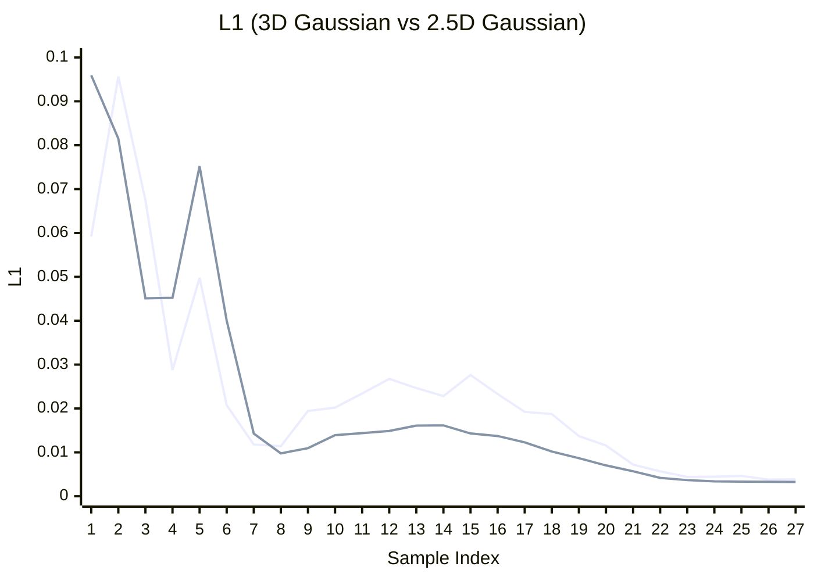

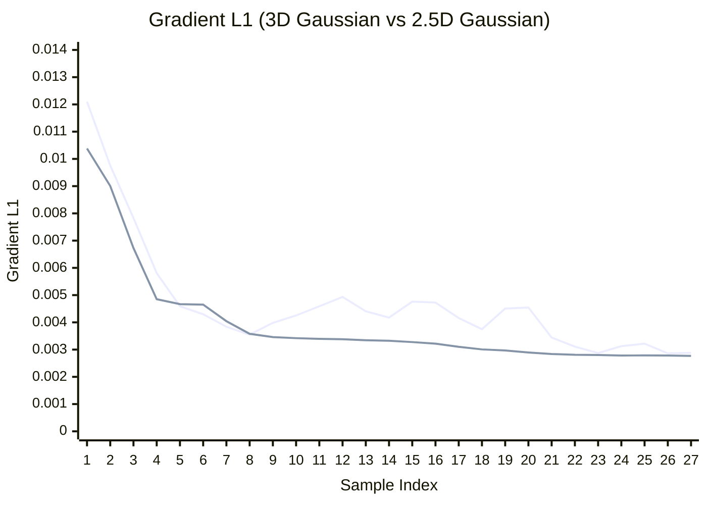

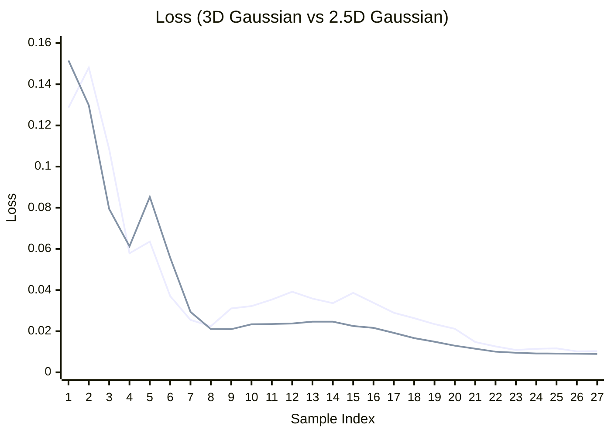

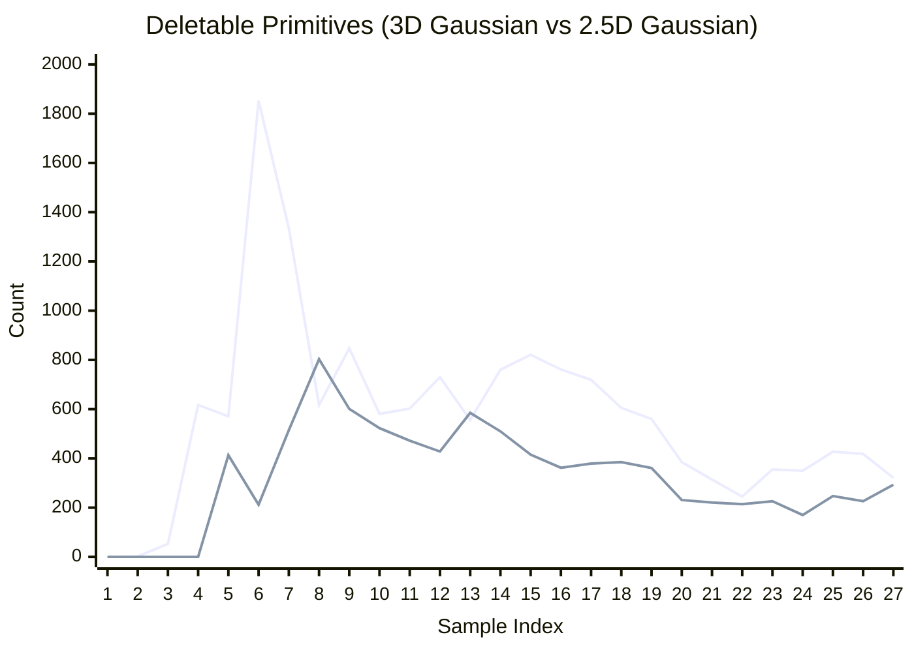

```shell title="shell" tab="column 渲染"
.venv/bin/python -m gfields.render \
  results/checkpoints/k1_slab8_cam32_stable/optimized_asset_pyr0 \
  --use_columns_representation \
  --kernel gaussian \
  --multiple_scattering \
  --max_depth 10 \
  --use_perspective_cam \
  --cam_fov 65 \
  --cam_distance 3 \
  --cam_count 8 \
  --cam_elevation 75 \
  --cam_azimuth_span 360 \
  --cam_index 2 \
  --cam_res_x 1920 \
  --cam_res_y 1080 \
  --spp 32 \
  --rr_depth 2 \
  --rr_nee_depth 64 \
  --max_depth_primitive 256 \
  --rr_depth_primitive 256 \
  --max_overlaps 256 \
  --solver_type bisection \
  --solver_max_iterations 4 \
  --stochastic_selection_criteria deterministic \
  --stochastic_selection_criteria_nee deterministic \
  --opacity_scaler 4.0 \
  --albedo 1.0 \
  --envmap data/envmaps/qwantani_dusk_2_1k.exr \
  --envmap_scale 1.0 \
  --max_level 0 \
  --output results/renders/k1_slab8_cam32_stable_1920x1080
```

```shell title="shell" tab="gaussian 渲染"
.venv/bin/python -m gfields.render \
  results/checkpoints/gaussian_24576_cam32_matched/optimized_asset_pyr0 \
  --kernel gaussian \
  --multiple_scattering \
  --max_depth 10 \
  --use_perspective_cam \
  --cam_fov 65 \
  --cam_distance 3 \
  --cam_count 8 \
  --cam_elevation 75 \
  --cam_azimuth_span 360 \
  --cam_index 2 \
  --cam_res_x 1920 \
  --cam_res_y 1080 \
  --spp 32 \
  --rr_depth 2 \
  --rr_nee_depth 64 \
  --max_depth_primitive 256 \
  --rr_depth_primitive 256 \
  --max_overlaps 256 \
  --solver_type bisection \
  --solver_max_iterations 4 \
  --stochastic_selection_criteria deterministic \
  --stochastic_selection_criteria_nee deterministic \
  --opacity_scaler 4.0 \
  --albedo 1.0 \
  --envmap data/envmaps/qwantani_dusk_2_1k.exr \
  --envmap_scale 1.0 \
  --max_level 0 \
  --output results/renders/gaussian_24576_cam32_matched_1920x1080
```

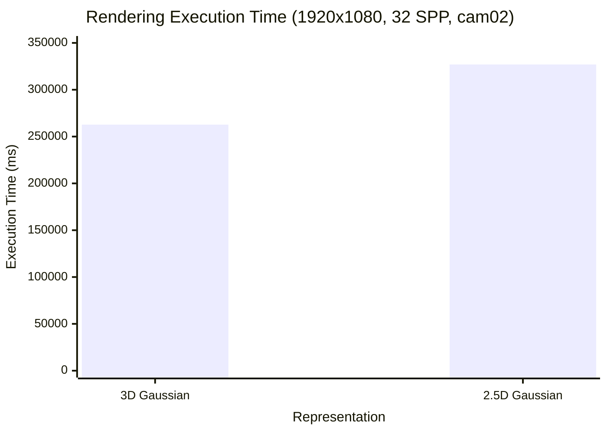

<ImageComparison
  before="experiments/20261116-ablation_columns_kx_slabx/gaussian_24576_cam32_matched_1920x1080.png"
  after="experiments/20261116-ablation_columns_kx_slabx/k1_slab8_cam32_stable_1920x1080.png"
  beforeAlt="3D Gaussian"
  afterAlt="2.5D Gaussian K=1 slab=8"
  beforeLabel={`3D Gaussian\n24,576 gaussians\n1920×1080\n32 spp\n262,720.91 ms`}
  afterLabel={`2.5D Gaussian\n24,576 columns\nK=1\nslab=8\n1920×1080\n32 spp\n326,984.34 ms`}
/>


### 每柱基元数消融实验

```shell title="shell" tab="column 训练"
for primitives_per_column in 1 2 4 8 16; do
  column_count=$((24576 / primitives_per_column))

  for slab_depth in 1 4 8 32 100; do
    WANDB_MODE=disabled bash examples/train.sh \
      data/thin_layer/LS_density_y100.npy \
      --output "results/checkpoints/ablation_n24576_cam32_stable/k${primitives_per_column}_slab${slab_depth}" \
      --opacity_scale 10.0 \
      --use_columns_representation \
      --column_count "$column_count" \
      --primitives_per_column "$primitives_per_column" \
      --column_slab_depth "$slab_depth" \
      --column_lr 4.0 \
      --centers_lr 0.003 --scales_lr 0.0002 \
      --opacity_lr 0.00002 --quats_lr 0.0003 \
      --init_scale 1.0 --init_opacity 0.00008 \
      --lambda_opacity 0.0001 --lambda_scale 0.000001 \
      --gauss_target_level 0 \
      --iterations_gaussian 200 \
      --cam_count 32 \
      --cam_res_x 512 --cam_res_y 512 \
      --ref_spp_chunk 64 \
      --opt_cam_batch 1 \
      --seed_offset 0 || break 2
  done
done
```

```shell title="shell" tab="column 渲染"
for name in \
  k16_slab0 k16_slab32 k16_slab4 k16_slab8 \
  k2_slab0  k2_slab32  k2_slab4  k2_slab8 \
  k4_slab0  k4_slab32  k4_slab4  k4_slab8 \
  k8_slab0  k8_slab32  k8_slab4  k8_slab8
do
  .venv/bin/python -m gfields.render \
    "results/checkpoints/ablation_n24576_cam32_stable/${name}/optimized_asset_pyr0" \
    --use_columns_representation \
    --kernel gaussian \
    --multiple_scattering \
    --max_depth 10 \
    --use_perspective_cam \
    --cam_fov 65 \
    --cam_distance 3 \
    --cam_count 8 \
    --cam_elevation 75 \
    --cam_azimuth_span 360 \
    --cam_index 2 \
    --cam_res_x 1920 \
    --cam_res_y 1080 \
    --spp 32 \
    --rr_depth 2 \
    --rr_nee_depth 64 \
    --max_depth_primitive 256 \
    --rr_depth_primitive 256 \
    --max_overlaps 256 \
    --solver_type bisection \
    --solver_max_iterations 4 \
    --stochastic_selection_criteria deterministic \
    --stochastic_selection_criteria_nee deterministic \
    --opacity_scaler 3.0 \
    --albedo 1.0 \
    --envmap data/envmaps/qwantani_dusk_2_1k.exr \
    --envmap_scale 1.0 \
    --max_level 0 \
    --output "results/renders/ablation_n24576_cam32_stable/${name}_1920x1080"
done

```

固定总基元数为 24,576；每张图 line1 为 Gaussian，line2–line5 依次为 slab=4、8、32、100。横轴为采样序号，保留日志中的指标定义。

#### K=2

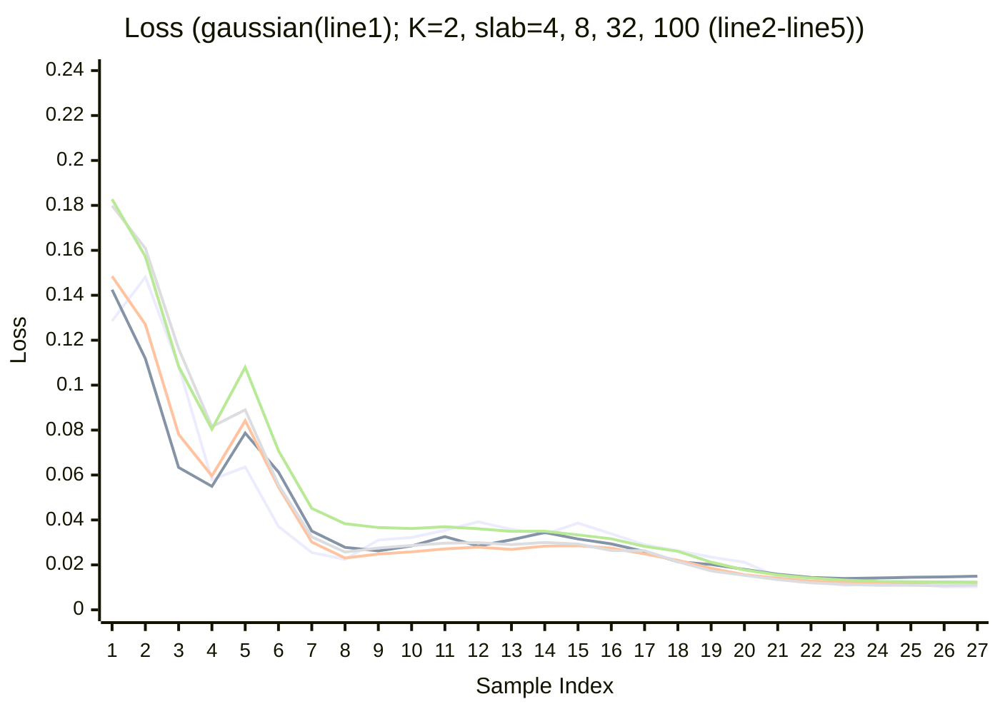

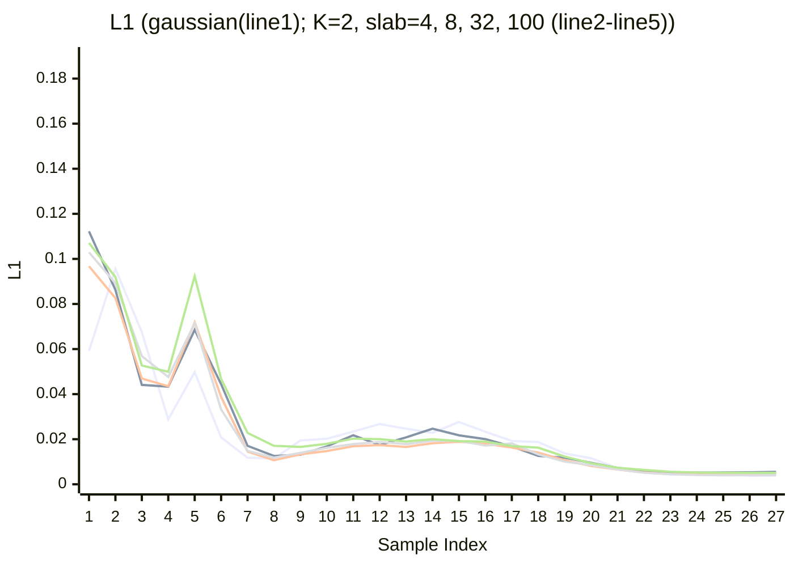

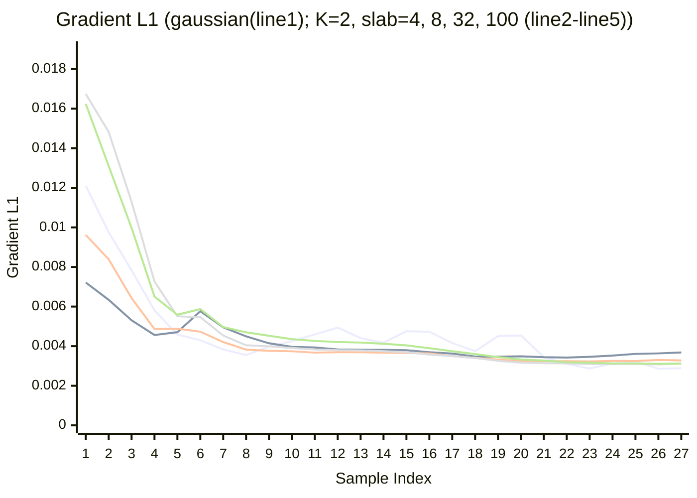

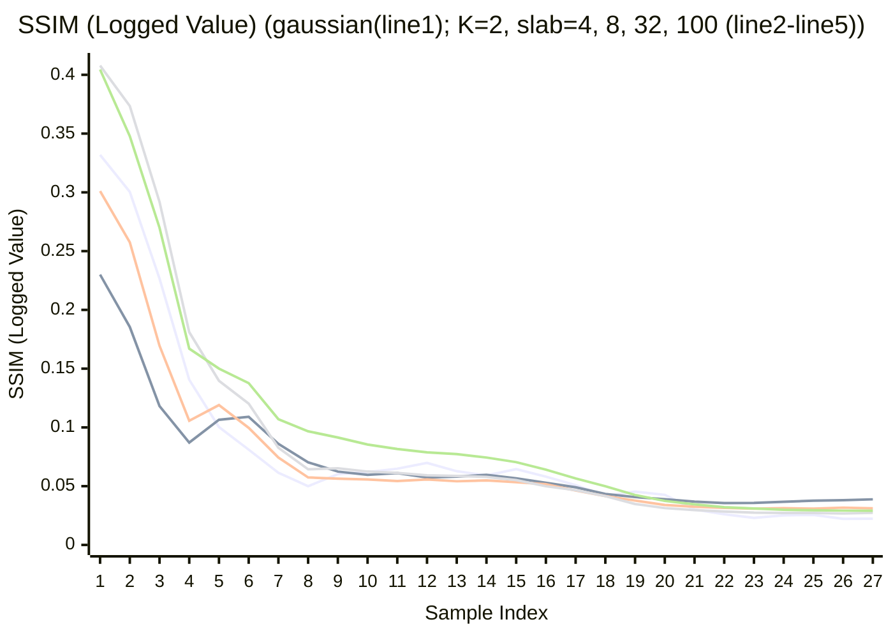

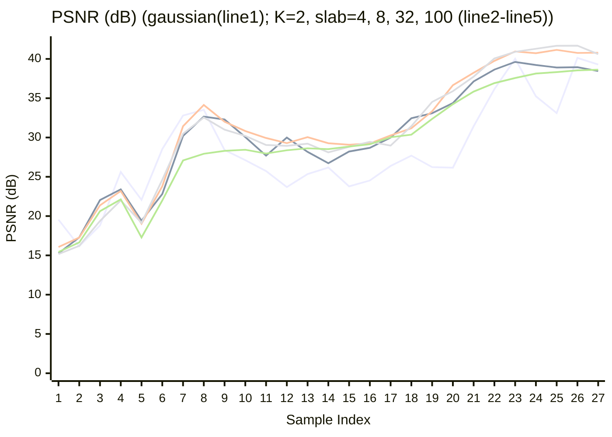

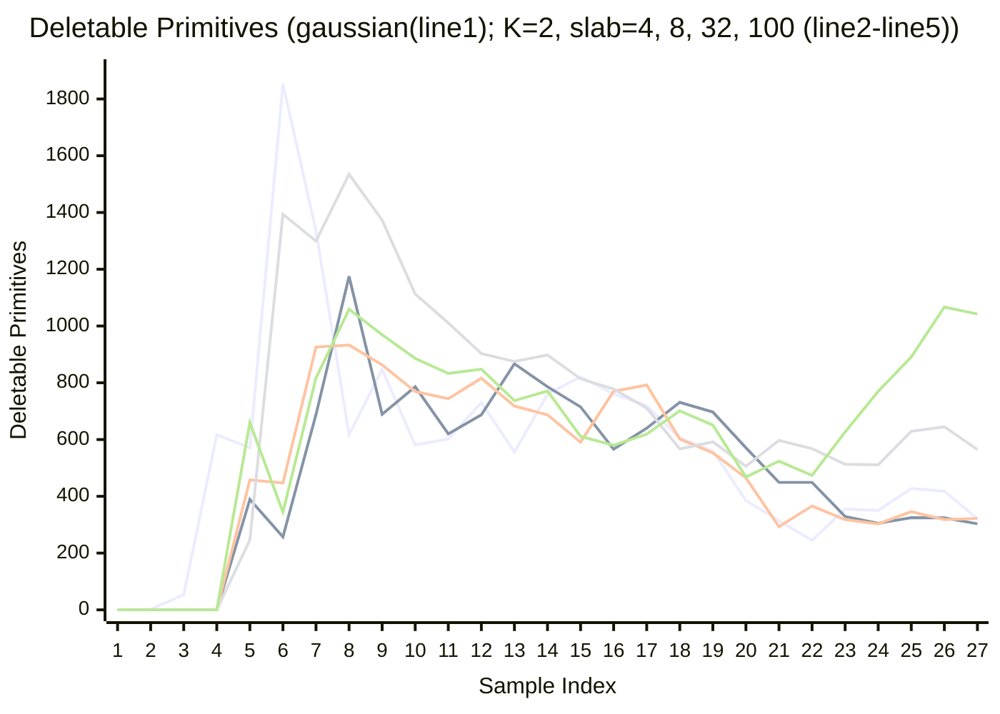

<ImageComparison
  before="experiments/20261116-ablation_columns_kx_slabx/gaussian_24576_cam32_matched_1920x1080.png"
  after="experiments/20261117/k2_slab4_1920x1080.png"
  beforeAlt="3D Gaussian"
  afterAlt="2.5D Gaussian K=2 slab=4"
  beforeLabel={`3D Gaussian\n24,576 gaussians\n1920×1080\n32 spp\n262,720.91 ms`}
  afterLabel={`2.5D Gaussian\n12,288 columns\nK=2\nslab=4\n1920×1080\n32 spp\n384,416.59 ms`}
/>

<ImageComparison
  before="experiments/20261116-ablation_columns_kx_slabx/gaussian_24576_cam32_matched_1920x1080.png"
  after="experiments/20261117/k2_slab8_1920x1080.png"
  beforeAlt="3D Gaussian"
  afterAlt="2.5D Gaussian K=2 slab=8"
  beforeLabel={`3D Gaussian\n24,576 gaussians\n1920×1080\n32 spp\n262,720.91 ms`}
  afterLabel={`2.5D Gaussian\n12,288 columns\nK=2\nslab=8\n1920×1080\n32 spp\n305,651.50 ms`}
/>

<ImageComparison
  before="experiments/20261116-ablation_columns_kx_slabx/gaussian_24576_cam32_matched_1920x1080.png"
  after="experiments/20261117/k2_slab32_1920x1080.png"
  beforeAlt="3D Gaussian"
  afterAlt="2.5D Gaussian K=2 slab=32"
  beforeLabel={`3D Gaussian\n24,576 gaussians\n1920×1080\n32 spp\n262,720.91 ms`}
  afterLabel={`2.5D Gaussian\n12,288 columns\nK=2\nslab=32\n1920×1080\n32 spp\n239,906.91 ms`}
/>

<ImageComparison
  before="experiments/20261116-ablation_columns_kx_slabx/gaussian_24576_cam32_matched_1920x1080.png"
  after="experiments/20261117/k2_slab0_1920x1080.png"
  beforeAlt="3D Gaussian"
  afterAlt="2.5D Gaussian K=2 slab=100"
  beforeLabel={`3D Gaussian\n24,576 gaussians\n1920×1080\n32 spp\n262,720.91 ms`}
  afterLabel={`2.5D Gaussian\n12,288 columns\nK=2\nslab=100\n1920×1080\n32 spp\n169,048.11 ms`}
/>


<ImageSequenceSlider
  width={640}
  height={360}
  processing="none"
  images={[
    {
      src: "experiments/20261117-ablation_opacity0_640x360/k2_slab4.png",
      alt: "Artifacts K=2 slab=4",
      label: `K=2\nslab=4`,
    },
    {
      src: "experiments/20261117-ablation_opacity0_640x360/k2_slab8.png",
      alt: "Artifacts K=2 slab=8",
      label: `K=2\nslab=8`,
    },
    {
      src: "experiments/20261117-ablation_opacity0_640x360/k2_slab32.png",
      alt: "Artifacts K=2 slab=32",
      label: `K=2\nslab=32`,
    },
    {
      src: "experiments/20261117-ablation_opacity0_640x360/k2_slab0.png",
      alt: "Artifacts K=2 slab=100",
      label: `K=2\nslab=100`,
    },
  ]}
/>

#### K=4

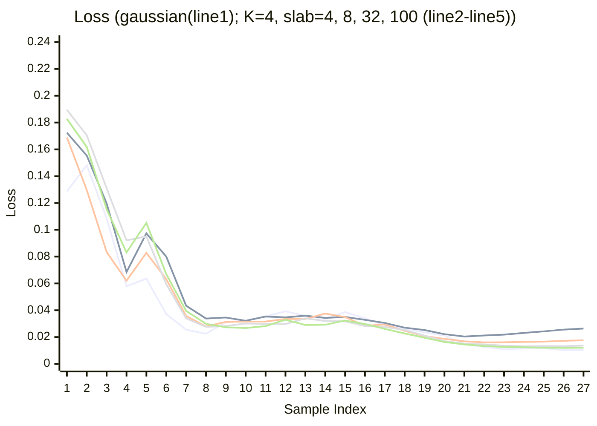

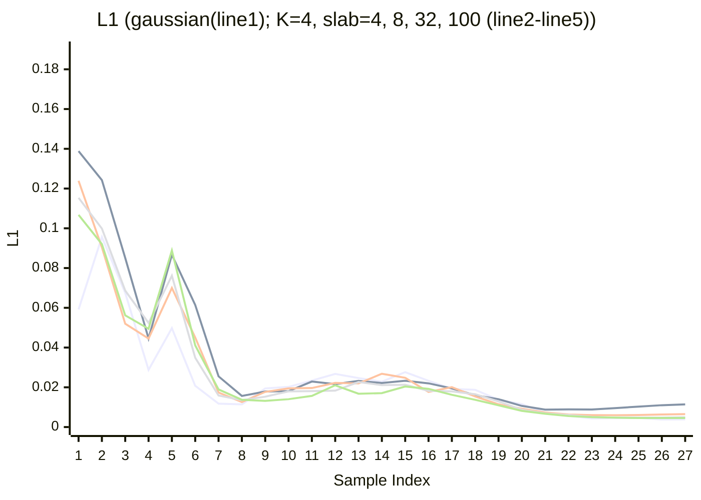

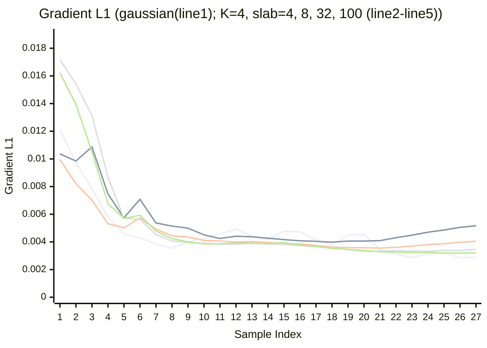

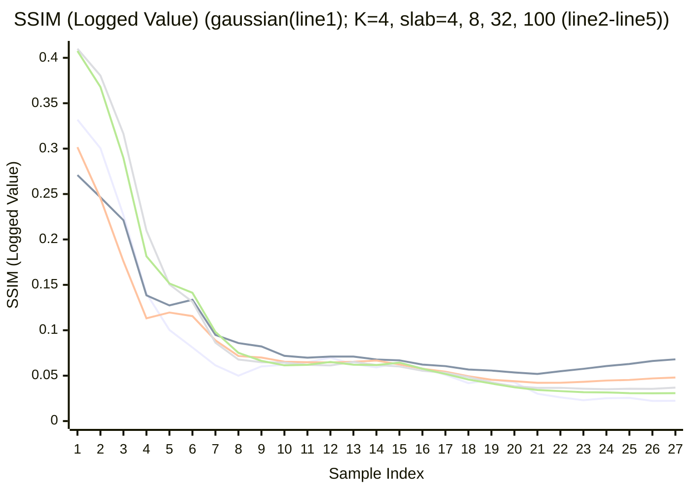

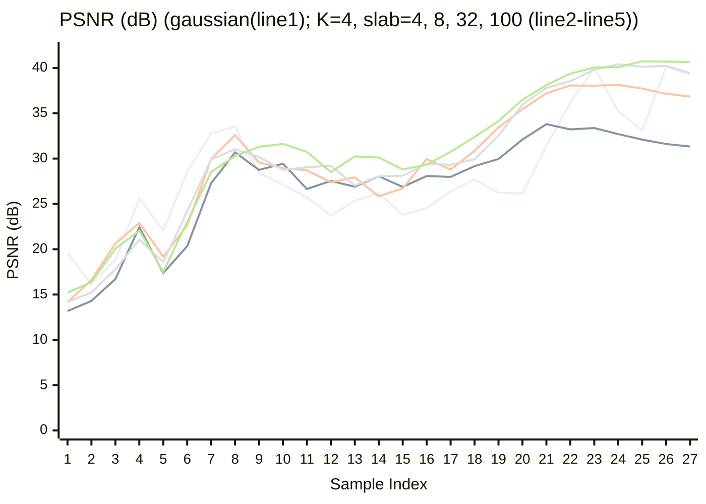

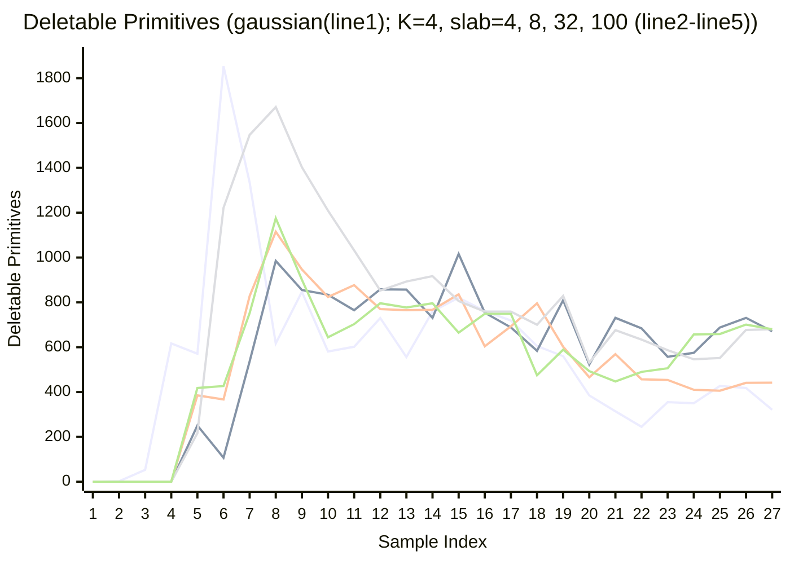

<ImageComparison
  before="experiments/20261116-ablation_columns_kx_slabx/gaussian_24576_cam32_matched_1920x1080.png"
  after="experiments/20261117/k4_slab4_1920x1080.png"
  beforeAlt="3D Gaussian"
  afterAlt="2.5D Gaussian K=4 slab=4"
  beforeLabel={`3D Gaussian\n24,576 gaussians\n1920×1080\n32 spp\n262,720.91 ms`}
  afterLabel={`2.5D Gaussian\n6,144 columns\nK=4\nslab=4\n1920×1080\n32 spp\n423,273.31 ms`}
/>

<ImageComparison
  before="experiments/20261116-ablation_columns_kx_slabx/gaussian_24576_cam32_matched_1920x1080.png"
  after="experiments/20261117/k4_slab8_1920x1080.png"
  beforeAlt="3D Gaussian"
  afterAlt="2.5D Gaussian K=4 slab=8"
  beforeLabel={`3D Gaussian\n24,576 gaussians\n1920×1080\n32 spp\n262,720.91 ms`}
  afterLabel={`2.5D Gaussian\n6,144 columns\nK=4\nslab=8\n1920×1080\n32 spp\n374,449.09 ms`}
/>

<ImageComparison
  before="experiments/20261116-ablation_columns_kx_slabx/gaussian_24576_cam32_matched_1920x1080.png"
  after="experiments/20261117/k4_slab32_1920x1080.png"
  beforeAlt="3D Gaussian"
  afterAlt="2.5D Gaussian K=4 slab=32"
  beforeLabel={`3D Gaussian\n24,576 gaussians\n1920×1080\n32 spp\n262,720.91 ms`}
  afterLabel={`2.5D Gaussian\n6,144 columns\nK=4\nslab=32\n1920×1080\n32 spp\n280,213.00 ms`}
/>

<ImageComparison
  before="experiments/20261116-ablation_columns_kx_slabx/gaussian_24576_cam32_matched_1920x1080.png"
  after="experiments/20261117/k4_slab0_1920x1080.png"
  beforeAlt="3D Gaussian"
  afterAlt="2.5D Gaussian K=4 slab=100"
  beforeLabel={`3D Gaussian\n24,576 gaussians\n1920×1080\n32 spp\n262,720.91 ms`}
  afterLabel={`2.5D Gaussian\n6,144 columns\nK=4\nslab=100\n1920×1080\n32 spp\n199,231.05 ms`}
/>


<ImageSequenceSlider
  width={640}
  height={360}
  processing="none"
  images={[
    {
      src: "experiments/20261117-ablation_opacity0_640x360/k4_slab4.png",
      alt: "Artifacts K=4 slab=4",
      label: `K=4\nslab=4`,
    },
    {
      src: "experiments/20261117-ablation_opacity0_640x360/k4_slab8.png",
      alt: "Artifacts K=4 slab=8",
      label: `K=4\nslab=8`,
    },
    {
      src: "experiments/20261117-ablation_opacity0_640x360/k4_slab32.png",
      alt: "Artifacts K=4 slab=32",
      label: `K=4\nslab=32`,
    },
    {
      src: "experiments/20261117-ablation_opacity0_640x360/k4_slab0.png",
      alt: "Artifacts K=4 slab=100",
      label: `K=4\nslab=100`,
    },
  ]}
/>

#### K=8

```mermaid
xychart-beta
    title "Loss (gaussian(line1); K=8, slab=4, 8, 32, 100 (line2-line5))"
    x-axis "Sample Index" [1, 2, 3, 4, 5, 6, 7, 8, 9, 10, 11, 12, 13, 14, 15, 16, 17, 18, 19, 20, 21, 22, 23, 24, 25, 26, 27]
    y-axis "Loss" 0 --> 0.24
    %% 3D Gaussian
    line [0.1286243349, 0.1480745226, 0.1084986404, 0.057885766, 0.0635750294, 0.0371065475, 0.0255096853, 0.0224327948, 0.0310747325, 0.0322069675, 0.0353988521, 0.0391736329, 0.0358488411, 0.0336405151, 0.03863772, 0.0338130407, 0.0289672632, 0.026345402, 0.0234684013, 0.0211702604, 0.0147694666, 0.012625644, 0.0108881695, 0.0114551503, 0.0116902366, 0.0102249095, 0.0102936607]
    %% k8_slab4
    line [0.201370224357, 0.219335123897, 0.157354027033, 0.0781467780471, 0.0964034348726, 0.0838795602322, 0.0445745252073, 0.0376602783799, 0.0379292741418, 0.0442285276949, 0.0414040200412, 0.0428365878761, 0.0423884764314, 0.0415132790804, 0.042176797986, 0.0396705791354, 0.0401002466679, 0.0345066711307, 0.0329217277467, 0.0324515104294, 0.0339030958712, 0.0361074097455, 0.0397856608033, 0.0436278916895, 0.0463681556284, 0.0477335602045, 0.0488101281226]
    %% k8_slab8
    line [0.214201569557, 0.169596612453, 0.132406130433, 0.0761861130595, 0.0969012603164, 0.0806106850505, 0.0429481752217, 0.0349942296743, 0.0363626815379, 0.0340931713581, 0.0361887849867, 0.0358523949981, 0.0370998568833, 0.0357732586563, 0.0377086102962, 0.0356554463506, 0.0303990077227, 0.0276009384543, 0.0260979607701, 0.0243931412697, 0.0242429953068, 0.0244810990989, 0.026983095333, 0.0284324567765, 0.0302334409207, 0.0304934363812, 0.0325406268239]
    %% k8_slab32
    line [0.204173773527, 0.18100361526, 0.137947142124, 0.0965074822307, 0.0970386490226, 0.0627130046487, 0.037968121469, 0.0298855844885, 0.0332832559943, 0.0327069684863, 0.0361408405006, 0.0364617407322, 0.0332303196192, 0.0348827950656, 0.0370929054916, 0.0342371314764, 0.0298005994409, 0.0277096796781, 0.0239628776908, 0.0196880437434, 0.0184407699853, 0.0179379396141, 0.0168975461274, 0.0168392714113, 0.0173908732831, 0.0176123455167, 0.0180501788855]
    %% k8_slab0
    line [0.183803230524, 0.166056588292, 0.123178705573, 0.0891049280763, 0.108676381409, 0.0689428970218, 0.0401072353125, 0.0288069434464, 0.0268871821463, 0.0278720371425, 0.0290315635502, 0.0297638997436, 0.03355769068, 0.0326494425535, 0.031499568373, 0.0294505786151, 0.0293621532619, 0.0233973637223, 0.0207770094275, 0.0184967014939, 0.0161466486752, 0.0148010309786, 0.0144071280956, 0.0140571799129, 0.014208285138, 0.0141781512648, 0.0142626669258]
```

```mermaid
xychart-beta
    title "L1 (gaussian(line1); K=8, slab=4, 8, 32, 100 (line2-line5))"
    x-axis "Sample Index" [1, 2, 3, 4, 5, 6, 7, 8, 9, 10, 11, 12, 13, 14, 15, 16, 17, 18, 19, 20, 21, 22, 23, 24, 25, 26, 27]
    y-axis "L1" 0 --> 0.19
    %% 3D Gaussian
    line [0.0591885708, 0.0956385136, 0.067490682, 0.0287534017, 0.0497794002, 0.0207545273, 0.0117761912, 0.0114113847, 0.0194375794, 0.0202028826, 0.0234031975, 0.0267340969, 0.0246481281, 0.0228296891, 0.0276337061, 0.0232977681, 0.0192322321, 0.0187441614, 0.0137149896, 0.011553091, 0.0072001484, 0.0056799585, 0.0043902872, 0.0044632042, 0.0046297428, 0.0037971435, 0.00385539]
    %% k8_slab4
    line [0.155439153314, 0.180705800653, 0.120136864483, 0.0499039180577, 0.0850760862231, 0.0667079016566, 0.0261763241142, 0.0190940201283, 0.0196361821145, 0.0279663149267, 0.0251122154295, 0.0268485918641, 0.0262735411525, 0.0264269262552, 0.0282830614597, 0.0262913685292, 0.0260763689876, 0.0204735212028, 0.0176603980362, 0.0165711697191, 0.0168490447104, 0.0178621914238, 0.0200458616018, 0.0226452499628, 0.0247659087181, 0.0257713440806, 0.0266088377684]
    %% k8_slab8
    line [0.167048156261, 0.128419011831, 0.0904788374901, 0.0473302565515, 0.0838568881154, 0.0596050433815, 0.0231208689511, 0.0166067220271, 0.0195635259151, 0.0188906081021, 0.0222428105772, 0.0215565636754, 0.023817261681, 0.0229656659067, 0.0256618689746, 0.0231141094118, 0.018588097766, 0.0158103946596, 0.014065194875, 0.0116892354563, 0.0107178520411, 0.0105321295559, 0.0116365142167, 0.0121666239575, 0.0132820382714, 0.0134508237243, 0.0144955636933]
    %% k8_slab32
    line [0.136079803109, 0.114578999579, 0.0778722316027, 0.0574592761695, 0.080028899014, 0.0377776548266, 0.0185534916818, 0.0146096516401, 0.0190973114222, 0.0197302885354, 0.0240551214665, 0.0248097851872, 0.0213517174125, 0.0229803547263, 0.0253085214645, 0.023711303249, 0.0190953537822, 0.0175319667906, 0.0142809804529, 0.00953395664692, 0.00818137079477, 0.00713744340464, 0.00630863942206, 0.00607011653483, 0.00617394363508, 0.00626751966774, 0.00643662642688]
    %% k8_slab0
    line [0.110084593296, 0.0965372845531, 0.0629876032472, 0.0532107949257, 0.0938632115722, 0.0394910536706, 0.018976084888, 0.0137248579413, 0.0141355320811, 0.0160868372768, 0.0174783729017, 0.0179716795683, 0.0219613797963, 0.0208645872772, 0.0200076829642, 0.0184763874859, 0.0195387322456, 0.0138916848227, 0.0112936953083, 0.0092698354274, 0.00712421350181, 0.00597114302218, 0.00544170523062, 0.00514646386728, 0.00515650166199, 0.00514717586339, 0.00520025053993]
```

```mermaid
xychart-beta
    title "Gradient L1 (gaussian(line1); K=8, slab=4, 8, 32, 100 (line2-line5))"
    x-axis "Sample Index" [1, 2, 3, 4, 5, 6, 7, 8, 9, 10, 11, 12, 13, 14, 15, 16, 17, 18, 19, 20, 21, 22, 23, 24, 25, 26, 27]
    y-axis "Gradient L1" 0 --> 0.019
    %% 3D Gaussian
    line [0.0120991534, 0.0097560808, 0.0078302156, 0.0058081262, 0.0045911688, 0.0042978898, 0.0038382865, 0.0035489213, 0.0039813914, 0.0042520678, 0.0045906571, 0.0049343109, 0.0044074971, 0.0041761063, 0.0047600954, 0.0047274819, 0.00416, 0.0037492979, 0.0045064837, 0.0045453813, 0.003443168, 0.0031081538, 0.0028730037, 0.0031256806, 0.0032192427, 0.0028616718, 0.0028823772]
    %% k8_slab4
    line [0.0123333651572, 0.0138002960011, 0.0130105400458, 0.00843812152743, 0.00573088414967, 0.00674261525273, 0.0053273900412, 0.00518854754046, 0.0052722916007, 0.0050942664966, 0.00505102006719, 0.00501244422048, 0.00503429491073, 0.004966952838, 0.00493737030774, 0.00480279047042, 0.00479267304763, 0.00472938781604, 0.00505792628974, 0.00519972946495, 0.00557006103918, 0.00596474995837, 0.00646149460226, 0.00693481368944, 0.00719907646999, 0.00732743972912, 0.00744376145303]
    %% k8_slab8
    line [0.0136383939534, 0.0115015162155, 0.0117873623967, 0.00809578690678, 0.00607096077874, 0.00731516210362, 0.00555044785142, 0.00523638445884, 0.00507454294711, 0.00472790841013, 0.00461696507409, 0.00463142246008, 0.00449703587219, 0.00443646125495, 0.00434541050345, 0.00427629984915, 0.00413603521883, 0.00417148182169, 0.00422226497903, 0.00430967239663, 0.00452984124422, 0.00466719502583, 0.00509611470625, 0.00535588944331, 0.00560698052868, 0.0056548723951, 0.00593196041882]
    %% k8_slab32
    line [0.0188019890338, 0.0163949392736, 0.0133905494586, 0.00883125700057, 0.00557240424678, 0.00561493495479, 0.00467725005001, 0.00422056112438, 0.0042508658953, 0.00404249737039, 0.00402350258082, 0.00403300719336, 0.00403514457867, 0.00402296334505, 0.00398624967784, 0.00393556943163, 0.00384584488347, 0.00379694602452, 0.0036757371854, 0.00366372964345, 0.00360472057946, 0.00377105316147, 0.00372334942222, 0.00378890056163, 0.00391396926716, 0.00395188620314, 0.00404108827934]
    %% k8_slab0
    line [0.0153581658378, 0.0137789323926, 0.0107664642856, 0.00693657621741, 0.00557263940573, 0.00615045055747, 0.00480717234313, 0.00413046870381, 0.00389689067379, 0.00383207388222, 0.0038483121898, 0.00389083055779, 0.00392053509131, 0.00394916208461, 0.0039272014983, 0.00383643223904, 0.00375338410959, 0.00361074670218, 0.00361461215653, 0.00356950052083, 0.00346161378548, 0.00340149062686, 0.00343358400278, 0.003419945715, 0.00346485059708, 0.00346648343839, 0.00348109472543]
```

```mermaid
xychart-beta
    title "SSIM (Logged Value) (gaussian(line1); K=8, slab=4, 8, 32, 100 (line2-line5))"
    x-axis "Sample Index" [1, 2, 3, 4, 5, 6, 7, 8, 9, 10, 11, 12, 13, 14, 15, 16, 17, 18, 19, 20, 21, 22, 23, 24, 25, 26, 27]
    y-axis "SSIM (Logged Value)" 0 --> 0.41
    %% 3D Gaussian
    line [0.3318869472, 0.3003621101, 0.2266104221, 0.1405623108, 0.1002885923, 0.0811119527, 0.0614350066, 0.0499764569, 0.0601712875, 0.062016584, 0.0648690388, 0.0697708279, 0.0627205893, 0.0591233596, 0.064509131, 0.0581079647, 0.0508441851, 0.041755788, 0.0453462787, 0.0426462032, 0.0301142372, 0.0261193626, 0.0230532568, 0.0251195841, 0.0255743917, 0.0222256184, 0.0223423187]
    %% k8_slab4
    line [0.337202966213, 0.33333671093, 0.267292112112, 0.161418765783, 0.129015177488, 0.133575856686, 0.0981058776379, 0.0915879160166, 0.0909786149859, 0.0910348296165, 0.0882338657975, 0.0886472538114, 0.0885956510901, 0.0845631659031, 0.0815764665604, 0.0774999260902, 0.0797907859087, 0.0743098855019, 0.0764103457332, 0.0778433680534, 0.0828418582678, 0.0886442065239, 0.0968303233385, 0.10441057384, 0.109023548663, 0.111476190388, 0.113278634846]
    %% k8_slab8
    line [0.353992462158, 0.291536778212, 0.256771683693, 0.161590993404, 0.1349542588, 0.142115324736, 0.10104227066, 0.0886546075344, 0.0851518362761, 0.0779441893101, 0.0761410072446, 0.0767614096403, 0.0749814286828, 0.0721217542887, 0.0716836899519, 0.0710915625095, 0.0636214911938, 0.0607574693859, 0.0599807240069, 0.0603140480816, 0.0626446530223, 0.0641656368971, 0.0708769336343, 0.0751005634665, 0.0789713710546, 0.0795186236501, 0.0845832526684]
    %% k8_slab32
    line [0.406954139471, 0.378848731518, 0.31691172719, 0.212626025081, 0.147116020322, 0.136202529073, 0.0949050635099, 0.0742853134871, 0.0742793977261, 0.0698716342449, 0.0704836249352, 0.0694196820259, 0.0668673813343, 0.0685076192021, 0.0702976733446, 0.0636373460293, 0.0597104355693, 0.0560382157564, 0.0508038327098, 0.0479616522789, 0.0470418334007, 0.0481710284948, 0.0465045832098, 0.0469960160553, 0.0488973259926, 0.0495091751218, 0.0507610961795]
    %% k8_slab0
    line [0.402886718512, 0.372616320848, 0.301926165819, 0.195205897093, 0.151632383466, 0.155421480536, 0.101648800075, 0.0720700472593, 0.0630394518375, 0.060956094414, 0.0613242313266, 0.0627156272531, 0.0658917427063, 0.0655021592975, 0.0634347274899, 0.0598107203841, 0.0562412254512, 0.0493267178535, 0.0466519221663, 0.0436085574329, 0.0406596586108, 0.0387493371964, 0.038770198822, 0.0382650792599, 0.038846027106, 0.0387594737113, 0.0389461256564]
```

```mermaid
xychart-beta
    title "PSNR (dB) (gaussian(line1); K=8, slab=4, 8, 32, 100 (line2-line5))"
    x-axis "Sample Index" [1, 2, 3, 4, 5, 6, 7, 8, 9, 10, 11, 12, 13, 14, 15, 16, 17, 18, 19, 20, 21, 22, 23, 24, 25, 26, 27]
    y-axis "PSNR (dB)" 0 --> 42
    %% 3D Gaussian
    line [19.5457954407, 16.1561183929, 18.8074913025, 25.6113204956, 22.0654506683, 28.52277565, 32.7957687378, 33.5149307251, 28.4137496948, 27.1140594482, 25.7293815613, 23.6869525909, 25.3478927612, 26.180311203, 23.7791881561, 24.5278530121, 26.3790111542, 27.6924762726, 26.2323169708, 26.1596641541, 31.4236087799, 36.155834198, 40.0160827637, 35.2413406372, 33.112361908, 40.1252326965, 39.2910308838]
    %% k8_slab4
    line [11.3611249924, 11.0720996857, 13.9118394852, 21.1985702515, 17.4464187622, 19.7338314056, 27.005241394, 28.6460399628, 28.7191028595, 25.4724617004, 26.4492721558, 25.3200817108, 25.4049606323, 26.0326633453, 26.0405464172, 26.5903339386, 25.3005657196, 27.3589096069, 28.4494686127, 29.0107707977, 28.6525592804, 28.3195171356, 27.3640041351, 26.15533638, 25.3073482513, 24.8817310333, 24.7183055878]
    %% k8_slab8
    line [11.5370826721, 13.7987852097, 16.0913047791, 21.7752075195, 17.6260185242, 20.4810638428, 27.8142089844, 30.0531711578, 28.3688373566, 28.71758461, 27.9782505035, 27.6087303162, 27.1205253601, 27.5538101196, 26.7665538788, 26.7184085846, 28.7267951965, 30.4850673676, 31.7842006683, 32.7216758728, 33.4953613281, 32.9203796387, 31.7630844116, 31.4139900208, 30.430934906, 30.3507041931, 29.826795578]
    %% k8_slab32
    line [12.6686697006, 14.0200557709, 16.78058815, 20.1172847748, 18.1259441376, 23.526391983, 28.6970977783, 30.5640411377, 28.4327278137, 28.3224182129, 26.8245677948, 26.4407234192, 28.4118061066, 27.3811817169, 25.5651226044, 27.0719928741, 28.507434845, 29.0265007019, 31.4747867584, 35.0810852051, 34.6017951965, 36.0194129944, 37.6853179932, 38.1129493713, 37.7968406677, 37.5161514282, 37.2427864075]
    %% k8_slab0
    line [14.8301887512, 15.8483829498, 19.1041049957, 21.2572784424, 16.9892196655, 23.1985912323, 28.3105945587, 30.6244487762, 31.1155395508, 30.8212490082, 30.1818027496, 29.9318790436, 28.3507976532, 28.8414669037, 29.246761322, 29.9655685425, 29.4633789062, 32.3719291687, 33.9311180115, 35.5714759827, 37.6922111511, 39.0031280518, 39.0590591431, 39.8672904968, 39.3749961853, 39.4746932983, 39.4174308777]
```

```mermaid
xychart-beta
    title "Deletable Primitives (gaussian(line1); K=8, slab=4, 8, 32, 100 (line2-line5))"
    x-axis "Sample Index" [1, 2, 3, 4, 5, 6, 7, 8, 9, 10, 11, 12, 13, 14, 15, 16, 17, 18, 19, 20, 21, 22, 23, 24, 25, 26, 27]
    y-axis "Deletable Primitives" 0 --> 1900
    %% 3D Gaussian
    line [0, 2, 53, 617, 571, 1853, 1335, 617, 847, 581, 602, 730, 556, 760, 821, 761, 719, 605, 560, 385, 314, 245, 355, 350, 427, 418, 321]
    %% k8_slab4
    line [0, 0, 0, 0, 157, 108, 548, 1100, 861, 595, 756, 972, 891, 1060, 1501, 1439, 770, 766, 1169, 1188, 1113, 1558, 1234, 1499, 911, 1154, 1251]
    %% k8_slab8
    line [0, 0, 0, 0, 202, 202, 649, 1156, 953, 928, 883, 962, 846, 953, 1112, 790, 1044, 1021, 748, 735, 533, 585, 653, 741, 617, 515, 643]
    %% k8_slab32
    line [0, 0, 0, 0, 153, 1178, 1632, 1787, 1461, 1268, 1026, 1133, 1092, 1179, 963, 1098, 1076, 850, 893, 774, 625, 756, 720, 738, 767, 787, 831]
    %% k8_slab0
    line [0, 0, 0, 0, 324, 464, 826, 1131, 1161, 890, 752, 838, 899, 897, 906, 824, 739, 862, 671, 621, 582, 528, 636, 697, 761, 879, 812]
```

<ImageComparison
  before="experiments/20261116-ablation_columns_kx_slabx/gaussian_24576_cam32_matched_1920x1080.png"
  after="experiments/20261117/k8_slab4_1920x1080.png"
  beforeAlt="3D Gaussian"
  afterAlt="2.5D Gaussian K=8 slab=4"
  beforeLabel={`3D Gaussian\n24,576 gaussians\n1920×1080\n32 spp\n262,720.91 ms`}
  afterLabel={`2.5D Gaussian\n3,072 columns\nK=8\nslab=4\n1920×1080\n32 spp\n432,271.06 ms`}
/>

<ImageComparison
  before="experiments/20261116-ablation_columns_kx_slabx/gaussian_24576_cam32_matched_1920x1080.png"
  after="experiments/20261117/k8_slab8_1920x1080.png"
  beforeAlt="3D Gaussian"
  afterAlt="2.5D Gaussian K=8 slab=8"
  beforeLabel={`3D Gaussian\n24,576 gaussians\n1920×1080\n32 spp\n262,720.91 ms`}
  afterLabel={`2.5D Gaussian\n3,072 columns\nK=8\nslab=8\n1920×1080\n32 spp\n423,423.78 ms`}
/>

<ImageComparison
  before="experiments/20261116-ablation_columns_kx_slabx/gaussian_24576_cam32_matched_1920x1080.png"
  after="experiments/20261117/k8_slab32_1920x1080.png"
  beforeAlt="3D Gaussian"
  afterAlt="2.5D Gaussian K=8 slab=32"
  beforeLabel={`3D Gaussian\n24,576 gaussians\n1920×1080\n32 spp\n262,720.91 ms`}
  afterLabel={`2.5D Gaussian\n3,072 columns\nK=8\nslab=32\n1920×1080\n32 spp\n338,604.72 ms`}
/>

<ImageComparison
  before="experiments/20261116-ablation_columns_kx_slabx/gaussian_24576_cam32_matched_1920x1080.png"
  after="experiments/20261117/k8_slab0_1920x1080.png"
  beforeAlt="3D Gaussian"
  afterAlt="2.5D Gaussian K=8 slab=100"
  beforeLabel={`3D Gaussian\n24,576 gaussians\n1920×1080\n32 spp\n262,720.91 ms`}
  afterLabel={`2.5D Gaussian\n3,072 columns\nK=8\nslab=100\n1920×1080\n32 spp\n222,526.70 ms`}
/>


<ImageSequenceSlider
  width={640}
  height={360}
  processing="none"
  images={[
    {
      src: "experiments/20261117-ablation_opacity0_640x360/k8_slab4.png",
      alt: "Artifacts K=8 slab=4",
      label: `K=8\nslab=4`,
    },
    {
      src: "experiments/20261117-ablation_opacity0_640x360/k8_slab8.png",
      alt: "Artifacts K=8 slab=8",
      label: `K=8\nslab=8`,
    },
    {
      src: "experiments/20261117-ablation_opacity0_640x360/k8_slab32.png",
      alt: "Artifacts K=8 slab=32",
      label: `K=8\nslab=32`,
    },
    {
      src: "experiments/20261117-ablation_opacity0_640x360/k8_slab0.png",
      alt: "Artifacts K=8 slab=100",
      label: `K=8\nslab=100`,
    },
  ]}
/>

#### K=16

```mermaid
xychart-beta
    title "Loss (gaussian(line1); K=16, slab=4, 8, 32, 100 (line2-line5))"
    x-axis "Sample Index" [1, 2, 3, 4, 5, 6, 7, 8, 9, 10, 11, 12, 13, 14, 15, 16, 17, 18, 19, 20, 21, 22, 23, 24, 25, 26, 27]
    y-axis "Loss" 0 --> 0.24
    %% 3D Gaussian
    line [0.1286243349, 0.1480745226, 0.1084986404, 0.057885766, 0.0635750294, 0.0371065475, 0.0255096853, 0.0224327948, 0.0310747325, 0.0322069675, 0.0353988521, 0.0391736329, 0.0358488411, 0.0336405151, 0.03863772, 0.0338130407, 0.0289672632, 0.026345402, 0.0234684013, 0.0211702604, 0.0147694666, 0.012625644, 0.0108881695, 0.0114551503, 0.0116902366, 0.0102249095, 0.0102936607]
    %% k16_slab4
    line [0.212736710906, 0.204558581114, 0.174601614475, 0.0802691653371, 0.0993371605873, 0.0898006558418, 0.051320515573, 0.0416624583304, 0.0427456982434, 0.0501832589507, 0.0488134101033, 0.0538274198771, 0.0500076115131, 0.0521535202861, 0.0510789677501, 0.0555516183376, 0.0478350333869, 0.0465484447777, 0.0446865223348, 0.0457836538553, 0.0487069375813, 0.0544724799693, 0.0588975101709, 0.0632398724556, 0.0674980729818, 0.0696278735995, 0.072338886559]
    %% k16_slab8
    line [0.238837152719, 0.210723474622, 0.155552327633, 0.0843972191215, 0.0959591567516, 0.079838976264, 0.0443688593805, 0.0392559617758, 0.0407083295286, 0.0423467382789, 0.0425353497267, 0.0437107644975, 0.0484912991524, 0.0475519448519, 0.043888002634, 0.0419454611838, 0.0381135381758, 0.0343898795545, 0.0355850458145, 0.0356291569769, 0.0376457870007, 0.0420703105628, 0.0464856289327, 0.0491866730154, 0.0540085174143, 0.0549656711519, 0.0562158562243]
    %% k16_slab32
    line [0.179418921471, 0.17718693614, 0.139878213406, 0.0980649292469, 0.0998361259699, 0.0753629654646, 0.0483068861067, 0.0395060032606, 0.0389985479414, 0.0382311046124, 0.0373536273837, 0.0390693992376, 0.0399096012115, 0.037672072649, 0.0357618704438, 0.0338627882302, 0.033501945436, 0.0311844106764, 0.0266840085387, 0.025184771046, 0.0239707808942, 0.0241187550128, 0.0258308146149, 0.0269881635904, 0.0285894330591, 0.0305454209447, 0.0309808552265]
    %% k16_slab0
    line [0.183334261179, 0.167372867465, 0.129514217377, 0.0947242602706, 0.11229390651, 0.0756453201175, 0.0462921783328, 0.0341323874891, 0.029974129051, 0.0322590060532, 0.0331106260419, 0.0355131998658, 0.0339554660022, 0.0346927978098, 0.0333511903882, 0.0323859490454, 0.0283735971898, 0.0251228865236, 0.0234087705612, 0.0208281558007, 0.0191173329949, 0.0182925872505, 0.0178281608969, 0.0177822392434, 0.0180067233741, 0.0183628108352, 0.0188579037786]
```

```mermaid
xychart-beta
    title "L1 (gaussian(line1); K=16, slab=4, 8, 32, 100 (line2-line5))"
    x-axis "Sample Index" [1, 2, 3, 4, 5, 6, 7, 8, 9, 10, 11, 12, 13, 14, 15, 16, 17, 18, 19, 20, 21, 22, 23, 24, 25, 26, 27]
    y-axis "L1" 0 --> 0.19
    %% 3D Gaussian
    line [0.0591885708, 0.0956385136, 0.067490682, 0.0287534017, 0.0497794002, 0.0207545273, 0.0117761912, 0.0114113847, 0.0194375794, 0.0202028826, 0.0234031975, 0.0267340969, 0.0246481281, 0.0228296891, 0.0276337061, 0.0232977681, 0.0192322321, 0.0187441614, 0.0137149896, 0.011553091, 0.0072001484, 0.0056799585, 0.0043902872, 0.0044632042, 0.0046297428, 0.0037971435, 0.00385539]
    %% k16_slab4
    line [0.162384003401, 0.16333630681, 0.13401208818, 0.0497527718544, 0.0879559069872, 0.0724703222513, 0.0326512940228, 0.0218532215804, 0.0223517529666, 0.0309139396995, 0.0294733401388, 0.0349857509136, 0.0315827839077, 0.033899653703, 0.0332018695772, 0.0365570299327, 0.0303665064275, 0.0274054966867, 0.0248783472925, 0.0251782331616, 0.0266816280782, 0.0307668931782, 0.0335078127682, 0.036221537739, 0.0395555384457, 0.0404120869935, 0.0428276285529]
    %% k16_slab8
    line [0.186954766512, 0.164759278297, 0.113159500062, 0.0536516197026, 0.0826924368739, 0.0605156831443, 0.024384489283, 0.0190701708198, 0.0220250394195, 0.0236675553024, 0.0253328029066, 0.0268089547753, 0.0324872545898, 0.0315054170787, 0.0273684225976, 0.0261821579188, 0.0227624382824, 0.018978850916, 0.0183425415307, 0.0177505966276, 0.0181736312807, 0.0210678670555, 0.0241514369845, 0.0256952997297, 0.0287995152175, 0.029132751748, 0.030214831233]
    %% k16_slab32
    line [0.117683947086, 0.117239072919, 0.0848784446716, 0.0614341162145, 0.0841150730848, 0.0465427227318, 0.0239892732352, 0.0188320577145, 0.0208826251328, 0.0229457952082, 0.0229956526309, 0.0254711825401, 0.0267624408007, 0.0239415485412, 0.0225929189473, 0.0210431106389, 0.0205813124776, 0.0187069978565, 0.0140940928832, 0.0124559858814, 0.0102327428758, 0.00965507142246, 0.0102157155052, 0.0106589989737, 0.0114353867248, 0.0123045938089, 0.0126127144322]
    %% k16_slab0
    line [0.114234656096, 0.101507037878, 0.0709702968597, 0.0586752742529, 0.09850371629, 0.0422898642719, 0.0229276865721, 0.0168499946594, 0.0157025996596, 0.0198920071125, 0.0208201091737, 0.0232173241675, 0.0214806348085, 0.0225250311196, 0.0214436650276, 0.0212774574757, 0.0169241689146, 0.0140942893922, 0.0126643488184, 0.0102163432166, 0.00816162768751, 0.00726869143546, 0.00651863962412, 0.00638025766239, 0.00641038361937, 0.00655601918697, 0.00674938829616]
```

```mermaid
xychart-beta
    title "Gradient L1 (gaussian(line1); K=16, slab=4, 8, 32, 100 (line2-line5))"
    x-axis "Sample Index" [1, 2, 3, 4, 5, 6, 7, 8, 9, 10, 11, 12, 13, 14, 15, 16, 17, 18, 19, 20, 21, 22, 23, 24, 25, 26, 27]
    y-axis "Gradient L1" 0 --> 0.019
    %% 3D Gaussian
    line [0.0120991534, 0.0097560808, 0.0078302156, 0.0058081262, 0.0045911688, 0.0042978898, 0.0038382865, 0.0035489213, 0.0039813914, 0.0042520678, 0.0045906571, 0.0049343109, 0.0044074971, 0.0041761063, 0.0047600954, 0.0047274819, 0.00416, 0.0037492979, 0.0045064837, 0.0045453813, 0.003443168, 0.0031081538, 0.0028730037, 0.0031256806, 0.0032192427, 0.0028616718, 0.0028823772]
    %% k16_slab4
    line [0.0158042106777, 0.0146470423788, 0.0153836719692, 0.00905041210353, 0.00576887326315, 0.00678049679846, 0.00546149164438, 0.00544971693307, 0.00565441092476, 0.00586471194401, 0.00578257348388, 0.00589752243832, 0.00572014553472, 0.00582899572328, 0.00570101570338, 0.00588669069111, 0.00571373756975, 0.00585034303367, 0.00607735430822, 0.0063429409638, 0.00683800503612, 0.00750307878479, 0.00804485660046, 0.00851841829717, 0.00904687214643, 0.00937903020531, 0.00964302849025]
    %% k16_slab8
    line [0.0184635501355, 0.0153205180541, 0.0133404275402, 0.0088413124904, 0.00594645086676, 0.0067529049702, 0.00549652380869, 0.00555640459061, 0.00539254629984, 0.00535037135705, 0.00522834900767, 0.00524321058765, 0.00525774201378, 0.00518879620358, 0.00510733574629, 0.00500771403313, 0.00499801104888, 0.00496359728277, 0.00529170781374, 0.00558302365243, 0.00607901066542, 0.0065528228879, 0.00709534855559, 0.00753407925367, 0.00815011467785, 0.00832750834525, 0.00847794767469]
    %% k16_slab32
    line [0.014720691368, 0.0147364102304, 0.0130580812693, 0.00887193903327, 0.00556765589863, 0.00703775323927, 0.00601073401049, 0.0055315787904, 0.0051079839468, 0.00467292917892, 0.00447423569858, 0.0044251899235, 0.00442220410332, 0.00439742766321, 0.00429510232061, 0.00421508401632, 0.00425110198557, 0.00418697204441, 0.0041901730001, 0.00422243773937, 0.00444742944092, 0.00463650841266, 0.00496298773214, 0.00519215688109, 0.00545254303142, 0.00575492018834, 0.00583122577518]
    %% k16_slab0
    line [0.0139348236844, 0.0127883385867, 0.0104899303988, 0.00688522215933, 0.00544624961913, 0.00647039152682, 0.00501903053373, 0.00436300924048, 0.00404733046889, 0.00392077397555, 0.00396639015526, 0.00402280548587, 0.00401609949768, 0.00398170622066, 0.00393344322219, 0.00387241528369, 0.00389550230466, 0.00377151486464, 0.00375742814504, 0.00370895094238, 0.0037475656718, 0.00375244370662, 0.00379479024559, 0.00383055442944, 0.00389511394314, 0.0039670127444, 0.00405928958207]
```

```mermaid
xychart-beta
    title "SSIM (Logged Value) (gaussian(line1); K=16, slab=4, 8, 32, 100 (line2-line5))"
    x-axis "Sample Index" [1, 2, 3, 4, 5, 6, 7, 8, 9, 10, 11, 12, 13, 14, 15, 16, 17, 18, 19, 20, 21, 22, 23, 24, 25, 26, 27]
    y-axis "SSIM (Logged Value)" 0 --> 0.41
    %% 3D Gaussian
    line [0.3318869472, 0.3003621101, 0.2266104221, 0.1405623108, 0.1002885923, 0.0811119527, 0.0614350066, 0.0499764569, 0.0601712875, 0.062016584, 0.0648690388, 0.0697708279, 0.0627205893, 0.0591233596, 0.064509131, 0.0581079647, 0.0508441851, 0.041755788, 0.0453462787, 0.0426462032, 0.0301142372, 0.0261193626, 0.0230532568, 0.0251195841, 0.0255743917, 0.0222256184, 0.0223423187]
    %% k16_slab4
    line [0.36215916276, 0.326664656401, 0.29498565197, 0.170696347952, 0.132450968027, 0.140310451388, 0.106056377292, 0.0997294783592, 0.10252443701, 0.106504037976, 0.105319306254, 0.10878045857, 0.103704087436, 0.105280458927, 0.103034555912, 0.110813826323, 0.0985483080149, 0.10228741169, 0.102455146611, 0.105988837779, 0.113212816417, 0.124034717679, 0.13352522254, 0.142761275172, 0.149800270796, 0.155758485198, 0.159361928701]
    %% k16_slab8
    line [0.393067151308, 0.347273975611, 0.281563282013, 0.175724416971, 0.134933397174, 0.136559814215, 0.103204578161, 0.0986228436232, 0.0954957529902, 0.0970084220171, 0.0927057266235, 0.092912837863, 0.0949524790049, 0.0940926074982, 0.0918066054583, 0.0875259488821, 0.0825118869543, 0.078998669982, 0.0856920331717, 0.0876749232411, 0.0945112258196, 0.103549331427, 0.111973285675, 0.118160113692, 0.128151997924, 0.130989581347, 0.132752865553]
    %% k16_slab32
    line [0.363379776478, 0.355861157179, 0.303880214691, 0.20720268786, 0.14633141458, 0.160803332925, 0.12029723078, 0.10045991838, 0.0921708196402, 0.0827283635736, 0.0789604038, 0.0783294215798, 0.0777918547392, 0.077258810401, 0.073615655303, 0.0706548839808, 0.0705582201481, 0.0669076740742, 0.062764339149, 0.061683151871, 0.0635216236115, 0.0658636763692, 0.0710406452417, 0.0743541866541, 0.078440323472, 0.0836693421006, 0.0844971835613]
    %% k16_slab0
    line [0.389157742262, 0.363569796085, 0.303919732571, 0.201895356178, 0.152793303132, 0.174462109804, 0.115173578262, 0.0846517682076, 0.0713655948639, 0.0677522867918, 0.0682711452246, 0.0706292688847, 0.0695869624615, 0.0693600177765, 0.067215397954, 0.0638146623969, 0.0608185529709, 0.0563051439822, 0.0537429787219, 0.0507640056312, 0.0500957705081, 0.0494853369892, 0.0498909763992, 0.0501283407211, 0.0509435944259, 0.0519373379648, 0.0533448494971]
```

```mermaid
xychart-beta
    title "PSNR (dB) (gaussian(line1); K=16, slab=4, 8, 32, 100 (line2-line5))"
    x-axis "Sample Index" [1, 2, 3, 4, 5, 6, 7, 8, 9, 10, 11, 12, 13, 14, 15, 16, 17, 18, 19, 20, 21, 22, 23, 24, 25, 26, 27]
    y-axis "PSNR (dB)" 0 --> 42
    %% 3D Gaussian
    line [19.5457954407, 16.1561183929, 18.8074913025, 25.6113204956, 22.0654506683, 28.52277565, 32.7957687378, 33.5149307251, 28.4137496948, 27.1140594482, 25.7293815613, 23.6869525909, 25.3478927612, 26.180311203, 23.7791881561, 24.5278530121, 26.3790111542, 27.6924762726, 26.2323169708, 26.1596641541, 31.4236087799, 36.155834198, 40.0160827637, 35.2413406372, 33.112361908, 40.1252326965, 39.2910308838]
    %% k16_slab4
    line [11.0985431671, 11.7577209473, 13.31108284, 21.4499015808, 17.2307128906, 19.1194610596, 25.3620815277, 28.1410655975, 28.1153850555, 25.0908355713, 25.4411334991, 23.9285812378, 24.9486522675, 24.2523345947, 24.155380249, 22.4654655457, 24.6486110687, 24.4319458008, 25.5239753723, 25.7257442474, 25.4442825317, 24.1590442657, 23.2344818115, 22.563873291, 21.7933044434, 21.7686862946, 21.2188949585]
    %% k16_slab8
    line [10.8068189621, 11.6442317963, 14.2612667084, 20.5379428864, 17.6763877869, 20.3780937195, 27.3648700714, 29.2294769287, 27.6189994812, 26.044839859, 26.1954936981, 25.6600837708, 24.1674556732, 24.4596214294, 25.1428050995, 25.400094986, 27.1829433441, 29.0312347412, 27.7519779205, 28.5068492889, 28.3559494019, 26.9153823853, 25.4149990082, 24.9682407379, 23.9494438171, 24.0028057098, 23.7591648102]
    %% k16_slab32
    line [14.0753240585, 13.9605760574, 16.2357120514, 19.5106563568, 17.6632080078, 21.888759613, 26.7746486664, 28.8678092957, 27.1430187225, 27.1981277466, 27.1954364777, 26.5551986694, 26.1698989868, 26.9899749756, 27.8052749634, 28.2220554352, 27.76912117, 28.6137199402, 31.5935840607, 32.6843147278, 34.0947990417, 34.0135307312, 33.0361480713, 32.660243988, 31.914182663, 31.293176651, 30.8963890076]
    %% k16_slab0
    line [14.4731407166, 15.3961086273, 18.1768226624, 20.3075237274, 16.5178165436, 22.6349258423, 26.7868976593, 28.8777446747, 30.1476268768, 28.6170368195, 28.5671138763, 27.5215911865, 28.1328105927, 28.1879005432, 28.6681118011, 28.5668468475, 30.4873085022, 32.0561180115, 33.0361633301, 34.6888885498, 36.3617019653, 37.1959686279, 37.4282913208, 37.9309463501, 37.5970840454, 37.2240715027, 36.6021690369]
```

```mermaid
xychart-beta
    title "Deletable Primitives (gaussian(line1); K=16, slab=4, 8, 32, 100 (line2-line5))"
    x-axis "Sample Index" [1, 2, 3, 4, 5, 6, 7, 8, 9, 10, 11, 12, 13, 14, 15, 16, 17, 18, 19, 20, 21, 22, 23, 24, 25, 26, 27]
    y-axis "Deletable Primitives" 0 --> 1900
    %% 3D Gaussian
    line [0, 2, 53, 617, 571, 1853, 1335, 617, 847, 581, 602, 730, 556, 760, 821, 761, 719, 605, 560, 385, 314, 245, 355, 350, 427, 418, 321]
    %% k16_slab4
    line [0, 0, 0, 0, 251, 98, 524, 826, 899, 800, 951, 969, 862, 905, 1087, 972, 1078, 965, 981, 876, 1206, 1529, 1045, 1072, 1497, 1526, 1217]
    %% k16_slab8
    line [0, 0, 0, 0, 127, 346, 786, 1144, 890, 714, 848, 761, 1023, 1006, 873, 1010, 1205, 1498, 1174, 1292, 1325, 1103, 1373, 1477, 1365, 1431, 1587]
    %% k16_slab32
    line [0, 0, 0, 0, 127, 1064, 1397, 1826, 1396, 1329, 1046, 977, 1023, 1017, 1152, 827, 956, 835, 991, 930, 826, 817, 812, 866, 1066, 985, 1042]
    %% k16_slab0
    line [0, 0, 0, 0, 268, 545, 891, 1314, 1098, 1134, 1133, 961, 1131, 1028, 924, 957, 952, 790, 740, 761, 844, 844, 871, 1004, 985, 1025, 987]
```

<ImageComparison
  before="experiments/20261116-ablation_columns_kx_slabx/gaussian_24576_cam32_matched_1920x1080.png"
  after="experiments/20261117/k16_slab4_1920x1080.png"
  beforeAlt="3D Gaussian"
  afterAlt="2.5D Gaussian K=16 slab=4"
  beforeLabel={`3D Gaussian\n24,576 gaussians\n1920×1080\n32 spp\n262,720.91 ms`}
  afterLabel={`2.5D Gaussian\n1,536 columns\nK=16\nslab=4\n1920×1080\n32 spp\n433,035.12 ms`}
/>

<ImageComparison
  before="experiments/20261116-ablation_columns_kx_slabx/gaussian_24576_cam32_matched_1920x1080.png"
  after="experiments/20261117/k16_slab8_1920x1080.png"
  beforeAlt="3D Gaussian"
  afterAlt="2.5D Gaussian K=16 slab=8"
  beforeLabel={`3D Gaussian\n24,576 gaussians\n1920×1080\n32 spp\n262,720.91 ms`}
  afterLabel={`2.5D Gaussian\n1,536 columns\nK=16\nslab=8\n1920×1080\n32 spp\n462,645.34 ms`}
/>

<ImageComparison
  before="experiments/20261116-ablation_columns_kx_slabx/gaussian_24576_cam32_matched_1920x1080.png"
  after="experiments/20261117/k16_slab32_1920x1080.png"
  beforeAlt="3D Gaussian"
  afterAlt="2.5D Gaussian K=16 slab=32"
  beforeLabel={`3D Gaussian\n24,576 gaussians\n1920×1080\n32 spp\n262,720.91 ms`}
  afterLabel={`2.5D Gaussian\n1,536 columns\nK=16\nslab=32\n1920×1080\n32 spp\n418,048.00 ms`}
/>

<ImageComparison
  before="experiments/20261116-ablation_columns_kx_slabx/gaussian_24576_cam32_matched_1920x1080.png"
  after="experiments/20261117/k16_slab0_1920x1080.png"
  beforeAlt="3D Gaussian"
  afterAlt="2.5D Gaussian K=16 slab=100"
  beforeLabel={`3D Gaussian\n24,576 gaussians\n1920×1080\n32 spp\n262,720.91 ms`}
  afterLabel={`2.5D Gaussian\n1,536 columns\nK=16\nslab=100\n1920×1080\n32 spp\n287,391.50 ms`}
/>


<ImageSequenceSlider
  width={640}
  height={360}
  processing="none"
  images={[
    {
      src: "experiments/20261117-ablation_opacity0_640x360/k16_slab4.png",
      alt: "Artifacts K=16 slab=4",
      label: `K=16\nslab=4`,
    },
    {
      src: "experiments/20261117-ablation_opacity0_640x360/k16_slab8.png",
      alt: "Artifacts K=16 slab=8",
      label: `K=16\nslab=8`,
    },
    {
      src: "experiments/20261117-ablation_opacity0_640x360/k16_slab32.png",
      alt: "Artifacts K=16 slab=32",
      label: `K=16\nslab=32`,
    },
    {
      src: "experiments/20261117-ablation_opacity0_640x360/k16_slab0.png",
      alt: "Artifacts K=16 slab=100",
      label: `K=16\nslab=100`,
    },
  ]}
/>

### 柱分配策略消融

固定总基元数为 24,576；每张图固定 slab，line1 为 Gaussian，line2–line5 依次为 K=2、4、8、16。

#### slab=4

```mermaid
xychart-beta
    title "Loss (gaussian(line1); slab=4, K=2, 4, 8, 16 (line2-line5))"
    x-axis "Sample Index" [1, 2, 3, 4, 5, 6, 7, 8, 9, 10, 11, 12, 13, 14, 15, 16, 17, 18, 19, 20, 21, 22, 23, 24, 25, 26, 27]
    y-axis "Loss" 0 --> 0.24
    %% 3D Gaussian
    line [0.1286243349, 0.1480745226, 0.1084986404, 0.057885766, 0.0635750294, 0.0371065475, 0.0255096853, 0.0224327948, 0.0310747325, 0.0322069675, 0.0353988521, 0.0391736329, 0.0358488411, 0.0336405151, 0.03863772, 0.0338130407, 0.0289672632, 0.026345402, 0.0234684013, 0.0211702604, 0.0147694666, 0.012625644, 0.0108881695, 0.0114551503, 0.0116902366, 0.0102249095, 0.0102936607]
    %% k2_slab4
    line [0.142477765679, 0.111834600568, 0.0633424296975, 0.0549537390471, 0.0786964893341, 0.0613260790706, 0.0350595526397, 0.0277990233153, 0.0262807067484, 0.0284358877689, 0.0325671583414, 0.028398770839, 0.0311617385596, 0.0344513505697, 0.031546998769, 0.0293504931033, 0.0259727854282, 0.0214302241802, 0.0201709922403, 0.0180192682892, 0.015822859481, 0.0143981259316, 0.0139616020024, 0.0141898877919, 0.0144703453407, 0.014626708813, 0.0149497427046]
    %% k4_slab4
    line [0.172430753708, 0.155362144113, 0.119666457176, 0.0685019865632, 0.0973240211606, 0.0800602659583, 0.0433869063854, 0.0337926819921, 0.034557081759, 0.0321559756994, 0.0353208966553, 0.0347017422318, 0.0359394773841, 0.0342978462577, 0.0349588170648, 0.0328346304595, 0.030514633283, 0.0269978959113, 0.0252358317375, 0.0221603028476, 0.0203733090311, 0.02117113024, 0.0217892955989, 0.0230854712427, 0.0242283456028, 0.0255699437112, 0.0263182744384]
    %% k8_slab4
    line [0.201370224357, 0.219335123897, 0.157354027033, 0.0781467780471, 0.0964034348726, 0.0838795602322, 0.0445745252073, 0.0376602783799, 0.0379292741418, 0.0442285276949, 0.0414040200412, 0.0428365878761, 0.0423884764314, 0.0415132790804, 0.042176797986, 0.0396705791354, 0.0401002466679, 0.0345066711307, 0.0329217277467, 0.0324515104294, 0.0339030958712, 0.0361074097455, 0.0397856608033, 0.0436278916895, 0.0463681556284, 0.0477335602045, 0.0488101281226]
    %% k16_slab4
    line [0.212736710906, 0.204558581114, 0.174601614475, 0.0802691653371, 0.0993371605873, 0.0898006558418, 0.051320515573, 0.0416624583304, 0.0427456982434, 0.0501832589507, 0.0488134101033, 0.0538274198771, 0.0500076115131, 0.0521535202861, 0.0510789677501, 0.0555516183376, 0.0478350333869, 0.0465484447777, 0.0446865223348, 0.0457836538553, 0.0487069375813, 0.0544724799693, 0.0588975101709, 0.0632398724556, 0.0674980729818, 0.0696278735995, 0.072338886559]
```

```mermaid
xychart-beta
    title "L1 (gaussian(line1); slab=4, K=2, 4, 8, 16 (line2-line5))"
    x-axis "Sample Index" [1, 2, 3, 4, 5, 6, 7, 8, 9, 10, 11, 12, 13, 14, 15, 16, 17, 18, 19, 20, 21, 22, 23, 24, 25, 26, 27]
    y-axis "L1" 0 --> 0.19
    %% 3D Gaussian
    line [0.0591885708, 0.0956385136, 0.067490682, 0.0287534017, 0.0497794002, 0.0207545273, 0.0117761912, 0.0114113847, 0.0194375794, 0.0202028826, 0.0234031975, 0.0267340969, 0.0246481281, 0.0228296891, 0.0276337061, 0.0232977681, 0.0192322321, 0.0187441614, 0.0137149896, 0.011553091, 0.0072001484, 0.0056799585, 0.0043902872, 0.0044632042, 0.0046297428, 0.0037971435, 0.00385539]
    %% k2_slab4
    line [0.112238124013, 0.086253464222, 0.0440963767469, 0.0433285720646, 0.0685458034277, 0.0444140955806, 0.0170677304268, 0.0125627340749, 0.0131271118298, 0.0168187413365, 0.0217451713979, 0.0174315162003, 0.0208247806877, 0.0246559418738, 0.0217440556735, 0.0200428310782, 0.0167881455272, 0.0126020051539, 0.0118016796187, 0.00952140428126, 0.00729429861531, 0.00579341221601, 0.00519605632871, 0.00518215587363, 0.00524272350594, 0.00529491016641, 0.00549077242613]
    %% k4_slab4
    line [0.138806536794, 0.124240651727, 0.0851068794727, 0.0445506982505, 0.0866881534457, 0.0614458657801, 0.0255201049149, 0.0156633201987, 0.0178703758866, 0.018059566617, 0.0229070074856, 0.0216158907861, 0.0232652835548, 0.0221502035856, 0.0232842564583, 0.0220016706735, 0.0194377992302, 0.0160051975399, 0.0140268709511, 0.0106428358704, 0.00879248976707, 0.00888028740883, 0.00882489606738, 0.00953072030097, 0.0102932229638, 0.0109981577843, 0.011398781091]
    %% k8_slab4
    line [0.155439153314, 0.180705800653, 0.120136864483, 0.0499039180577, 0.0850760862231, 0.0667079016566, 0.0261763241142, 0.0190940201283, 0.0196361821145, 0.0279663149267, 0.0251122154295, 0.0268485918641, 0.0262735411525, 0.0264269262552, 0.0282830614597, 0.0262913685292, 0.0260763689876, 0.0204735212028, 0.0176603980362, 0.0165711697191, 0.0168490447104, 0.0178621914238, 0.0200458616018, 0.0226452499628, 0.0247659087181, 0.0257713440806, 0.0266088377684]
    %% k16_slab4
    line [0.162384003401, 0.16333630681, 0.13401208818, 0.0497527718544, 0.0879559069872, 0.0724703222513, 0.0326512940228, 0.0218532215804, 0.0223517529666, 0.0309139396995, 0.0294733401388, 0.0349857509136, 0.0315827839077, 0.033899653703, 0.0332018695772, 0.0365570299327, 0.0303665064275, 0.0274054966867, 0.0248783472925, 0.0251782331616, 0.0266816280782, 0.0307668931782, 0.0335078127682, 0.036221537739, 0.0395555384457, 0.0404120869935, 0.0428276285529]
```

```mermaid
xychart-beta
    title "Gradient L1 (gaussian(line1); slab=4, K=2, 4, 8, 16 (line2-line5))"
    x-axis "Sample Index" [1, 2, 3, 4, 5, 6, 7, 8, 9, 10, 11, 12, 13, 14, 15, 16, 17, 18, 19, 20, 21, 22, 23, 24, 25, 26, 27]
    y-axis "Gradient L1" 0 --> 0.019
    %% 3D Gaussian
    line [0.0120991534, 0.0097560808, 0.0078302156, 0.0058081262, 0.0045911688, 0.0042978898, 0.0038382865, 0.0035489213, 0.0039813914, 0.0042520678, 0.0045906571, 0.0049343109, 0.0044074971, 0.0041761063, 0.0047600954, 0.0047274819, 0.00416, 0.0037492979, 0.0045064837, 0.0045453813, 0.003443168, 0.0031081538, 0.0028730037, 0.0031256806, 0.0032192427, 0.0028616718, 0.0028823772]
    %% k2_slab4
    line [0.00721699278802, 0.00633917562664, 0.00530741224065, 0.00456286966801, 0.00470705004409, 0.00576540688053, 0.00495423609391, 0.00449528824538, 0.00414591049775, 0.00396424625069, 0.00393402110785, 0.00383122265339, 0.00381819880567, 0.00381665537134, 0.00379386823624, 0.00369366398081, 0.00362639105879, 0.00347793428227, 0.00346961175092, 0.00348816905171, 0.00344106345437, 0.00342447124422, 0.00346441683359, 0.00352357886732, 0.00361017673276, 0.00363515364006, 0.00368230766617]
    %% k4_slab4
    line [0.0103639522567, 0.00984511617571, 0.0108669400215, 0.0074661616236, 0.00574776902795, 0.00707810744643, 0.00536780944094, 0.00514488294721, 0.00499287480488, 0.00450710160658, 0.00424955179915, 0.00441008480266, 0.0043696644716, 0.00426486041397, 0.00416669715196, 0.00407952396199, 0.00404133694246, 0.00397815089673, 0.0040624612011, 0.00405913870782, 0.00409170752391, 0.00430200388655, 0.00448875920847, 0.00469948304817, 0.00486003374681, 0.00505198678002, 0.00516686262563]
    %% k8_slab4
    line [0.0123333651572, 0.0138002960011, 0.0130105400458, 0.00843812152743, 0.00573088414967, 0.00674261525273, 0.0053273900412, 0.00518854754046, 0.0052722916007, 0.0050942664966, 0.00505102006719, 0.00501244422048, 0.00503429491073, 0.004966952838, 0.00493737030774, 0.00480279047042, 0.00479267304763, 0.00472938781604, 0.00505792628974, 0.00519972946495, 0.00557006103918, 0.00596474995837, 0.00646149460226, 0.00693481368944, 0.00719907646999, 0.00732743972912, 0.00744376145303]
    %% k16_slab4
    line [0.0158042106777, 0.0146470423788, 0.0153836719692, 0.00905041210353, 0.00576887326315, 0.00678049679846, 0.00546149164438, 0.00544971693307, 0.00565441092476, 0.00586471194401, 0.00578257348388, 0.00589752243832, 0.00572014553472, 0.00582899572328, 0.00570101570338, 0.00588669069111, 0.00571373756975, 0.00585034303367, 0.00607735430822, 0.0063429409638, 0.00683800503612, 0.00750307878479, 0.00804485660046, 0.00851841829717, 0.00904687214643, 0.00937903020531, 0.00964302849025]
```

```mermaid
xychart-beta
    title "SSIM (Logged Value) (gaussian(line1); slab=4, K=2, 4, 8, 16 (line2-line5))"
    x-axis "Sample Index" [1, 2, 3, 4, 5, 6, 7, 8, 9, 10, 11, 12, 13, 14, 15, 16, 17, 18, 19, 20, 21, 22, 23, 24, 25, 26, 27]
    y-axis "SSIM (Logged Value)" 0 --> 0.41
    %% 3D Gaussian
    line [0.3318869472, 0.3003621101, 0.2266104221, 0.1405623108, 0.1002885923, 0.0811119527, 0.0614350066, 0.0499764569, 0.0601712875, 0.062016584, 0.0648690388, 0.0697708279, 0.0627205893, 0.0591233596, 0.064509131, 0.0581079647, 0.0508441851, 0.041755788, 0.0453462787, 0.0426462032, 0.0301142372, 0.0261193626, 0.0230532568, 0.0251195841, 0.0255743917, 0.0222256184, 0.0223423187]
    %% k2_slab4
    line [0.230023026466, 0.185475960374, 0.118145570159, 0.087116792798, 0.106480792165, 0.109003856778, 0.0860124826431, 0.0703223198652, 0.0624190047383, 0.0596603862941, 0.0611717700958, 0.057310551405, 0.0581264942884, 0.0596182569861, 0.0566431507468, 0.0528793148696, 0.0490521639585, 0.0433810204268, 0.0407100990415, 0.0389429405332, 0.0368456952274, 0.0356525406241, 0.0357114560902, 0.0366762503982, 0.0376257896423, 0.0381033942103, 0.0388161949813]
    %% k4_slab4
    line [0.270864188671, 0.246363207698, 0.221157550812, 0.138420909643, 0.127382397652, 0.133598148823, 0.09483268857, 0.0858857706189, 0.0822035372257, 0.0718513429165, 0.0697866976261, 0.0710862576962, 0.071079313755, 0.0677681788802, 0.0668953061104, 0.0621964968741, 0.0605359002948, 0.0567492842674, 0.0556448921561, 0.0535295009613, 0.0519380494952, 0.0548831149936, 0.0575391054153, 0.0606177784503, 0.0629148930311, 0.0661778971553, 0.0679828673601]
    %% k8_slab4
    line [0.337202966213, 0.33333671093, 0.267292112112, 0.161418765783, 0.129015177488, 0.133575856686, 0.0981058776379, 0.0915879160166, 0.0909786149859, 0.0910348296165, 0.0882338657975, 0.0886472538114, 0.0885956510901, 0.0845631659031, 0.0815764665604, 0.0774999260902, 0.0797907859087, 0.0743098855019, 0.0764103457332, 0.0778433680534, 0.0828418582678, 0.0886442065239, 0.0968303233385, 0.10441057384, 0.109023548663, 0.111476190388, 0.113278634846]
    %% k16_slab4
    line [0.36215916276, 0.326664656401, 0.29498565197, 0.170696347952, 0.132450968027, 0.140310451388, 0.106056377292, 0.0997294783592, 0.10252443701, 0.106504037976, 0.105319306254, 0.10878045857, 0.103704087436, 0.105280458927, 0.103034555912, 0.110813826323, 0.0985483080149, 0.10228741169, 0.102455146611, 0.105988837779, 0.113212816417, 0.124034717679, 0.13352522254, 0.142761275172, 0.149800270796, 0.155758485198, 0.159361928701]
```

```mermaid
xychart-beta
    title "PSNR (dB) (gaussian(line1); slab=4, K=2, 4, 8, 16 (line2-line5))"
    x-axis "Sample Index" [1, 2, 3, 4, 5, 6, 7, 8, 9, 10, 11, 12, 13, 14, 15, 16, 17, 18, 19, 20, 21, 22, 23, 24, 25, 26, 27]
    y-axis "PSNR (dB)" 0 --> 42
    %% 3D Gaussian
    line [19.5457954407, 16.1561183929, 18.8074913025, 25.6113204956, 22.0654506683, 28.52277565, 32.7957687378, 33.5149307251, 28.4137496948, 27.1140594482, 25.7293815613, 23.6869525909, 25.3478927612, 26.180311203, 23.7791881561, 24.5278530121, 26.3790111542, 27.6924762726, 26.2323169708, 26.1596641541, 31.4236087799, 36.155834198, 40.0160827637, 35.2413406372, 33.112361908, 40.1252326965, 39.2910308838]
    %% k2_slab4
    line [15.2620697021, 17.2902565002, 22.040304184, 23.398431778, 19.4126529694, 22.8058815002, 30.2045688629, 32.6545639038, 32.2896003723, 30.0520439148, 27.6905670166, 29.9937343597, 28.1708221436, 26.7304000854, 28.2163124084, 28.6865196228, 29.9908981323, 32.4548072815, 33.0896263123, 34.3790931702, 37.1391372681, 38.6450309753, 39.6162071228, 39.228263855, 38.9054412842, 38.9474372864, 38.4545097351]
    %% k4_slab4
    line [13.1702899933, 14.2998628616, 16.6994400024, 22.4332885742, 17.3712558746, 20.3390922546, 27.2875499725, 30.6838283539, 28.7448616028, 29.4377746582, 26.644115448, 27.5311031342, 26.893037796, 28.0443840027, 26.8729190826, 28.075630188, 27.9797382355, 29.1645240784, 29.9511795044, 32.1064224243, 33.7949905396, 33.2171287537, 33.3688583374, 32.6959762573, 32.0914573669, 31.6152820587, 31.3268089294]
    %% k8_slab4
    line [11.3611249924, 11.0720996857, 13.9118394852, 21.1985702515, 17.4464187622, 19.7338314056, 27.005241394, 28.6460399628, 28.7191028595, 25.4724617004, 26.4492721558, 25.3200817108, 25.4049606323, 26.0326633453, 26.0405464172, 26.5903339386, 25.3005657196, 27.3589096069, 28.4494686127, 29.0107707977, 28.6525592804, 28.3195171356, 27.3640041351, 26.15533638, 25.3073482513, 24.8817310333, 24.7183055878]
    %% k16_slab4
    line [11.0985431671, 11.7577209473, 13.31108284, 21.4499015808, 17.2307128906, 19.1194610596, 25.3620815277, 28.1410655975, 28.1153850555, 25.0908355713, 25.4411334991, 23.9285812378, 24.9486522675, 24.2523345947, 24.155380249, 22.4654655457, 24.6486110687, 24.4319458008, 25.5239753723, 25.7257442474, 25.4442825317, 24.1590442657, 23.2344818115, 22.563873291, 21.7933044434, 21.7686862946, 21.2188949585]
```

```mermaid
xychart-beta
    title "Deletable Primitives (gaussian(line1); slab=4, K=2, 4, 8, 16 (line2-line5))"
    x-axis "Sample Index" [1, 2, 3, 4, 5, 6, 7, 8, 9, 10, 11, 12, 13, 14, 15, 16, 17, 18, 19, 20, 21, 22, 23, 24, 25, 26, 27]
    y-axis "Deletable Primitives" 0 --> 1900
    %% 3D Gaussian
    line [0, 2, 53, 617, 571, 1853, 1335, 617, 847, 581, 602, 730, 556, 760, 821, 761, 719, 605, 560, 385, 314, 245, 355, 350, 427, 418, 321]
    %% k2_slab4
    line [0, 0, 0, 0, 389, 257, 688, 1175, 689, 786, 620, 687, 867, 786, 715, 566, 640, 731, 697, 571, 449, 449, 329, 305, 325, 324, 303]
    %% k4_slab4
    line [0, 0, 0, 0, 251, 107, 537, 985, 855, 834, 765, 858, 857, 731, 1016, 754, 688, 584, 810, 523, 731, 684, 557, 575, 688, 731, 671]
    %% k8_slab4
    line [0, 0, 0, 0, 157, 108, 548, 1100, 861, 595, 756, 972, 891, 1060, 1501, 1439, 770, 766, 1169, 1188, 1113, 1558, 1234, 1499, 911, 1154, 1251]
    %% k16_slab4
    line [0, 0, 0, 0, 251, 98, 524, 826, 899, 800, 951, 969, 862, 905, 1087, 972, 1078, 965, 981, 876, 1206, 1529, 1045, 1072, 1497, 1526, 1217]
```

<ImageComparison
  before="experiments/20261116-ablation_columns_kx_slabx/gaussian_24576_cam32_matched_1920x1080.png"
  after="experiments/20261117/k2_slab4_1920x1080.png"
  beforeAlt="3D Gaussian"
  afterAlt="2.5D Gaussian K=2 slab=4"
  beforeLabel={`3D Gaussian\n24,576 gaussians\n1920×1080\n32 spp\n262,720.91 ms`}
  afterLabel={`2.5D Gaussian\n12,288 columns\nK=2\nslab=4\n1920×1080\n32 spp\n384,416.59 ms`}
/>

<ImageComparison
  before="experiments/20261116-ablation_columns_kx_slabx/gaussian_24576_cam32_matched_1920x1080.png"
  after="experiments/20261117/k4_slab4_1920x1080.png"
  beforeAlt="3D Gaussian"
  afterAlt="2.5D Gaussian K=4 slab=4"
  beforeLabel={`3D Gaussian\n24,576 gaussians\n1920×1080\n32 spp\n262,720.91 ms`}
  afterLabel={`2.5D Gaussian\n6,144 columns\nK=4\nslab=4\n1920×1080\n32 spp\n423,273.31 ms`}
/>

<ImageComparison
  before="experiments/20261116-ablation_columns_kx_slabx/gaussian_24576_cam32_matched_1920x1080.png"
  after="experiments/20261117/k8_slab4_1920x1080.png"
  beforeAlt="3D Gaussian"
  afterAlt="2.5D Gaussian K=8 slab=4"
  beforeLabel={`3D Gaussian\n24,576 gaussians\n1920×1080\n32 spp\n262,720.91 ms`}
  afterLabel={`2.5D Gaussian\n3,072 columns\nK=8\nslab=4\n1920×1080\n32 spp\n432,271.06 ms`}
/>

<ImageComparison
  before="experiments/20261116-ablation_columns_kx_slabx/gaussian_24576_cam32_matched_1920x1080.png"
  after="experiments/20261117/k16_slab4_1920x1080.png"
  beforeAlt="3D Gaussian"
  afterAlt="2.5D Gaussian K=16 slab=4"
  beforeLabel={`3D Gaussian\n24,576 gaussians\n1920×1080\n32 spp\n262,720.91 ms`}
  afterLabel={`2.5D Gaussian\n1,536 columns\nK=16\nslab=4\n1920×1080\n32 spp\n433,035.12 ms`}
/>


<ImageSequenceSlider
  width={640}
  height={360}
  processing="none"
  images={[
    {
      src: "experiments/20261117-ablation_opacity0_640x360/k2_slab4.png",
      alt: "Artifacts K=2 slab=4",
      label: `K=2\nslab=4`,
    },
    {
      src: "experiments/20261117-ablation_opacity0_640x360/k4_slab4.png",
      alt: "Artifacts K=4 slab=4",
      label: `K=4\nslab=4`,
    },
    {
      src: "experiments/20261117-ablation_opacity0_640x360/k8_slab4.png",
      alt: "Artifacts K=8 slab=4",
      label: `K=8\nslab=4`,
    },
    {
      src: "experiments/20261117-ablation_opacity0_640x360/k16_slab4.png",
      alt: "Artifacts K=16 slab=4",
      label: `K=16\nslab=4`,
    },
  ]}
/>

#### slab=8

```mermaid
xychart-beta
    title "Loss (gaussian(line1); slab=8, K=2, 4, 8, 16 (line2-line5))"
    x-axis "Sample Index" [1, 2, 3, 4, 5, 6, 7, 8, 9, 10, 11, 12, 13, 14, 15, 16, 17, 18, 19, 20, 21, 22, 23, 24, 25, 26, 27]
    y-axis "Loss" 0 --> 0.24
    %% 3D Gaussian
    line [0.1286243349, 0.1480745226, 0.1084986404, 0.057885766, 0.0635750294, 0.0371065475, 0.0255096853, 0.0224327948, 0.0310747325, 0.0322069675, 0.0353988521, 0.0391736329, 0.0358488411, 0.0336405151, 0.03863772, 0.0338130407, 0.0289672632, 0.026345402, 0.0234684013, 0.0211702604, 0.0147694666, 0.012625644, 0.0108881695, 0.0114551503, 0.0116902366, 0.0102249095, 0.0102936607]
    %% k2_slab8
    line [0.148505076766, 0.127020269632, 0.0781474858522, 0.0595920570195, 0.0842096656561, 0.0546640641987, 0.0301350019872, 0.0230925213546, 0.0248284116387, 0.0258230362087, 0.0271510016173, 0.0279070809484, 0.0269049927592, 0.028364200145, 0.028548406437, 0.0274246837944, 0.0248605646193, 0.0220406241715, 0.0185098871589, 0.0156541559845, 0.0141024356708, 0.0128685859963, 0.0122276870534, 0.0122148962691, 0.0120152942836, 0.012270363979, 0.0121412239969]
    %% k4_slab8
    line [0.168859899044, 0.129653558135, 0.0834231451154, 0.0620691739023, 0.0827648192644, 0.0631672143936, 0.0357218720019, 0.0278547443449, 0.0312865749002, 0.0315399542451, 0.0315603800118, 0.0334746539593, 0.033454913646, 0.0374932512641, 0.0349015034735, 0.0283782090992, 0.0293765868992, 0.024639967829, 0.0207185000181, 0.0186650417745, 0.0167963635176, 0.0160510651767, 0.0160632058978, 0.0163813587278, 0.01660271734, 0.0172231514007, 0.017607005313]
    %% k8_slab8
    line [0.214201569557, 0.169596612453, 0.132406130433, 0.0761861130595, 0.0969012603164, 0.0806106850505, 0.0429481752217, 0.0349942296743, 0.0363626815379, 0.0340931713581, 0.0361887849867, 0.0358523949981, 0.0370998568833, 0.0357732586563, 0.0377086102962, 0.0356554463506, 0.0303990077227, 0.0276009384543, 0.0260979607701, 0.0243931412697, 0.0242429953068, 0.0244810990989, 0.026983095333, 0.0284324567765, 0.0302334409207, 0.0304934363812, 0.0325406268239]
    %% k16_slab8
    line [0.238837152719, 0.210723474622, 0.155552327633, 0.0843972191215, 0.0959591567516, 0.079838976264, 0.0443688593805, 0.0392559617758, 0.0407083295286, 0.0423467382789, 0.0425353497267, 0.0437107644975, 0.0484912991524, 0.0475519448519, 0.043888002634, 0.0419454611838, 0.0381135381758, 0.0343898795545, 0.0355850458145, 0.0356291569769, 0.0376457870007, 0.0420703105628, 0.0464856289327, 0.0491866730154, 0.0540085174143, 0.0549656711519, 0.0562158562243]
```

```mermaid
xychart-beta
    title "L1 (gaussian(line1); slab=8, K=2, 4, 8, 16 (line2-line5))"
    x-axis "Sample Index" [1, 2, 3, 4, 5, 6, 7, 8, 9, 10, 11, 12, 13, 14, 15, 16, 17, 18, 19, 20, 21, 22, 23, 24, 25, 26, 27]
    y-axis "L1" 0 --> 0.19
    %% 3D Gaussian
    line [0.0591885708, 0.0956385136, 0.067490682, 0.0287534017, 0.0497794002, 0.0207545273, 0.0117761912, 0.0114113847, 0.0194375794, 0.0202028826, 0.0234031975, 0.0267340969, 0.0246481281, 0.0228296891, 0.0276337061, 0.0232977681, 0.0192322321, 0.0187441614, 0.0137149896, 0.011553091, 0.0072001484, 0.0056799585, 0.0043902872, 0.0044632042, 0.0046297428, 0.0037971435, 0.00385539]
    %% k2_slab8
    line [0.0967374369502, 0.0826344937086, 0.046884611249, 0.0434944704175, 0.0718687623739, 0.0387887358665, 0.0145137971267, 0.0106883002445, 0.0132856303826, 0.0147424051538, 0.0168633107096, 0.0173841100186, 0.0165641326457, 0.0182174537331, 0.018907001242, 0.0179687608033, 0.0163111705333, 0.0140929482877, 0.0106890806928, 0.00810556858778, 0.00653718644753, 0.00522515177727, 0.00457751331851, 0.00444686925039, 0.00431943358853, 0.00436795409769, 0.00438350718468]
    %% k4_slab8
    line [0.123902060091, 0.0904064998031, 0.0519857518375, 0.0445140264928, 0.069985806942, 0.0450497195125, 0.0173782613128, 0.01258358825, 0.0176881719381, 0.0194591153413, 0.019630132243, 0.0222201161087, 0.0219478197396, 0.0268371552229, 0.0248021259904, 0.0176593065262, 0.0200745202601, 0.0154025135562, 0.0114605817944, 0.00924028921872, 0.00734897656366, 0.00634071603417, 0.00603200029582, 0.00597104942426, 0.00604151980951, 0.0063294111751, 0.00650170398876]
    %% k8_slab8
    line [0.167048156261, 0.128419011831, 0.0904788374901, 0.0473302565515, 0.0838568881154, 0.0596050433815, 0.0231208689511, 0.0166067220271, 0.0195635259151, 0.0188906081021, 0.0222428105772, 0.0215565636754, 0.023817261681, 0.0229656659067, 0.0256618689746, 0.0231141094118, 0.018588097766, 0.0158103946596, 0.014065194875, 0.0116892354563, 0.0107178520411, 0.0105321295559, 0.0116365142167, 0.0121666239575, 0.0132820382714, 0.0134508237243, 0.0144955636933]
    %% k16_slab8
    line [0.186954766512, 0.164759278297, 0.113159500062, 0.0536516197026, 0.0826924368739, 0.0605156831443, 0.024384489283, 0.0190701708198, 0.0220250394195, 0.0236675553024, 0.0253328029066, 0.0268089547753, 0.0324872545898, 0.0315054170787, 0.0273684225976, 0.0261821579188, 0.0227624382824, 0.018978850916, 0.0183425415307, 0.0177505966276, 0.0181736312807, 0.0210678670555, 0.0241514369845, 0.0256952997297, 0.0287995152175, 0.029132751748, 0.030214831233]
```

```mermaid
xychart-beta
    title "Gradient L1 (gaussian(line1); slab=8, K=2, 4, 8, 16 (line2-line5))"
    x-axis "Sample Index" [1, 2, 3, 4, 5, 6, 7, 8, 9, 10, 11, 12, 13, 14, 15, 16, 17, 18, 19, 20, 21, 22, 23, 24, 25, 26, 27]
    y-axis "Gradient L1" 0 --> 0.019
    %% 3D Gaussian
    line [0.0120991534, 0.0097560808, 0.0078302156, 0.0058081262, 0.0045911688, 0.0042978898, 0.0038382865, 0.0035489213, 0.0039813914, 0.0042520678, 0.0045906571, 0.0049343109, 0.0044074971, 0.0041761063, 0.0047600954, 0.0047274819, 0.00416, 0.0037492979, 0.0045064837, 0.0045453813, 0.003443168, 0.0031081538, 0.0028730037, 0.0031256806, 0.0032192427, 0.0028616718, 0.0028823772]
    %% k2_slab8
    line [0.00961947441101, 0.00838927458972, 0.00642742170021, 0.00486910762265, 0.0048846444115, 0.00473100505769, 0.00420786673203, 0.0038264458999, 0.00376604637131, 0.00374223245308, 0.00367288617417, 0.00369699741714, 0.00369138177484, 0.00366675015539, 0.00365545903333, 0.00363168632612, 0.00349715538323, 0.00340542779304, 0.00332163413987, 0.00324552226812, 0.0032382006757, 0.00323963281699, 0.00322869955562, 0.00325634353794, 0.00325059494935, 0.0033046558965, 0.00328122335486]
    %% k4_slab8
    line [0.00996144022793, 0.0082042766735, 0.00701771257445, 0.00531702442095, 0.00501714833081, 0.00573053956032, 0.00492251338437, 0.00444375351071, 0.00434728898108, 0.00410955585539, 0.00406313920394, 0.00399026693776, 0.00402050372213, 0.00396361388266, 0.00388434506021, 0.00385884358548, 0.00374099379405, 0.00362877245061, 0.00358707504347, 0.00357513711788, 0.00355309271254, 0.0036058104597, 0.00369798042811, 0.0038060748484, 0.00386832328513, 0.00396741414443, 0.0040552127175]
    %% k8_slab8
    line [0.0136383939534, 0.0115015162155, 0.0117873623967, 0.00809578690678, 0.00607096077874, 0.00731516210362, 0.00555044785142, 0.00523638445884, 0.00507454294711, 0.00472790841013, 0.00461696507409, 0.00463142246008, 0.00449703587219, 0.00443646125495, 0.00434541050345, 0.00427629984915, 0.00413603521883, 0.00417148182169, 0.00422226497903, 0.00430967239663, 0.00452984124422, 0.00466719502583, 0.00509611470625, 0.00535588944331, 0.00560698052868, 0.0056548723951, 0.00593196041882]
    %% k16_slab8
    line [0.0184635501355, 0.0153205180541, 0.0133404275402, 0.0088413124904, 0.00594645086676, 0.0067529049702, 0.00549652380869, 0.00555640459061, 0.00539254629984, 0.00535037135705, 0.00522834900767, 0.00524321058765, 0.00525774201378, 0.00518879620358, 0.00510733574629, 0.00500771403313, 0.00499801104888, 0.00496359728277, 0.00529170781374, 0.00558302365243, 0.00607901066542, 0.0065528228879, 0.00709534855559, 0.00753407925367, 0.00815011467785, 0.00832750834525, 0.00847794767469]
```

```mermaid
xychart-beta
    title "SSIM (Logged Value) (gaussian(line1); slab=8, K=2, 4, 8, 16 (line2-line5))"
    x-axis "Sample Index" [1, 2, 3, 4, 5, 6, 7, 8, 9, 10, 11, 12, 13, 14, 15, 16, 17, 18, 19, 20, 21, 22, 23, 24, 25, 26, 27]
    y-axis "SSIM (Logged Value)" 0 --> 0.41
    %% 3D Gaussian
    line [0.3318869472, 0.3003621101, 0.2266104221, 0.1405623108, 0.1002885923, 0.0811119527, 0.0614350066, 0.0499764569, 0.0601712875, 0.062016584, 0.0648690388, 0.0697708279, 0.0627205893, 0.0591233596, 0.064509131, 0.0581079647, 0.0508441851, 0.041755788, 0.0453462787, 0.0426462032, 0.0301142372, 0.0261193626, 0.0230532568, 0.0251195841, 0.0255743917, 0.0222256184, 0.0223423187]
    %% k2_slab8
    line [0.301095336676, 0.257533311844, 0.169450715184, 0.105614125729, 0.119004771113, 0.099636040628, 0.0743286311626, 0.0574490018189, 0.0564062260091, 0.0556877069175, 0.0544036962092, 0.0556957349181, 0.0541510097682, 0.0548742040992, 0.053440451622, 0.0516450442374, 0.0462931320071, 0.0416278317571, 0.0377042405307, 0.034026235342, 0.0325334481895, 0.0315349623561, 0.030921548605, 0.0312702991068, 0.0308610312641, 0.03174347803, 0.0311878528446]
    %% k4_slab8
    line [0.301652818918, 0.24538628757, 0.175893649459, 0.113119378686, 0.119535461068, 0.115572348237, 0.0888577848673, 0.0716529786587, 0.0699171721935, 0.0654068216681, 0.0648230984807, 0.0645903795958, 0.0653075128794, 0.0666551962495, 0.062329210341, 0.0576399862766, 0.0543152429163, 0.0493534803391, 0.045490115881, 0.0439456366003, 0.0421456582844, 0.0422026365995, 0.0431847013533, 0.0446503460407, 0.0453328229487, 0.0469586923718, 0.0479858145118]
    %% k8_slab8
    line [0.353992462158, 0.291536778212, 0.256771683693, 0.161590993404, 0.1349542588, 0.142115324736, 0.10104227066, 0.0886546075344, 0.0851518362761, 0.0779441893101, 0.0761410072446, 0.0767614096403, 0.0749814286828, 0.0721217542887, 0.0716836899519, 0.0710915625095, 0.0636214911938, 0.0607574693859, 0.0599807240069, 0.0603140480816, 0.0626446530223, 0.0641656368971, 0.0708769336343, 0.0751005634665, 0.0789713710546, 0.0795186236501, 0.0845832526684]
    %% k16_slab8
    line [0.393067151308, 0.347273975611, 0.281563282013, 0.175724416971, 0.134933397174, 0.136559814215, 0.103204578161, 0.0986228436232, 0.0954957529902, 0.0970084220171, 0.0927057266235, 0.092912837863, 0.0949524790049, 0.0940926074982, 0.0918066054583, 0.0875259488821, 0.0825118869543, 0.078998669982, 0.0856920331717, 0.0876749232411, 0.0945112258196, 0.103549331427, 0.111973285675, 0.118160113692, 0.128151997924, 0.130989581347, 0.132752865553]
```

```mermaid
xychart-beta
    title "PSNR (dB) (gaussian(line1); slab=8, K=2, 4, 8, 16 (line2-line5))"
    x-axis "Sample Index" [1, 2, 3, 4, 5, 6, 7, 8, 9, 10, 11, 12, 13, 14, 15, 16, 17, 18, 19, 20, 21, 22, 23, 24, 25, 26, 27]
    y-axis "PSNR (dB)" 0 --> 42
    %% 3D Gaussian
    line [19.5457954407, 16.1561183929, 18.8074913025, 25.6113204956, 22.0654506683, 28.52277565, 32.7957687378, 33.5149307251, 28.4137496948, 27.1140594482, 25.7293815613, 23.6869525909, 25.3478927612, 26.180311203, 23.7791881561, 24.5278530121, 26.3790111542, 27.6924762726, 26.2323169708, 26.1596641541, 31.4236087799, 36.155834198, 40.0160827637, 35.2413406372, 33.112361908, 40.1252326965, 39.2910308838]
    %% k2_slab8
    line [16.0630435944, 17.2689647675, 21.371799469, 23.1836891174, 19.037065506, 23.7949542999, 31.4394512177, 34.1379318237, 32.0134429932, 30.8196392059, 29.9370517731, 29.2820930481, 30.0408973694, 29.2724914551, 29.0733642578, 29.2445716858, 30.2647628784, 31.1713123322, 33.3358879089, 36.6500854492, 38.239944458, 39.7469329834, 40.9495391846, 40.7285003662, 41.1509246826, 40.7626914978, 40.7897262573]
    %% k4_slab8
    line [14.1376829147, 16.6152858734, 20.6265335083, 22.8974132538, 19.171295166, 22.6159954071, 29.9368591309, 32.6054420471, 29.5596103668, 28.9414672852, 28.7089118958, 27.3754329681, 27.9239387512, 25.8291816711, 26.7156715393, 29.9466266632, 28.7844791412, 30.8524475098, 33.4315834045, 35.4411735535, 37.1977577209, 38.0708770752, 38.043258667, 38.1260566711, 37.724067688, 37.1491088867, 36.8449401855]
    %% k8_slab8
    line [11.5370826721, 13.7987852097, 16.0913047791, 21.7752075195, 17.6260185242, 20.4810638428, 27.8142089844, 30.0531711578, 28.3688373566, 28.71758461, 27.9782505035, 27.6087303162, 27.1205253601, 27.5538101196, 26.7665538788, 26.7184085846, 28.7267951965, 30.4850673676, 31.7842006683, 32.7216758728, 33.4953613281, 32.9203796387, 31.7630844116, 31.4139900208, 30.430934906, 30.3507041931, 29.826795578]
    %% k16_slab8
    line [10.8068189621, 11.6442317963, 14.2612667084, 20.5379428864, 17.6763877869, 20.3780937195, 27.3648700714, 29.2294769287, 27.6189994812, 26.044839859, 26.1954936981, 25.6600837708, 24.1674556732, 24.4596214294, 25.1428050995, 25.400094986, 27.1829433441, 29.0312347412, 27.7519779205, 28.5068492889, 28.3559494019, 26.9153823853, 25.4149990082, 24.9682407379, 23.9494438171, 24.0028057098, 23.7591648102]
```

```mermaid
xychart-beta
    title "Deletable Primitives (gaussian(line1); slab=8, K=2, 4, 8, 16 (line2-line5))"
    x-axis "Sample Index" [1, 2, 3, 4, 5, 6, 7, 8, 9, 10, 11, 12, 13, 14, 15, 16, 17, 18, 19, 20, 21, 22, 23, 24, 25, 26, 27]
    y-axis "Deletable Primitives" 0 --> 1900
    %% 3D Gaussian
    line [0, 2, 53, 617, 571, 1853, 1335, 617, 847, 581, 602, 730, 556, 760, 821, 761, 719, 605, 560, 385, 314, 245, 355, 350, 427, 418, 321]
    %% k2_slab8
    line [0, 0, 0, 0, 458, 447, 926, 933, 863, 769, 744, 816, 718, 687, 591, 770, 792, 602, 553, 465, 293, 366, 318, 303, 346, 318, 322]
    %% k4_slab8
    line [0, 0, 0, 0, 385, 367, 828, 1115, 947, 824, 877, 770, 765, 767, 836, 604, 693, 796, 602, 466, 569, 457, 454, 410, 406, 441, 442]
    %% k8_slab8
    line [0, 0, 0, 0, 202, 202, 649, 1156, 953, 928, 883, 962, 846, 953, 1112, 790, 1044, 1021, 748, 735, 533, 585, 653, 741, 617, 515, 643]
    %% k16_slab8
    line [0, 0, 0, 0, 127, 346, 786, 1144, 890, 714, 848, 761, 1023, 1006, 873, 1010, 1205, 1498, 1174, 1292, 1325, 1103, 1373, 1477, 1365, 1431, 1587]
```

<ImageComparison
  before="experiments/20261116-ablation_columns_kx_slabx/gaussian_24576_cam32_matched_1920x1080.png"
  after="experiments/20261117/k2_slab8_1920x1080.png"
  beforeAlt="3D Gaussian"
  afterAlt="2.5D Gaussian K=2 slab=8"
  beforeLabel={`3D Gaussian\n24,576 gaussians\n1920×1080\n32 spp\n262,720.91 ms`}
  afterLabel={`2.5D Gaussian\n12,288 columns\nK=2\nslab=8\n1920×1080\n32 spp\n305,651.50 ms`}
/>

<ImageComparison
  before="experiments/20261116-ablation_columns_kx_slabx/gaussian_24576_cam32_matched_1920x1080.png"
  after="experiments/20261117/k4_slab8_1920x1080.png"
  beforeAlt="3D Gaussian"
  afterAlt="2.5D Gaussian K=4 slab=8"
  beforeLabel={`3D Gaussian\n24,576 gaussians\n1920×1080\n32 spp\n262,720.91 ms`}
  afterLabel={`2.5D Gaussian\n6,144 columns\nK=4\nslab=8\n1920×1080\n32 spp\n374,449.09 ms`}
/>

<ImageComparison
  before="experiments/20261116-ablation_columns_kx_slabx/gaussian_24576_cam32_matched_1920x1080.png"
  after="experiments/20261117/k8_slab8_1920x1080.png"
  beforeAlt="3D Gaussian"
  afterAlt="2.5D Gaussian K=8 slab=8"
  beforeLabel={`3D Gaussian\n24,576 gaussians\n1920×1080\n32 spp\n262,720.91 ms`}
  afterLabel={`2.5D Gaussian\n3,072 columns\nK=8\nslab=8\n1920×1080\n32 spp\n423,423.78 ms`}
/>

<ImageComparison
  before="experiments/20261116-ablation_columns_kx_slabx/gaussian_24576_cam32_matched_1920x1080.png"
  after="experiments/20261117/k16_slab8_1920x1080.png"
  beforeAlt="3D Gaussian"
  afterAlt="2.5D Gaussian K=16 slab=8"
  beforeLabel={`3D Gaussian\n24,576 gaussians\n1920×1080\n32 spp\n262,720.91 ms`}
  afterLabel={`2.5D Gaussian\n1,536 columns\nK=16\nslab=8\n1920×1080\n32 spp\n462,645.34 ms`}
/>


<ImageSequenceSlider
  width={640}
  height={360}
  processing="none"
  images={[
    {
      src: "experiments/20261117-ablation_opacity0_640x360/k2_slab8.png",
      alt: "Artifacts K=2 slab=8",
      label: `K=2\nslab=8`,
    },
    {
      src: "experiments/20261117-ablation_opacity0_640x360/k4_slab8.png",
      alt: "Artifacts K=4 slab=8",
      label: `K=4\nslab=8`,
    },
    {
      src: "experiments/20261117-ablation_opacity0_640x360/k8_slab8.png",
      alt: "Artifacts K=8 slab=8",
      label: `K=8\nslab=8`,
    },
    {
      src: "experiments/20261117-ablation_opacity0_640x360/k16_slab8.png",
      alt: "Artifacts K=16 slab=8",
      label: `K=16\nslab=8`,
    },
  ]}
/>

#### slab=32

```mermaid
xychart-beta
    title "Loss (gaussian(line1); slab=32, K=2, 4, 8, 16 (line2-line5))"
    x-axis "Sample Index" [1, 2, 3, 4, 5, 6, 7, 8, 9, 10, 11, 12, 13, 14, 15, 16, 17, 18, 19, 20, 21, 22, 23, 24, 25, 26, 27]
    y-axis "Loss" 0 --> 0.24
    %% 3D Gaussian
    line [0.1286243349, 0.1480745226, 0.1084986404, 0.057885766, 0.0635750294, 0.0371065475, 0.0255096853, 0.0224327948, 0.0310747325, 0.0322069675, 0.0353988521, 0.0391736329, 0.0358488411, 0.0336405151, 0.03863772, 0.0338130407, 0.0289672632, 0.026345402, 0.0234684013, 0.0211702604, 0.0147694666, 0.012625644, 0.0108881695, 0.0114551503, 0.0116902366, 0.0102249095, 0.0102936607]
    %% k2_slab32
    line [0.179861009121, 0.160920038819, 0.116237029433, 0.0815353021026, 0.0890118479729, 0.0556261651218, 0.0325028672814, 0.0256921444088, 0.0275516305119, 0.0286381244659, 0.0296505056322, 0.0298949331045, 0.029038913548, 0.0299680475146, 0.0292720943689, 0.0264299921691, 0.0263327285647, 0.0214108265936, 0.0173393934965, 0.0153188342229, 0.0134691987187, 0.0120035344735, 0.0113138956949, 0.0109458193183, 0.010883753188, 0.0107734231278, 0.0109631521627]
    %% k4_slab32
    line [0.189484834671, 0.170473843813, 0.131009370089, 0.0920968055725, 0.095064163208, 0.059453882277, 0.0339347906411, 0.0275813620538, 0.0282126255333, 0.0301624685526, 0.0297152549028, 0.0297267846763, 0.033965498209, 0.031983576715, 0.0317174941301, 0.0282362252474, 0.0274956710637, 0.025252584368, 0.0210556015372, 0.0168846137822, 0.0150593267754, 0.0144920507446, 0.0135230040178, 0.0130661539733, 0.0132201872766, 0.0131908301264, 0.0136462794617]
    %% k8_slab32
    line [0.204173773527, 0.18100361526, 0.137947142124, 0.0965074822307, 0.0970386490226, 0.0627130046487, 0.037968121469, 0.0298855844885, 0.0332832559943, 0.0327069684863, 0.0361408405006, 0.0364617407322, 0.0332303196192, 0.0348827950656, 0.0370929054916, 0.0342371314764, 0.0298005994409, 0.0277096796781, 0.0239628776908, 0.0196880437434, 0.0184407699853, 0.0179379396141, 0.0168975461274, 0.0168392714113, 0.0173908732831, 0.0176123455167, 0.0180501788855]
    %% k16_slab32
    line [0.179418921471, 0.17718693614, 0.139878213406, 0.0980649292469, 0.0998361259699, 0.0753629654646, 0.0483068861067, 0.0395060032606, 0.0389985479414, 0.0382311046124, 0.0373536273837, 0.0390693992376, 0.0399096012115, 0.037672072649, 0.0357618704438, 0.0338627882302, 0.033501945436, 0.0311844106764, 0.0266840085387, 0.025184771046, 0.0239707808942, 0.0241187550128, 0.0258308146149, 0.0269881635904, 0.0285894330591, 0.0305454209447, 0.0309808552265]
```

```mermaid
xychart-beta
    title "L1 (gaussian(line1); slab=32, K=2, 4, 8, 16 (line2-line5))"
    x-axis "Sample Index" [1, 2, 3, 4, 5, 6, 7, 8, 9, 10, 11, 12, 13, 14, 15, 16, 17, 18, 19, 20, 21, 22, 23, 24, 25, 26, 27]
    y-axis "L1" 0 --> 0.19
    %% 3D Gaussian
    line [0.0591885708, 0.0956385136, 0.067490682, 0.0287534017, 0.0497794002, 0.0207545273, 0.0117761912, 0.0114113847, 0.0194375794, 0.0202028826, 0.0234031975, 0.0267340969, 0.0246481281, 0.0228296891, 0.0276337061, 0.0232977681, 0.0192322321, 0.0187441614, 0.0137149896, 0.011553091, 0.0072001484, 0.0056799585, 0.0043902872, 0.0044632042, 0.0046297428, 0.0037971435, 0.00385539]
    %% k2_slab32
    line [0.102937951684, 0.0891633108258, 0.0568434074521, 0.0475997254252, 0.0713752284646, 0.033205896616, 0.0148466061801, 0.0118090612814, 0.0139421187341, 0.0161788333207, 0.017842926085, 0.01879908517, 0.0178326088935, 0.0193061474711, 0.0192476902157, 0.0171687081456, 0.0181472450495, 0.0132655240595, 0.010065920651, 0.00852347072214, 0.00663446402177, 0.00509651983157, 0.00448798108846, 0.00409372337162, 0.00401231786236, 0.00401787552983, 0.00408222200349]
    %% k4_slab32
    line [0.115338742733, 0.0998780950904, 0.0686424747109, 0.0523494109511, 0.0761417225003, 0.0348882824183, 0.0158634483814, 0.0135289989412, 0.0152817629278, 0.0179462954402, 0.0180958658457, 0.0183159057051, 0.0226349737495, 0.0211185757071, 0.0212818048894, 0.018206095323, 0.0179476290941, 0.0165112037212, 0.0128724239767, 0.00872449576855, 0.00687328074127, 0.00610520876944, 0.00514311576262, 0.00474744103849, 0.00474897446111, 0.00477734301239, 0.00491294777021]
    %% k8_slab32
    line [0.136079803109, 0.114578999579, 0.0778722316027, 0.0574592761695, 0.080028899014, 0.0377776548266, 0.0185534916818, 0.0146096516401, 0.0190973114222, 0.0197302885354, 0.0240551214665, 0.0248097851872, 0.0213517174125, 0.0229803547263, 0.0253085214645, 0.023711303249, 0.0190953537822, 0.0175319667906, 0.0142809804529, 0.00953395664692, 0.00818137079477, 0.00713744340464, 0.00630863942206, 0.00607011653483, 0.00617394363508, 0.00626751966774, 0.00643662642688]
    %% k16_slab32
    line [0.117683947086, 0.117239072919, 0.0848784446716, 0.0614341162145, 0.0841150730848, 0.0465427227318, 0.0239892732352, 0.0188320577145, 0.0208826251328, 0.0229457952082, 0.0229956526309, 0.0254711825401, 0.0267624408007, 0.0239415485412, 0.0225929189473, 0.0210431106389, 0.0205813124776, 0.0187069978565, 0.0140940928832, 0.0124559858814, 0.0102327428758, 0.00965507142246, 0.0102157155052, 0.0106589989737, 0.0114353867248, 0.0123045938089, 0.0126127144322]
```

```mermaid
xychart-beta
    title "Gradient L1 (gaussian(line1); slab=32, K=2, 4, 8, 16 (line2-line5))"
    x-axis "Sample Index" [1, 2, 3, 4, 5, 6, 7, 8, 9, 10, 11, 12, 13, 14, 15, 16, 17, 18, 19, 20, 21, 22, 23, 24, 25, 26, 27]
    y-axis "Gradient L1" 0 --> 0.019
    %% 3D Gaussian
    line [0.0120991534, 0.0097560808, 0.0078302156, 0.0058081262, 0.0045911688, 0.0042978898, 0.0038382865, 0.0035489213, 0.0039813914, 0.0042520678, 0.0045906571, 0.0049343109, 0.0044074971, 0.0041761063, 0.0047600954, 0.0047274819, 0.00416, 0.0037492979, 0.0045064837, 0.0045453813, 0.003443168, 0.0031081538, 0.0028730037, 0.0031256806, 0.0032192427, 0.0028616718, 0.0028823772]
    %% k2_slab32
    line [0.016741912812, 0.0148218581453, 0.0112959789112, 0.00726337963715, 0.00550858257338, 0.00546234147623, 0.0045343185775, 0.00404461799189, 0.00399413891137, 0.00390879297629, 0.0038336776197, 0.00379622308537, 0.00378546002321, 0.00374360429123, 0.00369633524679, 0.00357310543768, 0.00350083690137, 0.0034055209253, 0.00325864343904, 0.00316407252103, 0.00313988002017, 0.00312547245994, 0.00309808482416, 0.00309831975028, 0.00310479290783, 0.00307661364786, 0.0031311402563]
    %% k4_slab32
    line [0.0171824973077, 0.0154134240001, 0.0131327640265, 0.00867363996804, 0.0057042655535, 0.00563982827589, 0.00453232601285, 0.00406615855172, 0.00395648367703, 0.003901662305, 0.00384579529054, 0.00382757443003, 0.00391693320125, 0.00385250966065, 0.00380877195857, 0.00372473662719, 0.00366061530076, 0.00355893513188, 0.00344048673287, 0.00333608547226, 0.00332427816465, 0.00336844543926, 0.00334851955995, 0.00332589028403, 0.00338046415709, 0.00337482034229, 0.00346242380328]
    %% k8_slab32
    line [0.0188019890338, 0.0163949392736, 0.0133905494586, 0.00883125700057, 0.00557240424678, 0.00561493495479, 0.00467725005001, 0.00422056112438, 0.0042508658953, 0.00404249737039, 0.00402350258082, 0.00403300719336, 0.00403514457867, 0.00402296334505, 0.00398624967784, 0.00393556943163, 0.00384584488347, 0.00379694602452, 0.0036757371854, 0.00366372964345, 0.00360472057946, 0.00377105316147, 0.00372334942222, 0.00378890056163, 0.00391396926716, 0.00395188620314, 0.00404108827934]
    %% k16_slab32
    line [0.014720691368, 0.0147364102304, 0.0130580812693, 0.00887193903327, 0.00556765589863, 0.00703775323927, 0.00601073401049, 0.0055315787904, 0.0051079839468, 0.00467292917892, 0.00447423569858, 0.0044251899235, 0.00442220410332, 0.00439742766321, 0.00429510232061, 0.00421508401632, 0.00425110198557, 0.00418697204441, 0.0041901730001, 0.00422243773937, 0.00444742944092, 0.00463650841266, 0.00496298773214, 0.00519215688109, 0.00545254303142, 0.00575492018834, 0.00583122577518]
```

```mermaid
xychart-beta
    title "SSIM (Logged Value) (gaussian(line1); slab=32, K=2, 4, 8, 16 (line2-line5))"
    x-axis "Sample Index" [1, 2, 3, 4, 5, 6, 7, 8, 9, 10, 11, 12, 13, 14, 15, 16, 17, 18, 19, 20, 21, 22, 23, 24, 25, 26, 27]
    y-axis "SSIM (Logged Value)" 0 --> 0.41
    %% 3D Gaussian
    line [0.3318869472, 0.3003621101, 0.2266104221, 0.1405623108, 0.1002885923, 0.0811119527, 0.0614350066, 0.0499764569, 0.0601712875, 0.062016584, 0.0648690388, 0.0697708279, 0.0627205893, 0.0591233596, 0.064509131, 0.0581079647, 0.0508441851, 0.041755788, 0.0453462787, 0.0426462032, 0.0301142372, 0.0261193626, 0.0230532568, 0.0251195841, 0.0255743917, 0.0222256184, 0.0223423187]
    %% k2_slab32
    line [0.407892733812, 0.373520582914, 0.29190415144, 0.181034952402, 0.139659062028, 0.120207972825, 0.082699008286, 0.0643447488546, 0.0651616603136, 0.0624396912754, 0.0612569004297, 0.059211358428, 0.0586853995919, 0.0578433945775, 0.0551410987973, 0.0499503538013, 0.0465588793159, 0.0415105521679, 0.0348165407777, 0.0313503369689, 0.0296286568046, 0.0283942017704, 0.0274705830961, 0.0271912347525, 0.0271931290627, 0.0267420709133, 0.0273173078895]
    %% k4_slab32
    line [0.40997749567, 0.380387157202, 0.316400468349, 0.209852829576, 0.150408670306, 0.131345525384, 0.0863115265965, 0.0677390247583, 0.0648449882865, 0.0643809661269, 0.0619718544185, 0.0612409934402, 0.0652109831572, 0.0617389418185, 0.060115866363, 0.0553727075458, 0.0531496442854, 0.0484559945762, 0.0425722375512, 0.0383596718311, 0.0366038680077, 0.0366463363171, 0.0356681086123, 0.0350359976292, 0.0356543883681, 0.0354557558894, 0.0368780307472]
    %% k8_slab32
    line [0.406954139471, 0.378848731518, 0.31691172719, 0.212626025081, 0.147116020322, 0.136202529073, 0.0949050635099, 0.0742853134871, 0.0742793977261, 0.0698716342449, 0.0704836249352, 0.0694196820259, 0.0668673813343, 0.0685076192021, 0.0702976733446, 0.0636373460293, 0.0597104355693, 0.0560382157564, 0.0508038327098, 0.0479616522789, 0.0470418334007, 0.0481710284948, 0.0465045832098, 0.0469960160553, 0.0488973259926, 0.0495091751218, 0.0507610961795]
    %% k16_slab32
    line [0.363379776478, 0.355861157179, 0.303880214691, 0.20720268786, 0.14633141458, 0.160803332925, 0.12029723078, 0.10045991838, 0.0921708196402, 0.0827283635736, 0.0789604038, 0.0783294215798, 0.0777918547392, 0.077258810401, 0.073615655303, 0.0706548839808, 0.0705582201481, 0.0669076740742, 0.062764339149, 0.061683151871, 0.0635216236115, 0.0658636763692, 0.0710406452417, 0.0743541866541, 0.078440323472, 0.0836693421006, 0.0844971835613]
```

```mermaid
xychart-beta
    title "PSNR (dB) (gaussian(line1); slab=32, K=2, 4, 8, 16 (line2-line5))"
    x-axis "Sample Index" [1, 2, 3, 4, 5, 6, 7, 8, 9, 10, 11, 12, 13, 14, 15, 16, 17, 18, 19, 20, 21, 22, 23, 24, 25, 26, 27]
    y-axis "PSNR (dB)" 0 --> 42
    %% 3D Gaussian
    line [19.5457954407, 16.1561183929, 18.8074913025, 25.6113204956, 22.0654506683, 28.52277565, 32.7957687378, 33.5149307251, 28.4137496948, 27.1140594482, 25.7293815613, 23.6869525909, 25.3478927612, 26.180311203, 23.7791881561, 24.5278530121, 26.3790111542, 27.6924762726, 26.2323169708, 26.1596641541, 31.4236087799, 36.155834198, 40.0160827637, 35.2413406372, 33.112361908, 40.1252326965, 39.2910308838]
    %% k2_slab32
    line [15.1695718765, 16.2146892548, 19.3851623535, 21.9992351532, 19.1296043396, 24.6191272736, 30.4789237976, 32.547252655, 30.9979228973, 30.2011852264, 29.0448894501, 28.9429893494, 29.2163543701, 28.1065254211, 28.806892395, 29.4558391571, 28.9684066772, 31.4408092499, 34.5246009827, 35.8952713013, 37.7475013733, 40.0579452515, 40.9041023254, 41.2882499695, 41.6693840027, 41.6884269714, 40.6113166809]
    %% k4_slab32
    line [14.1951503754, 15.2308349609, 17.7757129669, 21.0557250977, 18.5865135193, 24.1936664581, 29.8980484009, 31.0344371796, 30.1775932312, 28.7591953278, 29.0351276398, 29.2104644775, 27.0292758942, 28.0392951965, 28.1094532013, 29.4288883209, 29.3081111908, 29.9215278625, 32.5146942139, 35.9701080322, 37.8004760742, 38.5432052612, 39.8221321106, 40.4137458801, 40.1290626526, 40.2289199829, 39.4388008118]
    %% k8_slab32
    line [12.6686697006, 14.0200557709, 16.78058815, 20.1172847748, 18.1259441376, 23.526391983, 28.6970977783, 30.5640411377, 28.4327278137, 28.3224182129, 26.8245677948, 26.4407234192, 28.4118061066, 27.3811817169, 25.5651226044, 27.0719928741, 28.507434845, 29.0265007019, 31.4747867584, 35.0810852051, 34.6017951965, 36.0194129944, 37.6853179932, 38.1129493713, 37.7968406677, 37.5161514282, 37.2427864075]
    %% k16_slab32
    line [14.0753240585, 13.9605760574, 16.2357120514, 19.5106563568, 17.6632080078, 21.888759613, 26.7746486664, 28.8678092957, 27.1430187225, 27.1981277466, 27.1954364777, 26.5551986694, 26.1698989868, 26.9899749756, 27.8052749634, 28.2220554352, 27.76912117, 28.6137199402, 31.5935840607, 32.6843147278, 34.0947990417, 34.0135307312, 33.0361480713, 32.660243988, 31.914182663, 31.293176651, 30.8963890076]
```

```mermaid
xychart-beta
    title "Deletable Primitives (gaussian(line1); slab=32, K=2, 4, 8, 16 (line2-line5))"
    x-axis "Sample Index" [1, 2, 3, 4, 5, 6, 7, 8, 9, 10, 11, 12, 13, 14, 15, 16, 17, 18, 19, 20, 21, 22, 23, 24, 25, 26, 27]
    y-axis "Deletable Primitives" 0 --> 1900
    %% 3D Gaussian
    line [0, 2, 53, 617, 571, 1853, 1335, 617, 847, 581, 602, 730, 556, 760, 821, 761, 719, 605, 560, 385, 314, 245, 355, 350, 427, 418, 321]
    %% k2_slab32
    line [0, 0, 0, 0, 246, 1394, 1299, 1535, 1373, 1113, 1011, 903, 875, 898, 814, 778, 711, 567, 592, 506, 597, 568, 513, 511, 629, 645, 565]
    %% k4_slab32
    line [0, 0, 0, 0, 216, 1222, 1547, 1671, 1403, 1209, 1032, 853, 893, 917, 806, 759, 759, 700, 829, 531, 676, 634, 587, 546, 552, 677, 680]
    %% k8_slab32
    line [0, 0, 0, 0, 153, 1178, 1632, 1787, 1461, 1268, 1026, 1133, 1092, 1179, 963, 1098, 1076, 850, 893, 774, 625, 756, 720, 738, 767, 787, 831]
    %% k16_slab32
    line [0, 0, 0, 0, 127, 1064, 1397, 1826, 1396, 1329, 1046, 977, 1023, 1017, 1152, 827, 956, 835, 991, 930, 826, 817, 812, 866, 1066, 985, 1042]
```

<ImageComparison
  before="experiments/20261116-ablation_columns_kx_slabx/gaussian_24576_cam32_matched_1920x1080.png"
  after="experiments/20261117/k2_slab32_1920x1080.png"
  beforeAlt="3D Gaussian"
  afterAlt="2.5D Gaussian K=2 slab=32"
  beforeLabel={`3D Gaussian\n24,576 gaussians\n1920×1080\n32 spp\n262,720.91 ms`}
  afterLabel={`2.5D Gaussian\n12,288 columns\nK=2\nslab=32\n1920×1080\n32 spp\n239,906.91 ms`}
/>

<ImageComparison
  before="experiments/20261116-ablation_columns_kx_slabx/gaussian_24576_cam32_matched_1920x1080.png"
  after="experiments/20261117/k4_slab32_1920x1080.png"
  beforeAlt="3D Gaussian"
  afterAlt="2.5D Gaussian K=4 slab=32"
  beforeLabel={`3D Gaussian\n24,576 gaussians\n1920×1080\n32 spp\n262,720.91 ms`}
  afterLabel={`2.5D Gaussian\n6,144 columns\nK=4\nslab=32\n1920×1080\n32 spp\n280,213.00 ms`}
/>

<ImageComparison
  before="experiments/20261116-ablation_columns_kx_slabx/gaussian_24576_cam32_matched_1920x1080.png"
  after="experiments/20261117/k8_slab32_1920x1080.png"
  beforeAlt="3D Gaussian"
  afterAlt="2.5D Gaussian K=8 slab=32"
  beforeLabel={`3D Gaussian\n24,576 gaussians\n1920×1080\n32 spp\n262,720.91 ms`}
  afterLabel={`2.5D Gaussian\n3,072 columns\nK=8\nslab=32\n1920×1080\n32 spp\n338,604.72 ms`}
/>

<ImageComparison
  before="experiments/20261116-ablation_columns_kx_slabx/gaussian_24576_cam32_matched_1920x1080.png"
  after="experiments/20261117/k16_slab32_1920x1080.png"
  beforeAlt="3D Gaussian"
  afterAlt="2.5D Gaussian K=16 slab=32"
  beforeLabel={`3D Gaussian\n24,576 gaussians\n1920×1080\n32 spp\n262,720.91 ms`}
  afterLabel={`2.5D Gaussian\n1,536 columns\nK=16\nslab=32\n1920×1080\n32 spp\n418,048.00 ms`}
/>


<ImageSequenceSlider
  width={640}
  height={360}
  processing="none"
  images={[
    {
      src: "experiments/20261117-ablation_opacity0_640x360/k2_slab32.png",
      alt: "Artifacts K=2 slab=32",
      label: `K=2\nslab=32`,
    },
    {
      src: "experiments/20261117-ablation_opacity0_640x360/k4_slab32.png",
      alt: "Artifacts K=4 slab=32",
      label: `K=4\nslab=32`,
    },
    {
      src: "experiments/20261117-ablation_opacity0_640x360/k8_slab32.png",
      alt: "Artifacts K=8 slab=32",
      label: `K=8\nslab=32`,
    },
    {
      src: "experiments/20261117-ablation_opacity0_640x360/k16_slab32.png",
      alt: "Artifacts K=16 slab=32",
      label: `K=16\nslab=32`,
    },
  ]}
/>

#### slab=100

```mermaid
xychart-beta
    title "Loss (gaussian(line1); slab=100, K=2, 4, 8, 16 (line2-line5))"
    x-axis "Sample Index" [1, 2, 3, 4, 5, 6, 7, 8, 9, 10, 11, 12, 13, 14, 15, 16, 17, 18, 19, 20, 21, 22, 23, 24, 25, 26, 27]
    y-axis "Loss" 0 --> 0.24
    %% 3D Gaussian
    line [0.1286243349, 0.1480745226, 0.1084986404, 0.057885766, 0.0635750294, 0.0371065475, 0.0255096853, 0.0224327948, 0.0310747325, 0.0322069675, 0.0353988521, 0.0391736329, 0.0358488411, 0.0336405151, 0.03863772, 0.0338130407, 0.0289672632, 0.026345402, 0.0234684013, 0.0211702604, 0.0147694666, 0.012625644, 0.0108881695, 0.0114551503, 0.0116902366, 0.0102249095, 0.0102936607]
    %% k2_slab0
    line [0.182789668441, 0.157250985503, 0.108318433166, 0.080451220274, 0.107983760536, 0.0708427801728, 0.0451647974551, 0.0383450016379, 0.0366321280599, 0.0362092219293, 0.0369873642921, 0.0361157655716, 0.0349299758673, 0.0349873378873, 0.033369988203, 0.0316221863031, 0.0282477848232, 0.0260530430824, 0.0212151352316, 0.0177458841354, 0.0155044719577, 0.0141472695395, 0.0132698351517, 0.0127073964104, 0.0125397304073, 0.0124009875581, 0.0123529974371]
    %% k4_slab0
    line [0.182756558061, 0.161781653762, 0.115315862, 0.0831386223435, 0.105163447559, 0.0669147670269, 0.0395052842796, 0.0298742987216, 0.027285983786, 0.0267155840993, 0.0281327944249, 0.0329375974834, 0.0289976447821, 0.0291495155543, 0.0323106907308, 0.0297657884657, 0.0260713286698, 0.0226786844432, 0.0194833166897, 0.0163339357823, 0.0145111726597, 0.0133092533797, 0.0126015515998, 0.0123817706481, 0.0120072700083, 0.0119547499344, 0.0120052983984]
    %% k8_slab0
    line [0.183803230524, 0.166056588292, 0.123178705573, 0.0891049280763, 0.108676381409, 0.0689428970218, 0.0401072353125, 0.0288069434464, 0.0268871821463, 0.0278720371425, 0.0290315635502, 0.0297638997436, 0.03355769068, 0.0326494425535, 0.031499568373, 0.0294505786151, 0.0293621532619, 0.0233973637223, 0.0207770094275, 0.0184967014939, 0.0161466486752, 0.0148010309786, 0.0144071280956, 0.0140571799129, 0.014208285138, 0.0141781512648, 0.0142626669258]
    %% k16_slab0
    line [0.183334261179, 0.167372867465, 0.129514217377, 0.0947242602706, 0.11229390651, 0.0756453201175, 0.0462921783328, 0.0341323874891, 0.029974129051, 0.0322590060532, 0.0331106260419, 0.0355131998658, 0.0339554660022, 0.0346927978098, 0.0333511903882, 0.0323859490454, 0.0283735971898, 0.0251228865236, 0.0234087705612, 0.0208281558007, 0.0191173329949, 0.0182925872505, 0.0178281608969, 0.0177822392434, 0.0180067233741, 0.0183628108352, 0.0188579037786]
```

```mermaid
xychart-beta
    title "L1 (gaussian(line1); slab=100, K=2, 4, 8, 16 (line2-line5))"
    x-axis "Sample Index" [1, 2, 3, 4, 5, 6, 7, 8, 9, 10, 11, 12, 13, 14, 15, 16, 17, 18, 19, 20, 21, 22, 23, 24, 25, 26, 27]
    y-axis "L1" 0 --> 0.19
    %% 3D Gaussian
    line [0.0591885708, 0.0956385136, 0.067490682, 0.0287534017, 0.0497794002, 0.0207545273, 0.0117761912, 0.0114113847, 0.0194375794, 0.0202028826, 0.0234031975, 0.0267340969, 0.0246481281, 0.0228296891, 0.0276337061, 0.0232977681, 0.0192322321, 0.0187441614, 0.0137149896, 0.011553091, 0.0072001484, 0.0056799585, 0.0043902872, 0.0044632042, 0.0046297428, 0.0037971435, 0.00385539]
    %% k2_slab0
    line [0.107057332993, 0.0919283330441, 0.052711494267, 0.0499367304146, 0.0923330634832, 0.0467781722546, 0.0228014737368, 0.0170926488936, 0.0165504850447, 0.0179526265711, 0.0202492512763, 0.0200477726758, 0.0189797542989, 0.0200134925544, 0.0191679336131, 0.0189728215337, 0.0169601179659, 0.0162467975169, 0.0122967176139, 0.00937243457884, 0.00735825346783, 0.00639318535104, 0.00560056325048, 0.00521440757439, 0.00512744812295, 0.00505710206926, 0.00504095247015]
    %% k4_slab0
    line [0.106744267046, 0.0920313149691, 0.0561921708286, 0.0494286455214, 0.0888197794557, 0.04111142084, 0.0189267303795, 0.013718389906, 0.0131859341636, 0.0140220467001, 0.0156933348626, 0.0210290979594, 0.0167712979019, 0.0170715656132, 0.0203763190657, 0.0192319490016, 0.0162240732461, 0.013722570613, 0.0109449587762, 0.00814710557461, 0.00670346105471, 0.00553621165454, 0.00498867081478, 0.00476173823699, 0.00454172492027, 0.00454028649256, 0.00456766737625]
    %% k8_slab0
    line [0.110084593296, 0.0965372845531, 0.0629876032472, 0.0532107949257, 0.0938632115722, 0.0394910536706, 0.018976084888, 0.0137248579413, 0.0141355320811, 0.0160868372768, 0.0174783729017, 0.0179716795683, 0.0219613797963, 0.0208645872772, 0.0200076829642, 0.0184763874859, 0.0195387322456, 0.0138916848227, 0.0112936953083, 0.0092698354274, 0.00712421350181, 0.00597114302218, 0.00544170523062, 0.00514646386728, 0.00515650166199, 0.00514717586339, 0.00520025053993]
    %% k16_slab0
    line [0.114234656096, 0.101507037878, 0.0709702968597, 0.0586752742529, 0.09850371629, 0.0422898642719, 0.0229276865721, 0.0168499946594, 0.0157025996596, 0.0198920071125, 0.0208201091737, 0.0232173241675, 0.0214806348085, 0.0225250311196, 0.0214436650276, 0.0212774574757, 0.0169241689146, 0.0140942893922, 0.0126643488184, 0.0102163432166, 0.00816162768751, 0.00726869143546, 0.00651863962412, 0.00638025766239, 0.00641038361937, 0.00655601918697, 0.00674938829616]
```

```mermaid
xychart-beta
    title "Gradient L1 (gaussian(line1); slab=100, K=2, 4, 8, 16 (line2-line5))"
    x-axis "Sample Index" [1, 2, 3, 4, 5, 6, 7, 8, 9, 10, 11, 12, 13, 14, 15, 16, 17, 18, 19, 20, 21, 22, 23, 24, 25, 26, 27]
    y-axis "Gradient L1" 0 --> 0.019
    %% 3D Gaussian
    line [0.0120991534, 0.0097560808, 0.0078302156, 0.0058081262, 0.0045911688, 0.0042978898, 0.0038382865, 0.0035489213, 0.0039813914, 0.0042520678, 0.0045906571, 0.0049343109, 0.0044074971, 0.0041761063, 0.0047600954, 0.0047274819, 0.00416, 0.0037492979, 0.0045064837, 0.0045453813, 0.003443168, 0.0031081538, 0.0028730037, 0.0031256806, 0.0032192427, 0.0028616718, 0.0028823772]
    %% k2_slab0
    line [0.0162390787154, 0.0131004936993, 0.00997218582779, 0.00650631543249, 0.00558732356876, 0.00587566616014, 0.00496434047818, 0.00469997804612, 0.00452450662851, 0.004353960976, 0.00426396680996, 0.00420858338475, 0.00418244302273, 0.00412182835862, 0.00404088106006, 0.00389795121737, 0.00374638615176, 0.00360167655163, 0.003448006697, 0.00332606816664, 0.00327569479123, 0.00318533135578, 0.00316696171649, 0.00313052372076, 0.00312252808362, 0.00311107002199, 0.0031154518947]
    %% k4_slab0
    line [0.0162068940699, 0.0139410840347, 0.0105134313926, 0.00675746519119, 0.0056934854947, 0.00592667702585, 0.00477976165712, 0.00424202717841, 0.00399651704356, 0.00384920672514, 0.00386728229932, 0.003915916197, 0.00388635206036, 0.00387850333937, 0.00396025832742, 0.00377690908499, 0.00366593012586, 0.0035324417986, 0.0034630750306, 0.00337294698693, 0.0032854184974, 0.00326522858813, 0.00323083787225, 0.0032345217187, 0.00319855427369, 0.00319610000588, 0.00319739361294]
    %% k8_slab0
    line [0.0153581658378, 0.0137789323926, 0.0107664642856, 0.00693657621741, 0.00557263940573, 0.00615045055747, 0.00480717234313, 0.00413046870381, 0.00389689067379, 0.00383207388222, 0.0038483121898, 0.00389083055779, 0.00392053509131, 0.00394916208461, 0.0039272014983, 0.00383643223904, 0.00375338410959, 0.00361074670218, 0.00361461215653, 0.00356950052083, 0.00346161378548, 0.00340149062686, 0.00343358400278, 0.003419945715, 0.00346485059708, 0.00346648343839, 0.00348109472543]
    %% k16_slab0
    line [0.0139348236844, 0.0127883385867, 0.0104899303988, 0.00688522215933, 0.00544624961913, 0.00647039152682, 0.00501903053373, 0.00436300924048, 0.00404733046889, 0.00392077397555, 0.00396639015526, 0.00402280548587, 0.00401609949768, 0.00398170622066, 0.00393344322219, 0.00387241528369, 0.00389550230466, 0.00377151486464, 0.00375742814504, 0.00370895094238, 0.0037475656718, 0.00375244370662, 0.00379479024559, 0.00383055442944, 0.00389511394314, 0.0039670127444, 0.00405928958207]
```

```mermaid
xychart-beta
    title "SSIM (Logged Value) (gaussian(line1); slab=100, K=2, 4, 8, 16 (line2-line5))"
    x-axis "Sample Index" [1, 2, 3, 4, 5, 6, 7, 8, 9, 10, 11, 12, 13, 14, 15, 16, 17, 18, 19, 20, 21, 22, 23, 24, 25, 26, 27]
    y-axis "SSIM (Logged Value)" 0 --> 0.41
    %% 3D Gaussian
    line [0.3318869472, 0.3003621101, 0.2266104221, 0.1405623108, 0.1002885923, 0.0811119527, 0.0614350066, 0.0499764569, 0.0601712875, 0.062016584, 0.0648690388, 0.0697708279, 0.0627205893, 0.0591233596, 0.064509131, 0.0581079647, 0.0508441851, 0.041755788, 0.0453462787, 0.0426462032, 0.0301142372, 0.0261193626, 0.0230532568, 0.0251195841, 0.0255743917, 0.0222256184, 0.0223423187]
    %% k2_slab0
    line [0.404499799013, 0.347806423903, 0.269895851612, 0.166984751821, 0.150020956993, 0.137684598565, 0.106984391809, 0.0967002660036, 0.0913909450173, 0.0854027420282, 0.0816154181957, 0.078762024641, 0.0772381573915, 0.0743743032217, 0.0704534053802, 0.0640543401241, 0.0566011071205, 0.0499616414309, 0.0424985587597, 0.0374516732991, 0.0345695242286, 0.0320726633072, 0.0309656765312, 0.0298971552402, 0.0295071210712, 0.0291799921542, 0.0290549211204]
    %% k4_slab0
    line [0.407564967871, 0.367878764868, 0.289704561234, 0.181524887681, 0.151542395353, 0.141263991594, 0.0982188433409, 0.0751700699329, 0.0663071647286, 0.0613524951041, 0.0619087480009, 0.0650357156992, 0.0620689727366, 0.0617243535817, 0.064420722425, 0.0576283633709, 0.0518652722239, 0.0458219796419, 0.041371524334, 0.0371907949448, 0.0342491976917, 0.032961666584, 0.0317895114422, 0.0316025838256, 0.0307765118778, 0.0305815935135, 0.0307121854275]
    %% k8_slab0
    line [0.402886718512, 0.372616320848, 0.301926165819, 0.195205897093, 0.151632383466, 0.155421480536, 0.101648800075, 0.0720700472593, 0.0630394518375, 0.060956094414, 0.0613242313266, 0.0627156272531, 0.0658917427063, 0.0655021592975, 0.0634347274899, 0.0598107203841, 0.0562412254512, 0.0493267178535, 0.0466519221663, 0.0436085574329, 0.0406596586108, 0.0387493371964, 0.038770198822, 0.0382650792599, 0.038846027106, 0.0387594737113, 0.0389461256564]
    %% k16_slab0
    line [0.389157742262, 0.363569796085, 0.303919732571, 0.201895356178, 0.152793303132, 0.174462109804, 0.115173578262, 0.0846517682076, 0.0713655948639, 0.0677522867918, 0.0682711452246, 0.0706292688847, 0.0695869624615, 0.0693600177765, 0.067215397954, 0.0638146623969, 0.0608185529709, 0.0563051439822, 0.0537429787219, 0.0507640056312, 0.0500957705081, 0.0494853369892, 0.0498909763992, 0.0501283407211, 0.0509435944259, 0.0519373379648, 0.0533448494971]
```

```mermaid
xychart-beta
    title "PSNR (dB) (gaussian(line1); slab=100, K=2, 4, 8, 16 (line2-line5))"
    x-axis "Sample Index" [1, 2, 3, 4, 5, 6, 7, 8, 9, 10, 11, 12, 13, 14, 15, 16, 17, 18, 19, 20, 21, 22, 23, 24, 25, 26, 27]
    y-axis "PSNR (dB)" 0 --> 42
    %% 3D Gaussian
    line [19.5457954407, 16.1561183929, 18.8074913025, 25.6113204956, 22.0654506683, 28.52277565, 32.7957687378, 33.5149307251, 28.4137496948, 27.1140594482, 25.7293815613, 23.6869525909, 25.3478927612, 26.180311203, 23.7791881561, 24.5278530121, 26.3790111542, 27.6924762726, 26.2323169708, 26.1596641541, 31.4236087799, 36.155834198, 40.0160827637, 35.2413406372, 33.112361908, 40.1252326965, 39.2910308838]
    %% k2_slab0
    line [15.4420223236, 16.6468849182, 20.622877121, 22.1293373108, 17.2830467224, 21.9813518524, 27.0762119293, 27.9306354523, 28.2940502167, 28.4428749084, 27.9597892761, 28.3756484985, 28.6257133484, 28.5160427094, 28.848903656, 29.1384029388, 30.0304889679, 30.3611831665, 32.3601989746, 34.2375183105, 35.8420562744, 36.9174613953, 37.572177887, 38.1433677673, 38.3238372803, 38.5487747192, 38.6307182312]
    %% k4_slab0
    line [15.2112617493, 16.3662242889, 20.066493988, 22.0397148132, 17.5129203796, 23.0035915375, 28.5181903839, 30.2795009613, 31.3014011383, 31.6142177582, 30.7412891388, 28.5068950653, 30.2419185638, 30.1149787903, 28.8029899597, 29.3104667664, 30.7431678772, 32.3811988831, 34.1384124756, 36.4844284058, 38.1112251282, 39.3742332458, 40.0575027466, 40.0884780884, 40.7327690125, 40.6949005127, 40.6467094421]
    %% k8_slab0
    line [14.8301887512, 15.8483829498, 19.1041049957, 21.2572784424, 16.9892196655, 23.1985912323, 28.3105945587, 30.6244487762, 31.1155395508, 30.8212490082, 30.1818027496, 29.9318790436, 28.3507976532, 28.8414669037, 29.246761322, 29.9655685425, 29.4633789062, 32.3719291687, 33.9311180115, 35.5714759827, 37.6922111511, 39.0031280518, 39.0590591431, 39.8672904968, 39.3749961853, 39.4746932983, 39.4174308777]
    %% k16_slab0
    line [14.4731407166, 15.3961086273, 18.1768226624, 20.3075237274, 16.5178165436, 22.6349258423, 26.7868976593, 28.8777446747, 30.1476268768, 28.6170368195, 28.5671138763, 27.5215911865, 28.1328105927, 28.1879005432, 28.6681118011, 28.5668468475, 30.4873085022, 32.0561180115, 33.0361633301, 34.6888885498, 36.3617019653, 37.1959686279, 37.4282913208, 37.9309463501, 37.5970840454, 37.2240715027, 36.6021690369]
```

```mermaid
xychart-beta
    title "Deletable Primitives (gaussian(line1); slab=100, K=2, 4, 8, 16 (line2-line5))"
    x-axis "Sample Index" [1, 2, 3, 4, 5, 6, 7, 8, 9, 10, 11, 12, 13, 14, 15, 16, 17, 18, 19, 20, 21, 22, 23, 24, 25, 26, 27]
    y-axis "Deletable Primitives" 0 --> 1900
    %% 3D Gaussian
    line [0, 2, 53, 617, 571, 1853, 1335, 617, 847, 581, 602, 730, 556, 760, 821, 761, 719, 605, 560, 385, 314, 245, 355, 350, 427, 418, 321]
    %% k2_slab0
    line [0, 0, 0, 0, 660, 344, 817, 1059, 969, 886, 833, 848, 737, 771, 611, 580, 619, 701, 651, 468, 524, 474, 627, 770, 891, 1067, 1042]
    %% k4_slab0
    line [0, 0, 0, 0, 418, 427, 752, 1175, 901, 644, 703, 796, 777, 796, 665, 749, 749, 475, 589, 493, 447, 490, 506, 657, 659, 701, 680]
    %% k8_slab0
    line [0, 0, 0, 0, 324, 464, 826, 1131, 1161, 890, 752, 838, 899, 897, 906, 824, 739, 862, 671, 621, 582, 528, 636, 697, 761, 879, 812]
    %% k16_slab0
    line [0, 0, 0, 0, 268, 545, 891, 1314, 1098, 1134, 1133, 961, 1131, 1028, 924, 957, 952, 790, 740, 761, 844, 844, 871, 1004, 985, 1025, 987]
```

<ImageComparison
  before="experiments/20261116-ablation_columns_kx_slabx/gaussian_24576_cam32_matched_1920x1080.png"
  after="experiments/20261117/k2_slab0_1920x1080.png"
  beforeAlt="3D Gaussian"
  afterAlt="2.5D Gaussian K=2 slab=100"
  beforeLabel={`3D Gaussian\n24,576 gaussians\n1920×1080\n32 spp\n262,720.91 ms`}
  afterLabel={`2.5D Gaussian\n12,288 columns\nK=2\nslab=100\n1920×1080\n32 spp\n169,048.11 ms`}
/>

<ImageComparison
  before="experiments/20261116-ablation_columns_kx_slabx/gaussian_24576_cam32_matched_1920x1080.png"
  after="experiments/20261117/k4_slab0_1920x1080.png"
  beforeAlt="3D Gaussian"
  afterAlt="2.5D Gaussian K=4 slab=100"
  beforeLabel={`3D Gaussian\n24,576 gaussians\n1920×1080\n32 spp\n262,720.91 ms`}
  afterLabel={`2.5D Gaussian\n6,144 columns\nK=4\nslab=100\n1920×1080\n32 spp\n199,231.05 ms`}
/>

<ImageComparison
  before="experiments/20261116-ablation_columns_kx_slabx/gaussian_24576_cam32_matched_1920x1080.png"
  after="experiments/20261117/k8_slab0_1920x1080.png"
  beforeAlt="3D Gaussian"
  afterAlt="2.5D Gaussian K=8 slab=100"
  beforeLabel={`3D Gaussian\n24,576 gaussians\n1920×1080\n32 spp\n262,720.91 ms`}
  afterLabel={`2.5D Gaussian\n3,072 columns\nK=8\nslab=100\n1920×1080\n32 spp\n222,526.70 ms`}
/>

<ImageComparison
  before="experiments/20261116-ablation_columns_kx_slabx/gaussian_24576_cam32_matched_1920x1080.png"
  after="experiments/20261117/k16_slab0_1920x1080.png"
  beforeAlt="3D Gaussian"
  afterAlt="2.5D Gaussian K=16 slab=100"
  beforeLabel={`3D Gaussian\n24,576 gaussians\n1920×1080\n32 spp\n262,720.91 ms`}
  afterLabel={`2.5D Gaussian\n1,536 columns\nK=16\nslab=100\n1920×1080\n32 spp\n287,391.50 ms`}
/>


<ImageSequenceSlider
  width={640}
  height={360}
  processing="none"
  images={[
    {
      src: "experiments/20261117-ablation_opacity0_640x360/k2_slab0.png",
      alt: "Artifacts K=2 slab=100",
      label: `K=2\nslab=100`,
    },
    {
      src: "experiments/20261117-ablation_opacity0_640x360/k4_slab0.png",
      alt: "Artifacts K=4 slab=100",
      label: `K=4\nslab=100`,
    },
    {
      src: "experiments/20261117-ablation_opacity0_640x360/k8_slab0.png",
      alt: "Artifacts K=8 slab=100",
      label: `K=8\nslab=100`,
    },
    {
      src: "experiments/20261117-ablation_opacity0_640x360/k16_slab0.png",
      alt: "Artifacts K=16 slab=100",
      label: `K=16\nslab=100`,
    },
  ]}
/>

### 渲染参数消融

观察到密度增加时出现明显黑色，考虑是 opacity 设置问题，做消融实验。


```shell
for op in 1.0 2.0 3.0 4.0 6.0; do
  .venv/bin/python -m gfields.render \
    "results/checkpoints/ablation_n24576_cam32_stable/k8_slab4/optimized_asset_pyr0" \
    --use_columns_representation \
    --kernel gaussian \
    --multiple_scattering \
    --max_depth 10 \
    --use_perspective_cam \
    --cam_fov 65 \
    --cam_distance 3 \
    --cam_count 8 \
    --cam_elevation 75 \
    --cam_azimuth_span 360 \
    --cam_index 2 \
    --cam_res_x 640 \
    --cam_res_y 360 \
    --spp 4 \
    --rr_depth 2 \
    --rr_nee_depth 64 \
    --max_depth_primitive 256 \
    --rr_depth_primitive 256 \
    --max_overlaps 256 \
    --solver_type bisection \
    --solver_max_iterations 4 \
    --stochastic_selection_criteria deterministic \
    --stochastic_selection_criteria_nee deterministic \
    --opacity_scaler "$op" \
    --albedo 1.0 \
    --envmap data/envmaps/qwantani_dusk_2_1k.exr \
    --envmap_scale 1.0 \
    --max_level 0 \
    --output "results/renders/ablation_opacity_k8_slab4/${op}_spp4_640x360"
done
```