分析 Gabor Fields 的渲染性能，通过渲染参数和基元数量消融实验定位性能瓶颈。

## Nsight Systems 分析

```shell title="shell" tab="Nsight Systems 分析命令"
nsys profile \     #[!code highlight]
  --trace=cuda,nvtx,osrt \     #[!code highlight]
  --sample=none \     #[!code highlight]
  --stats=true \     #[!code highlight]
  --output=results/nsight/gabor_ms_cam2 \     #[!code highlight]
  .venv/bin/python -m gfields.render \
  results/checkpoints/LS-20261008_y100_official_gabor/optimized_asset_pyr1 \
  --multiple_scattering \
  --max_depth 10 \
  --use_perspective_cam \
  --cam_fov 65 \
  --cam_distance 3 \
  --cam_count 8 \
  --cam_index 2 \
  --cam_elevation 75 \
  --cam_azimuth_span 360 \
  --cam_res_x 1920 \
  --cam_res_y 1080 \
  --spp 32 \
  --rr_depth 2 \
  --rr_nee_depth 64 \
  --max_depth_primitive 256 \
  --rr_depth_primitive 256 \
  --max_overlaps 256 \
  --solver_type bisection \
  --solver_max_iterations 4 \
  --stochastic_selection_criteria deterministic \
  --stochastic_selection_criteria_nee deterministic \
  --opacity_scaler 4.0 \
  --albedo 1.0 \
  --envmap data/envmaps/qwantani_dusk_2_1k.exr \
  --envmap_scale 1.0 \
  --max_level 1 \
  --output results/renders/LS-20261008_y100_official_gabor
```

渲染结果：

<OssImage
  src="experiments/20261022-optimized-pyr1-1920x1080-32spp-1opacity-10maxdepth/render_cam02.png"
  alt="Gabor Baseline"
  width={1920}
  height={1080}
  caption="Gabor Baseline"
/>

Nsight System 结果：

<OssImage
  src="experiments/20261028-nsight-system-analysis-result.png"
  alt="Nsight Systems 分析结果"
  width={2559}
  height={1515}
  caption="Nsight Systems 分析结果"
  processing="none"
/>

Mitsuba/Dr.Jit 把 `sample()` 中的路径追踪逻辑编译、融合，生成一个大型 OptiX GPU 程序，一次 optixLaunch 运行约 123 秒。瓶颈确定在大型 OptiX 路径追踪 kernel 内部，但无法区分具体哪个模块最慢。

下一步计划通过消融实验，推断各模块耗时，找性能瓶颈。

## 基线设定

实验环境与基线渲染设置。

<Cards>
  <Card icon={<SiGithub />} href="https://github.com/VENUSXK/gabor_fields/tree/experiment-20261025" title="Github">
    实验代码 experiment-20261025
  </Card>
  <Card icon={<SiGoogledrive />} href="https://drive.google.com/file/d/1XKrbRn-YqBbQGea7DqVKzm2c99TxYR7V/view?usp=drive_link" title="Google Drive">
   数据 1334 x 1501 x 30 8bit
  </Card>
</Cards>


| 实验环境 |
| --- |
| Intel Core i7-14700KF |
| NVIDIA GeForce RTX 4090 D（24 GB GDDR6X） |
| 64 GB DDR5-4800（2 × 32 GB） |
| Ubuntu 26.04.1 LTS |

```shell title="shell" tab="baseline 渲染"
.venv/bin/python -m gfields.render \
  results/checkpoints/LS-20261008_y100_official_gabor/optimized_asset_pyr1 \
  --multiple_scattering \
  --max_depth 10 \
  --use_perspective_cam \
  --cam_fov 65 \
  --cam_distance 3 \
  --cam_count 8 \
  --cam_elevation 75 \
  --cam_azimuth_span 360 \
  --render_all_cams \
  --cam_res_x 640 \
  --cam_res_y 360 \
  --spp 32 \
  --rr_depth 2 \
  --rr_nee_depth 64 \
  --max_depth_primitive 256 \
  --rr_depth_primitive 256 \
  --max_overlaps 256 \
  --solver_type bisection \
  --solver_max_iterations 4 \
  --stochastic_selection_criteria deterministic \
  --stochastic_selection_criteria_nee deterministic \
  --opacity_scaler 4.0 \
  --albedo 1.0 \
  --envmap data/envmaps/qwantani_dusk_2_1k.exr \
  --envmap_scale 1.0 \
  --max_level 1 \
  --output results/renders/LS-20261008_ablation_baseline
```

```shell title="shell" tab="voxel grid data 渲染"
.venv/bin/python -m gfields.references.grid \
  data/laoshan/LS-20261008_density_y100_cube.npy \
  --asset_name LS-20261008 \
  --method groundtruth \
  --multiple_scattering \
  --max_depth 10 \
  --rr_depth 2 \
  --use_perspective_cam \
  --cam_fov 65 \
  --cam_distance 3 \
  --cam_count 8 \
  --render_all_cams \
  --cam_elevation 75 \
  --cam_azimuth_span 360 \
  --cam_res_x 640 \
  --cam_res_y 360 \
  --spp 32 \
  --density_scale 40.0 \
  --albedo 1.0 \
  --envmap data/envmaps/qwantani_dusk_2_1k.exr \
  --envmap_scale 1.0 \
  --output results/renders/LS-20261008_groundtruth_640x360
```


| data | resolution | execution time (ms) |
|:---:|:---:|:---:|
| baseline (8-camera average) | 640×360 | 13,588.84 |
| voxel grid data | 640×360 | 2,240.92 |

```mermaid
xychart-beta
    title "Execution Time (baseline [bar 1] vs voxel grid data [bar 2])"
    x-axis "Camera" [cam00, cam01, cam02, cam03, cam04, cam05, cam06, cam07]
    y-axis "Execution Time (ms)" 0 --> 15000
    bar [13641.71, 13274.12, 13852.54, 13447.38, 13756.35, 13444.18, 13878.61, 13415.82]
    bar [2240.92, 2240.92, 2240.92, 2240.92, 2240.92, 2240.92, 2240.92, 2240.92]
```

{(() => {
  const baselineTimes = [13641.71, 13274.12, 13852.54, 13447.38, 13756.35, 13444.18, 13878.61, 13415.82];
  const availableCameras = [0, 1, 2, 3, 4, 5, 6, 7];
  return availableCameras.map((i) => {
    const time = baselineTimes[i];
    const cam = `cam${String(i).padStart(2, "0")}`;
    const renderTime = time.toLocaleString("en-US", { minimumFractionDigits: 2, maximumFractionDigits: 2 });
    return (
      <ImageComparison
        key={`baseline-${cam}`}
        before={`experiments/20261102-baseline-640x360-32spp-4opacity-10maxdepth/render_${cam}.png`}
        after={`experiments/20261102-ground_truth-640x360-32spp-4opacity-10maxdepth/LS-20261008_groundtruth_0_${cam}.png`}
        beforeAlt={`baseline gaussian 1024 + gabor 24576 ${cam}`}
        afterAlt={`voxel grid data ${cam}`}
        beforeLabel={`baseline\ngaussian 1024 + gabor 24,576\n640×360\n${renderTime} ms`}
        afterLabel={`voxel grid data\n640×360\n2,240.92 ms`}
        caption={`${cam}, 32 spp`}
      />
    );
  });
})()}

## 渲染参数消融实验

### SPP 消融


```shell title="shell" tab="SPP 消融渲染"
.venv/bin/python -m gfields.render \
  results/checkpoints/LS-20261008_y100_official_gabor/optimized_asset_pyr1 \
  --multiple_scattering \
  --max_depth 10 \
  --use_perspective_cam \
  --cam_fov 65 \
  --cam_distance 3 \
  --cam_count 8 \
  --cam_elevation 75 \
  --cam_azimuth_span 360 \
  --cam_index 2 \
  --cam_res_x 640 \
  --cam_res_y 360 \
  --spp 1 \   #[!code highlight]
  --rr_depth 2 \
  --rr_nee_depth 64 \
  --max_depth_primitive 256 \
  --rr_depth_primitive 256 \
  --max_overlaps 256 \
  --solver_type bisection \
  --solver_max_iterations 4 \
  --stochastic_selection_criteria deterministic \
  --stochastic_selection_criteria_nee deterministic \
  --opacity_scaler 4.0 \
  --albedo 1.0 \
  --envmap data/envmaps/qwantani_dusk_2_1k.exr \
  --envmap_scale 1.0 \
  --max_level 1 \
  --output results/renders/ablation-20261029/baseline
```

| 实验 | GPU 时间 (ms) | 帧率 (FPS) |
| :---: | :---: | :---: |
| SPP 1 | 632.03 | 1.58 |
| SPP 2 | 1,029.33 | 0.97 |
| SPP 4 | 1,874.95 | 0.53 |
| SPP 8 | 3,551.20 | 0.28 |
| SPP 16 | 6,955.48 | 0.14 |
| SPP 32 | 13,786.08 | 0.07 |
| SPP 64 | 27,724.98 | 0.04 |

```mermaid
xychart-beta
    title "GPU Time (SPP [bar 1] vs voxel grid data, 32 spp [bar 2])"
    x-axis "SPP" [1, 2, 4, 8, 16, 32, 64]
    y-axis "GPU Time (ms)" 0 --> 28000
    bar [632.03, 1029.33, 1874.95, 3551.20, 6955.48, 13786.08, 27724.98]
    bar [2240.92, 2240.92, 2240.92, 2240.92, 2240.92, 2240.92, 2240.92]
```

<ImageSequenceSlider
  images={[
    { src: "experiments/20261029-optimized-pyr1-640x360-spp-4opacity/20261029-optimized-pyr1-640x360-1spp-4opacity.png", label: "SPP 1\n632.03 ms" },
    { src: "experiments/20261029-optimized-pyr1-640x360-spp-4opacity/20261029-optimized-pyr1-640x360-2spp-4opacity.png", label: "SPP 2\n1,029.33 ms" },
    { src: "experiments/20261029-optimized-pyr1-640x360-spp-4opacity/20261029-optimized-pyr1-640x360-4spp-4opacity.png", label: "SPP 4\n1,874.95 ms" },
    { src: "experiments/20261029-optimized-pyr1-640x360-spp-4opacity/20261029-optimized-pyr1-640x360-8spp-4opacity.png", label: "SPP 8\n3,551.20 ms" },
    { src: "experiments/20261029-optimized-pyr1-640x360-spp-4opacity/20261029-optimized-pyr1-640x360-16spp-4opacity.png", label: "SPP 16\n6,955.48 ms" },
    { src: "experiments/20261029-optimized-pyr1-640x360-spp-4opacity/20261029-optimized-pyr1-640x360-32spp-4opacity.png", label: "SPP 32\n13,786.08 ms" },
  ]}
  width={640}
  height={360}
/>


### NEE 消融

Next Event Estimation，表示在介质碰撞点 $x_t$ 处，主动向光源发射一条阴影射线，直接估计光源对该点的贡献。

```shell title="shell" tab="关闭 NEE 渲染"
.venv/bin/python -m gfields.render \
  results/checkpoints/LS-20261008_y100_official_gabor/optimized_asset_pyr1 \
  --multiple_scattering \
  --no_nee \     #[!code highlight]
  --max_depth 10 \
  --use_perspective_cam \
  --cam_fov 65 \
  --cam_distance 3 \
  --cam_count 8 \
  --cam_elevation 75 \
  --cam_azimuth_span 360 \
  --cam_index 2 \
  --cam_res_x 640 \
  --cam_res_y 360 \
  --spp 32 \  
  --rr_depth 2 \
  --rr_nee_depth 64 \
  --max_depth_primitive 256 \
  --rr_depth_primitive 256 \
  --max_overlaps 256 \
  --solver_type bisection \
  --solver_max_iterations 4 \
  --stochastic_selection_criteria deterministic \
  --stochastic_selection_criteria_nee deterministic \
  --opacity_scaler 4.0 \
  --albedo 1.0 \
  --envmap data/envmaps/qwantani_dusk_2_1k.exr \
  --envmap_scale 1.0 \
  --max_level 1 \
  --output results/renders/ablation-20261029-no_nee
```


| 实验 | GPU 时间 (ms) | 帧率 (FPS) |
| :---: | :---: | :---: |
| SPP 1 | 399.54 | 2.50 |
| SPP 2 | 789.11 | 1.27 |
| SPP 4 | 1,143.63 | 0.87 |
| SPP 8 | 2,204.31 | 0.45 |
| SPP 16 | 4,286.37 | 0.23 |
| SPP 32 | 8,434.24 | 0.12 |
| SPP 64 | 16,777.66 | 0.06 |

```mermaid
xychart-beta
    title "GPU Time (NEE off [bar 1] vs NEE on [bar 2] vs voxel grid data, 32 spp [bar 3])"
    x-axis "SPP (samples per pixel)" [1, 2, 4, 8, 16, 32, 64]
    y-axis "GPU Time (ms)" 0 --> 28000
    bar [399.54, 789.11, 1143.63, 2204.31, 4286.37, 8434.24, 16777.66]
    bar [632.03, 1029.33, 1874.95, 3551.20, 6955.48, 13786.08, 27724.98]
    bar [2240.92, 2240.92, 2240.92, 2240.92, 2240.92, 2240.92, 2240.92]
```


渲染结果（NEE on vs NEE off）：

{(() => {
  const sppList = [
    { spp: 1, neeOn: "632.03", neeOff: "399.54" },
    { spp: 2, neeOn: "1,029.33", neeOff: "789.11" },
    { spp: 4, neeOn: "1,874.95", neeOff: "1,143.63" },
    { spp: 8, neeOn: "3,551.20", neeOff: "2,204.31" },
    { spp: 16, neeOn: "6,955.48", neeOff: "4,286.37" },
    { spp: 32, neeOn: "13,786.08", neeOff: "8,434.24" },
    { spp: 64, neeOn: "27,724.98", neeOff: "16,777.66" },
  ];
  return sppList.map(({ spp, neeOn, neeOff }) => {
    const timeOn = neeOn ? `\n${neeOn} ms` : "";
    const timeOff = neeOff ? `\n${neeOff} ms` : "";
    return (
      <ImageComparison
        key={spp}
        before={`experiments/20261029-optimized-pyr1-640x360-spp-4opacity/20261029-optimized-pyr1-640x360-${spp}spp-4opacity.png`}
        after={`experiments/20261029-optimized-pyr1-640x360-spp-4opacity-no_nee/20261029-optimized-pyr1-640x360-${spp}spp-4opacity-no_nee.png`}
        beforeAlt={`NEE on spp ${spp}`}
        afterAlt={`NEE off spp ${spp}`}
        beforeLabel={`NEE on\nspp ${spp}${timeOn}`}
        afterLabel={`NEE off\nspp ${spp}${timeOff}`}
      />
    );
  });
})()}


### 距离求解消融


```shell title="shell" tab="二分法 4 次迭代(base_line) 渲染"
.venv/bin/python -m gfields.render \
  results/checkpoints/LS-20261008_y100_official_gabor/optimized_asset_pyr1 \
  --multiple_scattering \
  --max_depth 10 \
  --use_perspective_cam \
  --cam_fov 65 \
  --cam_distance 3 \
  --cam_count 8 \
  --cam_elevation 75 \
  --cam_azimuth_span 360 \
  --cam_index 2 \
  --cam_res_x 640 \
  --cam_res_y 360 \
  --spp 32 \
  --rr_depth 2 \
  --rr_nee_depth 64 \
  --max_depth_primitive 256 \
  --rr_depth_primitive 256 \
  --max_overlaps 256 \
  --solver_type bisection \
  --solver_max_iterations 4 \      #[!code highlight]
  --stochastic_selection_criteria deterministic \
  --stochastic_selection_criteria_nee deterministic \
  --opacity_scaler 4.0 \
  --albedo 1.0 \
  --envmap data/envmaps/qwantani_dusk_2_1k.exr \
  --envmap_scale 1.0 \
  --max_level 1 \
  --output results/renders/ablation-20261029-solver_type/4solver_max_iterations/
```


```shell title="shell" tab="二分法 2 次迭代 渲染"
.venv/bin/python -m gfields.render \
  results/checkpoints/LS-20261008_y100_official_gabor/optimized_asset_pyr1 \
  --multiple_scattering \
  --max_depth 10 \
  --use_perspective_cam \
  --cam_fov 65 \
  --cam_distance 3 \
  --cam_count 8 \
  --cam_elevation 75 \
  --cam_azimuth_span 360 \
  --cam_index 2 \
  --cam_res_x 640 \
  --cam_res_y 360 \
  --spp 32 \
  --rr_depth 2 \
  --rr_nee_depth 64 \
  --max_depth_primitive 256 \
  --rr_depth_primitive 256 \
  --max_overlaps 256 \
  --solver_type bisection \
  --solver_max_iterations 2 \       #[!code highlight]
  --stochastic_selection_criteria deterministic \
  --stochastic_selection_criteria_nee deterministic \
  --opacity_scaler 4.0 \
  --albedo 1.0 \
  --envmap data/envmaps/qwantani_dusk_2_1k.exr \
  --envmap_scale 1.0 \
  --max_level 1 \
  --output results/renders/ablation-20261029-solver_type/2solver_max_iterations/
```

```shell title="shell" tab="二分法 1 次迭代 渲染"
.venv/bin/python -m gfields.render \
  results/checkpoints/LS-20261008_y100_official_gabor/optimized_asset_pyr1 \
  --multiple_scattering \
  --max_depth 10 \
  --use_perspective_cam \
  --cam_fov 65 \
  --cam_distance 3 \
  --cam_count 8 \
  --cam_elevation 75 \
  --cam_azimuth_span 360 \
  --cam_index 2 \
  --cam_res_x 640 \
  --cam_res_y 360 \
  --spp 32 \
  --rr_depth 2 \
  --rr_nee_depth 64 \
  --max_depth_primitive 256 \
  --rr_depth_primitive 256 \
  --max_overlaps 256 \
  --solver_type bisection \
  --solver_max_iterations 1 \       #[!code highlight]
  --stochastic_selection_criteria deterministic \
  --stochastic_selection_criteria_nee deterministic \
  --opacity_scaler 4.0 \
  --albedo 1.0 \
  --envmap data/envmaps/qwantani_dusk_2_1k.exr \
  --envmap_scale 1.0 \
  --max_level 1 \
  --output results/renders/ablation-20261029-solver_type/1solver_max_iterations/
```

```shell title="shell" tab="牛顿法 渲染"
.venv/bin/python -m gfields.render \
  results/checkpoints/LS-20261008_y100_official_gabor/optimized_asset_pyr1 \
  --multiple_scattering \
  --max_depth 10 \
  --use_perspective_cam \
  --cam_fov 65 \
  --cam_distance 3 \
  --cam_count 8 \
  --cam_elevation 75 \
  --cam_azimuth_span 360 \
  --cam_index 2 \
  --cam_res_x 640 \
  --cam_res_y 360 \
  --spp 32 \
  --rr_depth 2 \
  --rr_nee_depth 64 \
  --max_depth_primitive 256 \
  --rr_depth_primitive 256 \
  --max_overlaps 256 \
  --solver_type newton \      #[!code highlight]
  --solver_max_iterations 4 \
  --stochastic_selection_criteria deterministic \
  --stochastic_selection_criteria_nee deterministic \
  --opacity_scaler 4.0 \
  --albedo 1.0 \
  --envmap data/envmaps/qwantani_dusk_2_1k.exr \
  --envmap_scale 1.0 \
  --max_level 1 \
  --output results/renders/ablation-20261029-solver_type/newton/
```

```shell title="shell" tab="关闭距离求解器 渲染"
.venv/bin/python -m gfields.render \
  results/checkpoints/LS-20261008_y100_official_gabor/optimized_asset_pyr1 \
  --multiple_scattering \
  --max_depth 10 \
  --use_perspective_cam \
  --cam_fov 65 \
  --cam_distance 3 \
  --cam_count 8 \
  --cam_elevation 75 \
  --cam_azimuth_span 360 \
  --cam_index 2 \
  --cam_res_x 640 \
  --cam_res_y 360 \
  --spp 32 \
  --rr_depth 2 \
  --rr_nee_depth 64 \
  --max_depth_primitive 256 \
  --rr_depth_primitive 256 \
  --max_overlaps 256 \
  --solver_type disabled \      #[!code highlight]
  --solver_max_iterations 1 \    #[!code highlight]
  --stochastic_selection_criteria deterministic \
  --stochastic_selection_criteria_nee deterministic \
  --opacity_scaler 4.0 \
  --albedo 1.0 \
  --envmap data/envmaps/qwantani_dusk_2_1k.exr \
  --envmap_scale 1.0 \
  --max_level 1 \
  --output results/renders/ablation-20261029-solver_type/disabled/
```

| 求解器 (solver_type) | SPP | GPU 时间 (ms) | 帧率 (FPS) |
| :---: | :---: | :---: | :---: |
| disabled | 32 | 13,571.05 | 0.07 |
| bisection_1 | 32 | 13,825.45 | 0.07 |
| bisection_2 | 32 | 13,756.72 | 0.07 |
| bisection_4 | 32 | 13,769.01 | 0.07 |
| newton_4 | 32 | 13,849.29 | 0.07 |

```mermaid
xychart-beta
    title "GPU Time (solver_type [bar 1] vs baseline [bar 2] vs voxel grid data [bar 3])"
    x-axis "solver_type" [disabled, bisection_1, bisection_2, bisection_4, newton_4]
    y-axis "GPU Time (ms)" 0 --> 14000
    bar [13571.05, 13825.45, 13756.72, 13769.01, 13849.29]
    bar [13769.01, 13769.01, 13769.01, 13769.01, 13769.01]
    bar [2240.92, 2240.92, 2240.92, 2240.92, 2240.92]
```

{(() => {
  const solverList = [
    { solver: "bisection 1", file: "bisection_1", time: "13,825.45" },
    { solver: "bisection 2", file: "bisection_2", time: "13,756.72" },
    { solver: "bisection 4", file: "bisection_4", time: "13,769.01" },
    { solver: "disabled", file: "disabled", time: "13,571.05" },
    { solver: "newton 4", file: "newton_4", time: "13,849.29" },
  ];
  return solverList.map(({ solver, file, time }) => (
    <ImageComparison
      key={file}
      before="experiments/20261029-optimized-pyr1-640x360-spp-4opacity/20261029-optimized-pyr1-640x360-32spp-4opacity.png"
      after={`experiments/20261029-ablation-solver_type-pyr1-640x360-32spp-4opacity/20261029-ablation-${file}-pyr1-640x360-32spp-4opacity.png`}
      beforeAlt="baseline bisection 4"
      afterAlt={`solver ${solver}`}
      beforeLabel={`baseline (bisection 4)\n13,786.08 ms`}
      afterLabel={`${solver}\n${time} ms`}
    />
  ));
})()}


### 路径深度消融

```shell title="shell" tab="路径深度消融渲染"
for depth in 1 2 4 8 10; do
.venv/bin/python -m gfields.render \
  results/checkpoints/LS-20261008_y100_official_gabor/optimized_asset_pyr1 \
  --multiple_scattering \
  --max_depth "$depth" \
  --use_perspective_cam \
  --cam_fov 65 \
  --cam_distance 3 \
  --cam_count 8 \
  --cam_elevation 75 \
  --cam_azimuth_span 360 \
  --cam_index 2 \
  --cam_res_x 640 \
  --cam_res_y 360 \
  --spp 32 \
  --rr_depth 2 \
  --rr_nee_depth 64 \
  --max_depth_primitive 256 \
  --rr_depth_primitive 256 \
  --max_overlaps 256 \
  --solver_type bisection \
  --solver_max_iterations 4 \
  --stochastic_selection_criteria deterministic \
  --stochastic_selection_criteria_nee deterministic \
  --opacity_scaler 4.0 \
  --albedo 1.0 \
  --envmap data/envmaps/qwantani_dusk_2_1k.exr \
  --envmap_scale 1.0 \
  --max_level 1 \
  --output "results/renders/ablation-20261029-max_depth/${depth}"
done
```


| max_depth | SPP | GPU 时间 (ms) | 帧率 (FPS) |
| :---: | :---: | :---: | :---: |
| 1 | 32 | 1,370.48 | 0.73 |
| 2 | 32 | 4,734.41 | 0.21 |
| 4 | 32 | 8,627.91 | 0.12 |
| 8 | 32 | 12,781.81 | 0.08 |
| 10 | 32 | 13,758.01 | 0.07 |

```mermaid
xychart-beta
    title "GPU Time (different max_depth [bar 1] vs baseline [bar 2] vs voxel grid data [bar 3])"
    x-axis "max_depth" [1, 2, 4, 8, 10]
    y-axis "GPU Time (ms)" 0 --> 14000
    bar [1370.48, 4734.41, 8627.91, 12781.81, 13758.01]
    bar [13758.01, 13758.01, 13758.01, 13758.01, 13758.01]
    bar [2240.92, 2240.92, 2240.92, 2240.92, 2240.92]
```


{(() => {
  const maxDepthList = [
    { maxDepth: 1, time: "1,370.48" },
    { maxDepth: 2, time: "4,734.41" },
    { maxDepth: 4, time: "8,627.91" },
    { maxDepth: 8, time: "12,781.81" },
    { maxDepth: 10, time: "13,758.01" },
  ];
  return maxDepthList.map(({ maxDepth, time }) => (
    <ImageComparison
      key={maxDepth}
      before="experiments/20261029-optimized-pyr1-640x360-spp-4opacity/20261029-optimized-pyr1-640x360-32spp-4opacity.png"
      after={`experiments/20261029-optimized-pyr1-640x360-32spp-4opacity-max_depth/20261029-ablation-${maxDepth}max_depth-pyr1-640x360-32spp-4opacity.png`}
      beforeAlt="NEE on spp 32 max_depth 10"
      afterAlt={`max_depth ${maxDepth}`}
      beforeLabel={`max_depth 10\n13,786.08 ms`}
      afterLabel={`max_depth ${maxDepth}\n${time} ms`}
    />
  ));
})()}

### 基元相交消融


#### `max_depth_primitive` 消融

`max_depth_primitive` 表示达到 $n$ 个基元访问数量后，无条件停止。

```shell title="shell" tab="max_depth_primitive 消融 渲染"
for depth in 32 64 128 256; do
  .venv/bin/python -m gfields.render \
    results/checkpoints/LS-20261008_y100_official_gabor/optimized_asset_pyr1 \
    --multiple_scattering \
    --max_depth 10 \
    --use_perspective_cam \
    --cam_fov 65 \
    --cam_distance 3 \
    --cam_count 8 \
    --cam_elevation 75 \
    --cam_azimuth_span 360 \
    --cam_index 2 \
    --cam_res_x 640 \
    --cam_res_y 360 \
    --spp 32 \
    --rr_depth 2 \
    --rr_nee_depth 64 \
    --max_depth_primitive "$depth" \
    --rr_depth_primitive 256 \
    --max_overlaps 256 \
    --solver_type bisection \
    --solver_max_iterations 4 \
    --stochastic_selection_criteria deterministic \
    --stochastic_selection_criteria_nee deterministic \
    --opacity_scaler 4.0 \
    --albedo 1.0 \
    --envmap data/envmaps/qwantani_dusk_2_1k.exr \
    --envmap_scale 1.0 \
    --max_level 1 \
    --output "results/renders/ablation-20261029-primitive/max_depth_${depth}"
done
```


| max_depth_primitive | SPP | GPU 时间 (ms) | 帧率 (FPS) |
| :---: | :---: | :---: | :---: |
| 32 | 32 | 320.39 | 3.12 |
| 64 | 32 | 2,748.79 | 0.36 |
| 128 | 32 | 12,406.18 | 0.08 |
| 256 | 32 | 13,868.53 | 0.07 |


{(() => {
  const experiments = [
    { value: 32,  time: "320.39" },
    { value: 64,  time: "2,748.79" },
    { value: 128, time: "12,406.18" },
    { value: 256, time: "13,868.53" },
  ];

  const baseline =
    "experiments/20261029-optimized-pyr1-640x360-spp-4opacity/20261029-optimized-pyr1-640x360-32spp-4opacity.png";

  return experiments.map(({ value, time }) => (
    <ImageComparison
      key={`max-depth-${value}`}
      before={baseline}
      after={`experiments/20261029-optimized-pyr1-640x360-spp-4opacity-primitive/20261029-ablation-max_depth_${value}-pyr1-640x360-32spp-4opacity.png`}
      beforeAlt="Baseline max depth 基元 256"
      afterAlt={`Max depth 基元 ${value}`}
      beforeLabel={`(baseline) max_depth_primitive 256\n640×360\n13,786.08 ms`}
      afterLabel={`max_depth_primitive ${value}\n640×360\n${time} ms`}
    />
  ));
})()}

#### `rr_depth_primitive` 消融


`rr_depth_primitive` 表示达到 $n$ 个基元访问数量后，随机决定是否继续。


```shell title="shell" tab="rr_depth_primitive 消融 渲染"
for rr_depth_prim in 32 64 128 256; do
  .venv/bin/python -m gfields.render \
    results/checkpoints/LS-20261008_y100_official_gabor/optimized_asset_pyr1 \
    --multiple_scattering \
    --max_depth 10 \
    --use_perspective_cam \
    --cam_fov 65 \
    --cam_distance 3 \
    --cam_count 8 \
    --cam_elevation 75 \
    --cam_azimuth_span 360 \
    --cam_index 2 \
    --cam_res_x 640 \
    --cam_res_y 360 \
    --spp 32 \
    --rr_depth 2 \
    --rr_nee_depth 64 \
    --max_depth_primitive 256 \
    --rr_depth_primitive "$rr_depth_prim" \
    --max_overlaps 256 \
    --solver_type bisection \
    --solver_max_iterations 4 \
    --stochastic_selection_criteria deterministic \
    --stochastic_selection_criteria_nee deterministic \
    --opacity_scaler 4.0 \
    --albedo 1.0 \
    --envmap data/envmaps/qwantani_dusk_2_1k.exr \
    --envmap_scale 1.0 \
    --max_level 1 \
    --output "results/renders/ablation-20261029-primitive/rr_depth_${rr_depth_prim}"
done
```

| rr_depth_primitive | SPP | GPU 时间 (ms) | 帧率 (FPS) |
| :---: | :---: | :---: | :---: |
| 32 | 32 | 1,064.88 | 0.66 |
| 64 | 32 | 4,652.54 | 0.15 |
| 128 | 32 | 12,732.98 | 0.06 |
| 256 | 32 | 13,853.25 | 0.05 |


```mermaid
xychart-beta
    title "GPU Time (rr_depth_primitive [bar 1] vs baseline [bar 2] vs voxel grid data [bar 3])"
    x-axis "rr_depth_primitive" [32, 64, 128, 256]
    y-axis "GPU Time (ms)" 0 --> 14000
    bar [1064.88, 4652.54, 12732.98, 13853.25]
    bar [13786.08, 13786.08, 13786.08, 13786.08]
    bar [2240.92, 2240.92, 2240.92, 2240.92]
```

{(() => {
  const experiments = [
    { value: 32,  time: "1,064.88" },
    { value: 64,  time: "4,652.54" },
    { value: 128, time: "12,732.98" },
    { value: 256, time: "13,853.25" },
  ];

  const baseline =
    "experiments/20261029-optimized-pyr1-640x360-spp-4opacity/20261029-optimized-pyr1-640x360-32spp-4opacity.png";

  return experiments.map(({ value, time }) => (
    <ImageComparison
      key={`rr-depth-${value}`}
      before={baseline}
      after={`experiments/20261029-optimized-pyr1-640x360-spp-4opacity-primitive/20261029-ablation-rr_depth_${value}-pyr1-640x360-32spp-4opacity.png`}
      beforeAlt="Baseline 基元 RR depth 256"
      afterAlt={`基元 RR depth ${value}`}
      beforeLabel={`(baseline) rr_depth_primitive 256\n640×360\n13,786.08 ms`}
      afterLabel={`rr_depth_primitive ${value}\n640×360\n${time} ms`}
    />
  ));
})()}

#### `max_overlaps` 消融

`max_overlaps` 表示一条射线最多可以经过多少个重叠的基元。

```shell title="shell" tab="max_overlaps 消融 渲染"
for overlaps in 32 64 128 256; do
  .venv/bin/python -m gfields.render \
    results/checkpoints/LS-20261008_y100_official_gabor/optimized_asset_pyr1 \
    --multiple_scattering \
    --max_depth 10 \
    --use_perspective_cam \
    --cam_fov 65 \
    --cam_distance 3 \
    --cam_count 8 \
    --cam_elevation 75 \
    --cam_azimuth_span 360 \
    --cam_index 2 \
    --cam_res_x 640 \
    --cam_res_y 360 \
    --spp 32 \
    --rr_depth 2 \
    --rr_nee_depth 64 \
    --max_depth_primitive 256 \
    --rr_depth_primitive 256 \
    --max_overlaps "$overlaps" \
    --solver_type bisection \
    --solver_max_iterations 4 \
    --stochastic_selection_criteria deterministic \
    --stochastic_selection_criteria_nee deterministic \
    --opacity_scaler 4.0 \
    --albedo 1.0 \
    --envmap data/envmaps/qwantani_dusk_2_1k.exr \
    --envmap_scale 1.0 \
    --max_level 1 \
    --output "results/renders/ablation-20261029-primitive/max_overlaps_${overlaps}"
done
```


| max_overlaps | SPP | GPU 时间 (ms) | 帧率 (FPS) |
| :---: | :---: | :---: | :---: |
| 32 | 32 | 7,069.65 | 0.10 |
| 64 | 32 | 13,330.24 | 0.05 |
| 128 | 32 | 13,800.06 | 0.05 |
| 256 | 32 | 13,902.29 | 0.05 |


```mermaid
xychart-beta
    title "GPU Time (max_overlaps [bar 1] vs baseline [bar 2] vs voxel grid data [bar 3])"
    x-axis "max_overlaps" [32, 64, 128, 256]
    y-axis "GPU Time (ms)" 0 --> 14000
    bar [7069.65, 13330.24, 13800.06, 13902.29]
    bar [13786.08, 13786.08, 13786.08, 13786.08]
    bar [2240.92, 2240.92, 2240.92, 2240.92]
```

{(() => {
  const experiments = [
    { value: 32,  time: "7,069.65" },
    { value: 64,  time: "13,330.24" },
    { value: 128, time: "13,800.06" },
    { value: 256, time: "13,902.29" },
  ];

  const baseline =
    "experiments/20261029-optimized-pyr1-640x360-spp-4opacity/20261029-optimized-pyr1-640x360-32spp-4opacity.png";

  return experiments.map(({ value, time }) => (
    <ImageComparison
      key={`max-overlaps-${value}`}
      before={baseline}
      after={`experiments/20261029-optimized-pyr1-640x360-spp-4opacity-primitive/20261029-ablation-max_overlaps_${value}-pyr1-640x360-32spp-4opacity.png`}
      beforeAlt="Baseline maximum overlaps 256"
      afterAlt={`Maximum overlaps ${value}`}
      beforeLabel={`(baseline) max_overlaps 256\n640×360\n13,786.08 ms`}
      afterLabel={`max_overlaps ${value}\n640×360\n${time} ms`}
    />
  ));
})()}

## 基元数量消融实验

### Gaussian 基元数量消融

```shell title="shell" tab="高斯数量消融训练命令"
gauss_counts=(12288 18432 24576 30720 36864)
for gauss_count in "${gauss_counts[@]}"; do
  WANDB_MODE=disabled bash examples/train.sh \
    data/laoshan/LS-20261008_density_y100_cube.npy \
    --gaussian \
    --output "results/checkpoints/ablation_gauss_count/${gauss_count}gauss" \
    --opacity_scale 10.0 \
    --gauss_count "${gauss_count}" \
    --ref_spp_chunk 64 \
    --opt_cam_batch 1 \
    --iterations_gaussian 200
done
```


|        曲线顺序        |    1   |    2   |    3   |    4   |    5   |
| :----------------: | :----: | :----: | :----: | :----: | :----: |
| Gaussian kernel 数量 | 12,288 | 18,432 | 24,576 | 30,720 | 36,864 |

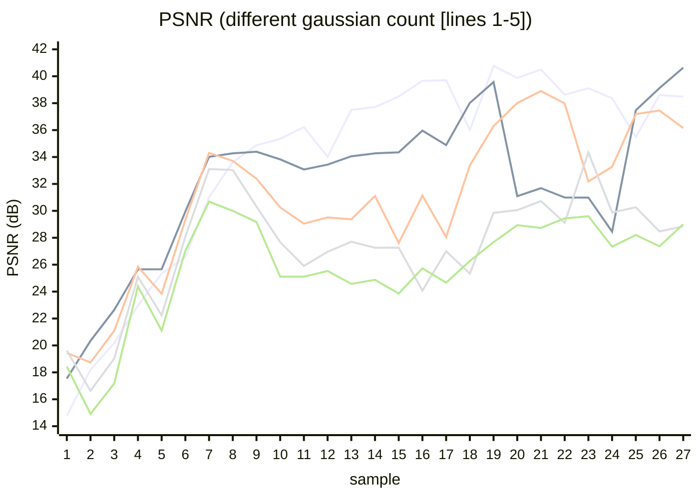

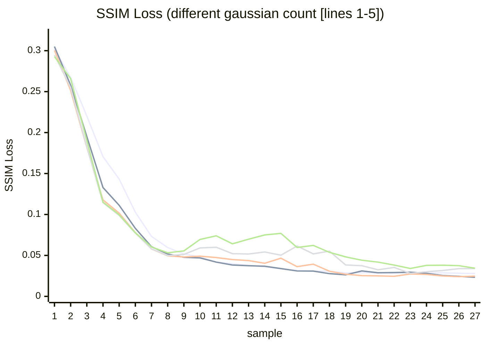

```shell title="shell" tab="高斯数量消融渲染"
for gauss_count in 12288 18432 24576 30720 36864; do
  .venv/bin/python -m gfields.render \
    "results/checkpoints/ablation_gauss_count/${gauss_count}gauss/optimized_asset_pyr0" \
    --kernel gaussian \
    --multiple_scattering \
    --max_depth 10 \
    --use_perspective_cam \
    --cam_fov 65 \
    --cam_distance 3 \
    --cam_count 8 \
    --cam_elevation 75 \
    --cam_azimuth_span 360 \
    --cam_index 2 \
    --cam_res_x 640 \
    --cam_res_y 360 \
    --spp 32 \
    --rr_depth 2 \
    --rr_nee_depth 64 \
    --max_depth_primitive 256 \
    --rr_depth_primitive 256 \
    --max_overlaps 256 \
    --solver_type bisection \
    --solver_max_iterations 4 \
    --stochastic_selection_criteria deterministic \
    --stochastic_selection_criteria_nee deterministic \
    --opacity_scaler 4.0 \
    --albedo 1.0 \
    --envmap data/envmaps/qwantani_dusk_2_1k.exr \
    --envmap_scale 1.0 \
    --max_level 0 \
    --output "results/renders/ablation_gauss_count_spp32/${gauss_count}gauss"
done
```


| gauss_count | SPP | GPU 时间 (ms) | 帧率 (FPS) |
| :---: | :---: | :---: | :---: |
| 12,288 | 32 | 7,052.00 | 0.14 |
| 18,432 | 32 | 15,467.91 | 0.06 |
| 24,576 | 32 | 32,212.00 | 0.03 |
| 30,720 | 32 | 59,287.60 | 0.02 |
| 36,864 | 32 | 74,874.39 | 0.01 |

```mermaid
xychart-beta
    title "GPU Time (gaussian count [bar 1] vs baseline [bar 2] vs voxel grid data [bar 3])"
    x-axis "gaussian count" [12288, 18432, 24576, 30720, 36864]
    y-axis "GPU Time (ms)" 0 --> 80000
    bar [7052.00, 15467.91, 32212.00, 59287.60, 74874.39]
    bar [13852.54, 13852.54, 13852.54, 13852.54, 13852.54]
    bar [2240.92, 2240.92, 2240.92, 2240.92, 2240.92]
```

{[
  { gaussCount: 12288, primitiveCount: 12288, time: "7,052.00" },
  { gaussCount: 18432, primitiveCount: 18432, time: "15,467.91" },
  { gaussCount: 24576, primitiveCount: 24576, time: "32,212.00" },
  { gaussCount: 30720, primitiveCount: 30719, time: "59,287.60" },
  { gaussCount: 36864, primitiveCount: 36862, time: "74,874.39" },
].map(({ gaussCount, primitiveCount, time }) => (
  <ImageComparison
    key={`baseline-vs-gaussian-${gaussCount}-spp-32`}
    before="experiments/20261102-baseline-640x360-32spp-4opacity-10maxdepth/render_cam02.png"
    after={`experiments/20261103-ablation-max_depth_10-pyr0-640x360-32spp-4opacity-different-gauss/20261103-ablation-max_depth_10-pyr0-640x360-32spp-4opacity-${gaussCount}gauss.png`}
    beforeAlt="baseline gaussian 1024 + gabor 24,576"
    afterAlt={`gaussian ${primitiveCount.toLocaleString("en-US")}`}
    beforeLabel={`(baseline) gaussian 1,024 + gabor 24,576\n640×360\n13,852.54 ms`}
    afterLabel={`gaussian ${primitiveCount.toLocaleString("en-US")}\n640×360\n${time} ms`}
  />
))}


```shell title="shell" tab="1920×1080 高斯数量消融渲染"
for gauss_count in 12288 18432 24576 30720 36864; do
  .venv/bin/python -m gfields.render \
    "results/checkpoints/ablation_gauss_count/${gauss_count}gauss/optimized_asset_pyr0" \
    --kernel gaussian \
    --multiple_scattering \
    --max_depth 10 \
    --use_perspective_cam \
    --cam_fov 65 \
    --cam_distance 3 \
    --cam_count 8 \
    --cam_elevation 75 \
    --cam_azimuth_span 360 \
    --cam_index 2 \
    --cam_res_x 1920 \
    --cam_res_y 1080 \
    --spp 32 \
    --rr_depth 2 \
    --rr_nee_depth 64 \
    --max_depth_primitive 256 \
    --rr_depth_primitive 256 \
    --max_overlaps 256 \
    --solver_type bisection \
    --solver_max_iterations 4 \
    --stochastic_selection_criteria deterministic \
    --stochastic_selection_criteria_nee deterministic \
    --opacity_scaler 4.0 \
    --albedo 1.0 \
    --envmap data/envmaps/qwantani_dusk_2_1k.exr \
    --envmap_scale 1.0 \
    --max_level 0 \
    --output "results/renders/ablation_gauss_count_1920x1080_spp32/${gauss_count}gauss"
done
```

| gauss_count | SPP | GPU 时间 (ms) | 帧率 (FPS) |
| :---: | :---: | :---: | :---: |
| 12,288 | 32 | 62,716.06 | 0.01594 |
| 18,432 | 32 | 137,586.14 | 0.00727 |
| 24,576 | 32 | 286,251.31 | 0.00349 |
| 30,720 | 32 | 527,829.25 | 0.00189 |
| 36,864 | 32 | 664,146.25 | 0.00151 |

```mermaid
xychart-beta
    title "GPU Time (gaussian count [bar 1] vs voxel grid data [bar 2])"
    x-axis "gaussian count" [12288, 18432, 24576, 30720, 36864]
    y-axis "GPU Time (ms)" 0 --> 700000
    bar [62716.06, 137586.14, 286251.31, 527829.25, 664146.25]
    bar [20463.09, 20463.09, 20463.09, 20463.09, 20463.09]
```

{[
  { gaussCount: 12288, primitiveCount: 12288, time: "62,716.06" },
  { gaussCount: 18432, primitiveCount: 18432, time: "137,586.14" },
  { gaussCount: 24576, primitiveCount: 24576, time: "286,251.31" },
  { gaussCount: 30720, primitiveCount: 30719, time: "527,829.25" },
  { gaussCount: 36864, primitiveCount: 36862, time: "664,146.25" },
].map(({ gaussCount, primitiveCount, time }) => (
  <ImageComparison
    key={`gaussian-${gaussCount}-vs-voxel-grid-1920x1080`}
    before={`experiments/20261103-ablation-max_depth_10-pyr0-1920x1080-32spp-4opacity-different-gauss/20261103-ablation-max_depth_64-pyr0-1920x1080-32spp-4opacity-${gaussCount}gauss.png`}
    after="experiments/20261022-ground_truth-1920x1080-32spp-1opacity-10maxdepth/LS-20261008_groundtruth_0_cam02.png"
    beforeAlt={`gaussian ${primitiveCount.toLocaleString("en-US")}`}
    afterAlt="voxel grid data"
    beforeLabel={`gaussian ${primitiveCount.toLocaleString("en-US")}\n1920×1080\n${time} ms`}
    afterLabel={`voxel grid data\n1920×1080\n20,463.09 ms`}
  />
))}


### Gabor 基元数量消融


```shell title="shell" tab="gabor 数量消融训练命令"
gabor_counts=(12288 18432 24576 30720 36864)
for gabor_count in "${gabor_counts[@]}"; do
  WANDB_MODE=disabled bash examples/train.sh \
    data/laoshan/LS-20261008_density_y100_cube.npy \
    --output "results/checkpoints/ablation_gabor_count/1024gauss_${gabor_count}gabor" \
    --opacity_scale 10.0 \
    --gauss_count 1024 \
    --gabor_count "${gabor_count}" \
    --ref_spp_chunk 64 \
    --opt_cam_batch 1 \
    --iterations_gabor 200 \
    --skip_gaussian_optim \
    --from_gaussian_checkpoint \
      results/checkpoints/1024gauss_1024gabor/optimized_asset_pyr0/npy_data
done
```

| configuration | test 1 | test 2 | baseline | test 3 | test 4 |
|:---:|:---:|:---:|:---:|:---:|:---:|
| number of gabor kernels | 12,288 | 18,432 | 24,576 | 30,720 | 36,864 |

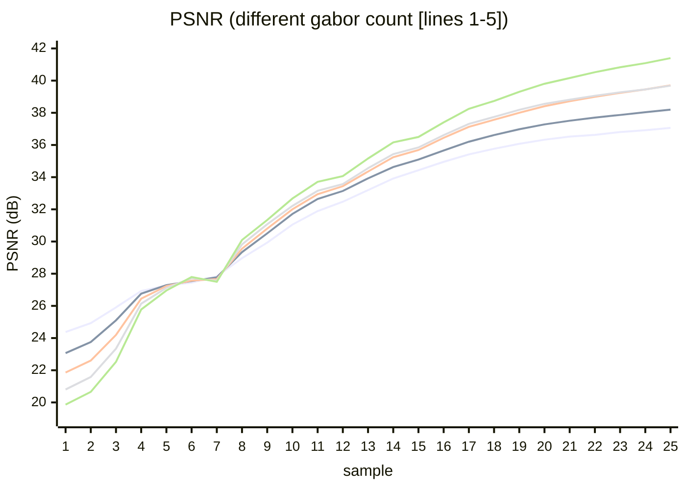

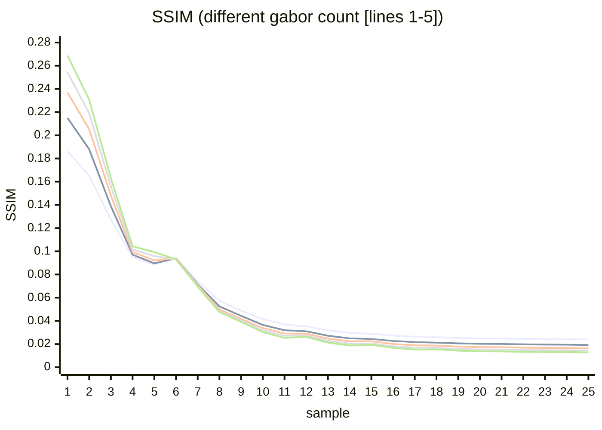


```shell title="shell" tab="gabor 数量消融渲染"
for gabor_count in 12288 18432 24576 30720 36864; do
  .venv/bin/python -m gfields.render \
    "results/checkpoints/ablation_gabor_count/1024gauss_${gabor_count}gabor/optimized_asset_pyr1" \
    --multiple_scattering \
    --max_depth 10 \
    --use_perspective_cam \
    --cam_fov 65 \
    --cam_distance 3 \
    --cam_count 8 \
    --cam_elevation 75 \
    --cam_azimuth_span 360 \
    --cam_index 2 \
    --cam_res_x 640 \
    --cam_res_y 360 \
    --spp 32 \
    --rr_depth 2 \
    --rr_nee_depth 64 \
    --max_depth_primitive 256 \
    --rr_depth_primitive 256 \
    --max_overlaps 256 \
    --solver_type bisection \
    --solver_max_iterations 4 \
    --stochastic_selection_criteria deterministic \
    --stochastic_selection_criteria_nee deterministic \
    --opacity_scaler 4.0 \
    --albedo 1.0 \
    --envmap data/envmaps/qwantani_dusk_2_1k.exr \
    --envmap_scale 1.0 \
    --max_level 1 \
    --output "results/renders/ablation_gabor_count_spp32/1024gauss_${gabor_count}gabor"
done
```

| gabor_count | SPP | Total time (sync) (ms) | GPU 时间 (ms) | 帧率 (FPS) |
| :---: | :---: | :---: | :---: | :---: |
| 12,288 | 32 | 8,349.30 | 8,001.03 | 0.12 |
| 18,432 | 32 | 10,458.28 | 10,122.26 | 0.10 |
| 24,576 | 32 | 12,116.27 | 11,782.22 | 0.08 |
| 30,720 | 32 | 13,649.36 | 13,315.18 | 0.08 |
| 36,864 | 32 | 16,481.29 | 16,145.03 | 0.06 |

```mermaid
xychart-beta
    title "GPU Time (different gabor count [bar 1] vs baseline [bar 2] vs voxel grid data [bar 3])"
    x-axis "gabor count" [12288, 18432, 24576, 30720, 36864]
    y-axis "GPU Time (ms)" 0 --> 17000
    bar [8001.03, 10122.26, 11782.22, 13315.18, 16145.03]
    bar [11782.22, 11782.22, 11782.22, 11782.22, 11782.22]
    bar [2240.92, 2240.92, 2240.92, 2240.92, 2240.92]
```

<ImageComparison
  key="baseline-24576-vs-gabor-12288-spp-32"
  before="experiments/20261102-ablation-max_depth_64-pyr1-640x360-32spp-4opacity-1024gauss-different-gabor/20261102-ablation-max_depth_64-pyr1-640x360-32spp-4opacity-1024gauss-24576gabor.png"
  after="experiments/20261102-ablation-max_depth_64-pyr1-640x360-32spp-4opacity-1024gauss-different-gabor/20261102-ablation-max_depth_64-pyr1-640x360-32spp-4opacity-1024gauss-12288gabor.png"
  beforeAlt="baseline gaussian 1024 + gabor 24,576"
  afterAlt="gaussian 1024 + gabor 12,288"
  beforeLabel={`(baseline) gaussian 1,024 + gabor 24,576\n640×360\n11,782.22 ms`}
  afterLabel={`gaussian 1,024 + gabor 12,288\n640×360\n8,001.03 ms`}
  caption="32 spp"
/>

<ImageComparison
  key="baseline-24576-vs-gabor-18432-spp-32"
  before="experiments/20261102-ablation-max_depth_64-pyr1-640x360-32spp-4opacity-1024gauss-different-gabor/20261102-ablation-max_depth_64-pyr1-640x360-32spp-4opacity-1024gauss-24576gabor.png"
  after="experiments/20261102-ablation-max_depth_64-pyr1-640x360-32spp-4opacity-1024gauss-different-gabor/20261102-ablation-max_depth_64-pyr1-640x360-32spp-4opacity-1024gauss-18432gabor.png"
  beforeAlt="baseline gaussian 1024 + gabor 24,576"
  afterAlt="gaussian 1024 + gabor 18,432"
  beforeLabel={`(baseline) gaussian 1,024 + gabor 24,576\n640×360\n11,782.22 ms`}
  afterLabel={`gaussian 1,024 + gabor 18,432\n640×360\n10,122.26 ms`}
  caption="32 spp"
/>

<ImageComparison
  key="baseline-24576-vs-gabor-30720-spp-32"
  before="experiments/20261102-ablation-max_depth_64-pyr1-640x360-32spp-4opacity-1024gauss-different-gabor/20261102-ablation-max_depth_64-pyr1-640x360-32spp-4opacity-1024gauss-24576gabor.png"
  after="experiments/20261102-ablation-max_depth_64-pyr1-640x360-32spp-4opacity-1024gauss-different-gabor/20261102-ablation-max_depth_64-pyr1-640x360-32spp-4opacity-1024gauss-30720gabor.png"
  beforeAlt="baseline gaussian 1024 + gabor 24,576"
  afterAlt="gaussian 1024 + gabor 30,720"
  beforeLabel={`(baseline) gaussian 1,024 + gabor 24,576\n640×360\n11,782.22 ms`}
  afterLabel={`gaussian 1,024 + gabor 30,720\n640×360\n13,315.18 ms`}
  caption="32 spp"
/>

<ImageComparison
  key="baseline-24576-vs-gabor-36864-spp-32"
  before="experiments/20261102-ablation-max_depth_64-pyr1-640x360-32spp-4opacity-1024gauss-different-gabor/20261102-ablation-max_depth_64-pyr1-640x360-32spp-4opacity-1024gauss-24576gabor.png"
  after="experiments/20261102-ablation-max_depth_64-pyr1-640x360-32spp-4opacity-1024gauss-different-gabor/20261102-ablation-max_depth_64-pyr1-640x360-32spp-4opacity-1024gauss-36864gabor.png"
  beforeAlt="baseline gaussian 1024 + gabor 24,576"
  afterAlt="gaussian 1024 + gabor 36,864"
  beforeLabel={`(baseline) gaussian 1,024 + gabor 24,576\n640×360\n11,782.22 ms`}
  afterLabel={`gaussian 1,024 + gabor 36,864\n640×360\n16,145.03 ms`}
  caption="32 spp"
/>

```shell title="shell" tab="1920×1080 gabor 数量消融渲染"
for gabor_count in 12288 18432 24576 30720 36864; do
  .venv/bin/python -m gfields.render \
    "results/checkpoints/ablation_gabor_count/1024gauss_${gabor_count}gabor/optimized_asset_pyr1" \
    --multiple_scattering \
    --max_depth 10 \
    --use_perspective_cam \
    --cam_fov 65 \
    --cam_distance 3 \
    --cam_count 8 \
    --cam_elevation 75 \
    --cam_azimuth_span 360 \
    --cam_index 2 \
    --cam_res_x 1920 \
    --cam_res_y 1080 \
    --spp 32 \
    --rr_depth 2 \
    --rr_nee_depth 64 \
    --max_depth_primitive 256 \
    --rr_depth_primitive 256 \
    --max_overlaps 256 \
    --solver_type bisection \
    --solver_max_iterations 4 \
    --stochastic_selection_criteria deterministic \
    --stochastic_selection_criteria_nee deterministic \
    --opacity_scaler 4.0 \
    --albedo 1.0 \
    --envmap data/envmaps/qwantani_dusk_2_1k.exr \
    --envmap_scale 1.0 \
    --max_level 1 \
    --output "results/renders/ablation_gabor_count_spp32/1024gauss_${gabor_count}gabor"
done
```

| gabor count | SPP | Total time (sync) (ms) | GPU 时间 (ms) | 帧率 (FPS) |
|:---:|:---:|:---:|:---:|:---:|
| 12,288 | 32 | 71,840.53 | 71,507.20 | 0.01 |
| 18,432 | 32 | 90,874.44 | 90,538.91 | 0.01 |
| 24,576 | 32 | 105,417.58 | 105,080.21 | 0.01 |
| 30,720 | 32 | 118,977.26 | 118,642.82 | 0.01 |
| 36,864 | 32 | 143,894.20 | 143,563.30 | 0.01 |

```mermaid
xychart-beta
    title "GPU Time (different gabor count [bar 1] vs voxel grid data [bar 2])"
    x-axis "gabor count" [12288, 18432, 24576, 30720, 36864]
    y-axis "GPU Time (ms)" 0 --> 150000
    bar [71507.20, 90538.91, 105080.21, 118642.82, 143563.30]
    bar [20463.09, 20463.09, 20463.09, 20463.09, 20463.09]
```


<ImageSequenceSlider
  images={[
    { src: "experiments/20261102-ablation-max_depth_64-pyr1-1920x1080-32spp-4opacity-1024gauss-different-gabor/20261102-ablation-max_depth_64-pyr1-1920x1080-32spp-4opacity-1024gauss-12288gabor.png", label: "gaussian 1,024 + gabor 12,288\n1920×1080\n71,507.20 ms" },
    { src: "experiments/20261102-ablation-max_depth_64-pyr1-1920x1080-32spp-4opacity-1024gauss-different-gabor/20261102-ablation-max_depth_64-pyr1-1920x1080-32spp-4opacity-1024gauss-18432gabor.png", label: "gaussian 1,024 + gabor 18,432\n1920×1080\n90,538.91 ms" },
    { src: "experiments/20261102-ablation-max_depth_64-pyr1-1920x1080-32spp-4opacity-1024gauss-different-gabor/20261102-ablation-max_depth_64-pyr1-1920x1080-32spp-4opacity-1024gauss-24576gabor.png", label: "gaussian 1,024 + gabor 24,576\n1920×1080\n105,080.21 ms" },
    { src: "experiments/20261102-ablation-max_depth_64-pyr1-1920x1080-32spp-4opacity-1024gauss-different-gabor/20261102-ablation-max_depth_64-pyr1-1920x1080-32spp-4opacity-1024gauss-30720gabor.png", label: "gaussian 1,024 + gabor 30,720\n1920×1080\n118,642.82 ms" },
    { src: "experiments/20261102-ablation-max_depth_64-pyr1-1920x1080-32spp-4opacity-1024gauss-different-gabor/20261102-ablation-max_depth_64-pyr1-1920x1080-32spp-4opacity-1024gauss-36864gabor.png", label: "gaussian 1,024 + gabor 36,864\n1920×1080\n143,563.30 ms" }
  ]}
  width={1920}
  height={1080}
/>

<ImageComparison
  key="gabor-12288-1920x1080-gt"
  before="experiments/20261102-ablation-max_depth_64-pyr1-1920x1080-32spp-4opacity-1024gauss-different-gabor/20261102-ablation-max_depth_64-pyr1-1920x1080-32spp-4opacity-1024gauss-12288gabor.png"
  after="experiments/20261022-ground_truth-1920x1080-32spp-1opacity-10maxdepth/LS-20261008_groundtruth_0_cam02.png"
  beforeAlt="gaussian 1024 + gabor 12,288"
  afterAlt="voxel grid data"
  beforeLabel={`gaussian 1,024 + gabor 12,288\n1920×1080\n71,507.20 ms`}
  afterLabel={`voxel grid data\n1920×1080\n20,463.09 ms`}
  caption="gabor / voxel grid data: 1920×1080"
/>

<ImageComparison
  key="gabor-18432-1920x1080-gt"
  before="experiments/20261102-ablation-max_depth_64-pyr1-1920x1080-32spp-4opacity-1024gauss-different-gabor/20261102-ablation-max_depth_64-pyr1-1920x1080-32spp-4opacity-1024gauss-18432gabor.png"
  after="experiments/20261022-ground_truth-1920x1080-32spp-1opacity-10maxdepth/LS-20261008_groundtruth_0_cam02.png"
  beforeAlt="gaussian 1024 + gabor 18,432"
  afterAlt="voxel grid data"
  beforeLabel={`gaussian 1,024 + gabor 18,432\n1920×1080\n90,538.91 ms`}
  afterLabel={`voxel grid data\n1920×1080\n20,463.09 ms`}
  caption="gabor / voxel grid data: 1920×1080"
/>

<ImageComparison
  key="gabor-24576-1920x1080-gt"
  before="experiments/20261102-ablation-max_depth_64-pyr1-1920x1080-32spp-4opacity-1024gauss-different-gabor/20261102-ablation-max_depth_64-pyr1-1920x1080-32spp-4opacity-1024gauss-24576gabor.png"
  after="experiments/20261022-ground_truth-1920x1080-32spp-1opacity-10maxdepth/LS-20261008_groundtruth_0_cam02.png"
  beforeAlt="gaussian 1024 + gabor 24,576"
  afterAlt="voxel grid data"
  beforeLabel={`gaussian 1,024 + gabor 24,576\n1920×1080\n105,080.21 ms`}
  afterLabel={`voxel grid data\n1920×1080\n20,463.09 ms`}
  caption="gabor / voxel grid data: 1920×1080"
/>

<ImageComparison
  key="gabor-30720-1920x1080-gt"
  before="experiments/20261102-ablation-max_depth_64-pyr1-1920x1080-32spp-4opacity-1024gauss-different-gabor/20261102-ablation-max_depth_64-pyr1-1920x1080-32spp-4opacity-1024gauss-30720gabor.png"
  after="experiments/20261022-ground_truth-1920x1080-32spp-1opacity-10maxdepth/LS-20261008_groundtruth_0_cam02.png"
  beforeAlt="gaussian 1024 + gabor 30,720"
  afterAlt="voxel grid data"
  beforeLabel={`gaussian 1,024 + gabor 30,720\n1920×1080\n118,642.82 ms`}
  afterLabel={`voxel grid data\n1920×1080\n20,463.09 ms`}
  caption="gabor / voxel grid data: 1920×1080"
/>

<ImageComparison
  key="gabor-36864-1920x1080-gt"
  before="experiments/20261102-ablation-max_depth_64-pyr1-1920x1080-32spp-4opacity-1024gauss-different-gabor/20261102-ablation-max_depth_64-pyr1-1920x1080-32spp-4opacity-1024gauss-36864gabor.png"
  after="experiments/20261022-ground_truth-1920x1080-32spp-1opacity-10maxdepth/LS-20261008_groundtruth_0_cam02.png"
  beforeAlt="gaussian 1024 + gabor 36,864"
  afterAlt="voxel grid data"
  beforeLabel={`gaussian 1,024 + gabor 36,864\n1920×1080\n143,563.30 ms`}
  afterLabel={`voxel grid data\n1920×1080\n20,463.09 ms`}
  caption="gabor / voxel grid data: 1920×1080"
/>

### Gaussian 和 Gabor 效果对比

```mermaid
xychart-beta
    title "GPU Time (gaussian+gabor [bar 1] vs gaussian-only [bar 2] vs voxel grid data [bar 3])"
    x-axis "gabor count / gaussian-only count" [12288, 18432, 24576, 30720, 36864]
    y-axis "GPU Time (ms)" 0 --> 700000
    bar [71507.20, 90538.91, 105080.21, 118642.82, 143563.30]
    bar [62716.06, 137586.14, 286251.31, 527829.25, 664146.25]
    bar [20463.09, 20463.09, 20463.09, 20463.09, 20463.09]
```

{[
  { count: 12288, gaborTime: "71,507.20", gaussianTime: "62,716.06" },
  { count: 18432, gaborTime: "90,538.91", gaussianTime: "137,586.14" },
  { count: 24576, gaborTime: "105,080.21", gaussianTime: "286,251.31" },
  { count: 30720, gaborTime: "118,642.82", gaussianTime: "527,829.25" },
  { count: 36864, gaborTime: "143,563.30", gaussianTime: "664,146.25" },
].map(({ count, gaborTime, gaussianTime }) => (
  <ImageComparison
    key={`gabor-vs-gaussian-${count}-1920x1080`}
    before={`experiments/20261102-ablation-max_depth_64-pyr1-1920x1080-32spp-4opacity-1024gauss-different-gabor/20261102-ablation-max_depth_64-pyr1-1920x1080-32spp-4opacity-1024gauss-${count}gabor.png`}
    after={`experiments/20261103-ablation-max_depth_10-pyr0-1920x1080-32spp-4opacity-different-gauss/20261103-ablation-max_depth_64-pyr0-1920x1080-32spp-4opacity-${count}gauss.png`}
    beforeAlt={`gaussian 1,024 + gabor ${count.toLocaleString("en-US")}`}
    afterAlt={`gaussian ${count.toLocaleString("en-US")}`}
    beforeLabel={`gaussian 1,024 + gabor ${count.toLocaleString("en-US")}\n1920×1080\n${gaborTime} ms`}
    afterLabel={`gaussian ${count.toLocaleString("en-US")}\n1920×1080\n${gaussianTime} ms`}
  />
))}

## 消融实验结果汇总

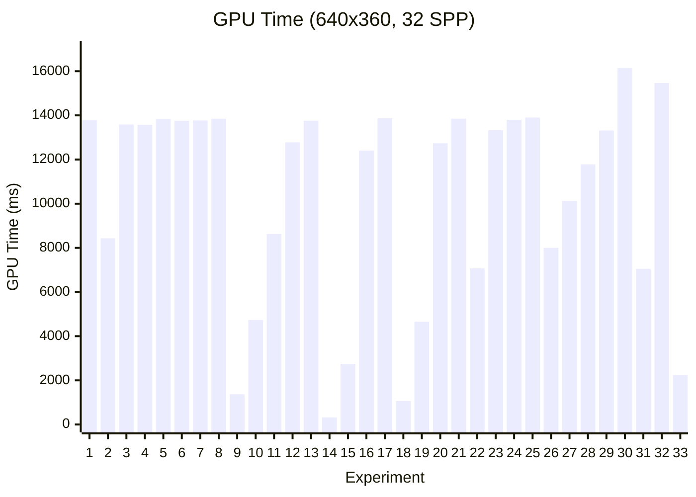

| Experiment | Content | GPU 时间 (ms) |
| :---: | :--- | ---: |
| 1 | NEE on (baseline) | 13,786.08 |
| 2 | NEE off | 8,434.24 |
| 3 | baseline, average across 8 cameras | 13,588.84 |
| 4 | solver_type disabled | 13,571.05 |
| 5 | solver_type bisection, 1 iteration | 13,825.45 |
| 6 | solver_type bisection, 2 iterations | 13,756.72 |
| 7 | solver_type bisection, 4 iterations | 13,769.01 |
| 8 | solver_type newton, 4 iterations | 13,849.29 |
| 9 | max_depth 1 | 1,370.48 |
| 10 | max_depth 2 | 4,734.41 |
| 11 | max_depth 4 | 8,627.91 |
| 12 | max_depth 8 | 12,781.81 |
| 13 | max_depth 10 | 13,758.01 |
| 14 | max_depth_primitive 32 | 320.39 |
| 15 | max_depth_primitive 64 | 2,748.79 |
| 16 | max_depth_primitive 128 | 12,406.18 |
| 17 | max_depth_primitive 256 | 13,868.53 |
| 18 | rr_depth_primitive 32 | 1,064.88 |
| 19 | rr_depth_primitive 64 | 4,652.54 |
| 20 | rr_depth_primitive 128 | 12,732.98 |
| 21 | rr_depth_primitive 256 | 13,853.25 |
| 22 | max_overlaps 32 | 7,069.65 |
| 23 | max_overlaps 64 | 13,330.24 |
| 24 | max_overlaps 128 | 13,800.06 |
| 25 | max_overlaps 256 | 13,902.29 |
| 26 | gauss_count 1,024 + gabor_count 12,288 | 8,001.03 |
| 27 | gauss_count 1,024 + gabor_count 18,432 | 10,122.26 |
| 28 | gauss_count 1,024 + gabor_count 24,576 | 11,782.22 |
| 29 | gauss_count 1,024 + gabor_count 30,720 | 13,315.18 |
| 30 | gauss_count 1,024 + gabor_count 36,864 | 16,145.03 |
| 31 | gauss_count 12,288 | 7,052.00 |
| 32 | gauss_count 18,432 | 15,467.91 |
| 33 | voxel_grid | 2,240.92 |
